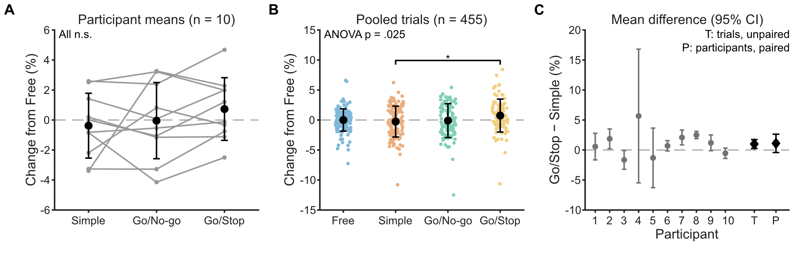

<!--
先方に渡す「指標の計算の説明」の原稿（md を正とし、docx・PDF は生成物）。
元は ../技術説明.md の 4 節「指標の計算の説明（先方に渡す用、案）」。値は 3 節と同じ。
変換：./convert.sh → docx を Word で開いて PDF に保存（sandbox/6.1_Pandoc/技術説明.md の方式）
2026-11-16 加藤 和太郎（AI 補助で作成）
-->

# フリー条件に対するヘッドスピードの変化率：指標の計算

2026 年 11 月 16 日　加藤 和太郎

{width=16cm}

## 共通

- **ヘッドスピード**：バット先端のマーカーの合成速度の、1 試行の中での最大値（m/s）。
- **対象**：除外の後の、スイングを最後まで行う試行（各条件の Go 試行）455 試行。参加者 10 名、Free 140、Simple 128、Go/No-go 98、Go/Stop 89 試行。参加者あたり 41〜50 試行（1 名だけ 25 試行）。
- **基準**：参加者 $s$ ごとの、フリー条件の全試行の平均 $F_s$。どの変化率も、その参加者自身の $F_s$ で割って求めた。
- **記号**：$v_{s,c,i}$ は参加者 $s$・条件 $c$・試行 $i$ のヘッドスピード、$V_{s,c}$ は参加者 $s$・条件 $c$ の試行の平均。

## A　参加者単位の変化率（n = 10）

$$R_{s,c} = \left( \frac{V_{s,c}}{F_s} - 1 \right) \times 100 \;[\%]$$

- 1 名・1 条件につき 1 値。フリー条件は定義から全員 0%（分散 0）になるので比較に含めず、各条件の $R$ が 0 と異なるかを 1 標本 t 検定で調べた（Holm 補正、3 条件）。
- 3 条件の比較は、各条件の 10 値を独立な群とみなす一元配置分散分析（F(2, 27)）で行った（ご依頼の「対応なし」）。参考に、同じ参加者の対応を考える対応のある t 検定（Holm 補正、3 組）も行った。
- 図：灰色の線が各参加者の $R$、黒丸と誤差棒が 10 名の平均 ± SD。

## B　試行単位の変化率（n = 455）

$$r_{s,c,i} = \left( \frac{v_{s,c,i}}{F_s} - 1 \right) \times 100 \;[\%]$$

- 分母は A と同じ $F_s$ で、試行ごとに割った。フリー条件の試行も含めた（平均は定義から 0% だが、試行の間のばらつきは残る。SD 1.85%）。
- 全参加者の試行をまとめ、試行を独立な観測とみなして、4 条件を一元配置分散分析（F(3, 451)）で比べた。Levene 検定で等分散が棄却された（p < .001）ので、対ごとの比較は Welch の t 検定（Holm 補正、6 組）で行った。
- 図：点が各試行、黒丸と誤差棒が試行全体の平均 ± SD。
- 注：分母は参加者の中で一定なので、参加者 $s$・条件 $c$ の $r$ の平均は、A の $R_{s,c}$ と一致する。B の条件の平均は、A の値を試行数で重みづけした平均にあたる。一方、同じ参加者の試行は独立ではない（擬似反復）。自由度が参加者の数ではなく試行の数で決まるので、p 値は小さく出やすい。

## C　Go/Stop − Simple の差

$$d_s = \bar{r}_{s,\mathrm{Go/Stop}} - \bar{r}_{s,\mathrm{Simple}} = R_{s,\mathrm{Go/Stop}} - R_{s,\mathrm{Simple}}$$

- **参加者ごとの差**（1〜10）：誤差棒は、その参加者の Go/Stop と Simple の試行から求めた Welch の t の 95% 信頼区間。試行数は参加者・条件で異なり、試行が少ないほど区間は広い（例：参加者 4 は Simple が 4 試行）。
- **T（試行単位・対応なし）**：全参加者の Go/Stop の試行の平均 − Simple の試行の平均と、その Welch の 95% 信頼区間。1.00%（0.27〜1.73）。B の対ごとの比較と同じ計算で、区間には多重比較の補正をしていない。
- **P（参加者単位・対応あり）**：10 名の $d_s$ の平均と、t 分布（自由度 9）による 95% 信頼区間。1.11%（−0.42〜2.63）。A の参考の対応のある t 検定と同じ計算。
- T と P で、差の大きさはほぼ同じだった。T の区間は試行の間のばらつきだけから求めるため、参加者によって差の向きが違うこと（$d_s$ は −1.65〜5.67%）が区間に入らない。P の区間はこのばらつきを含むので、0 をまたいだ。

計算には MATLAB R2026a（Statistics and Machine Learning Toolbox）を用いた。
