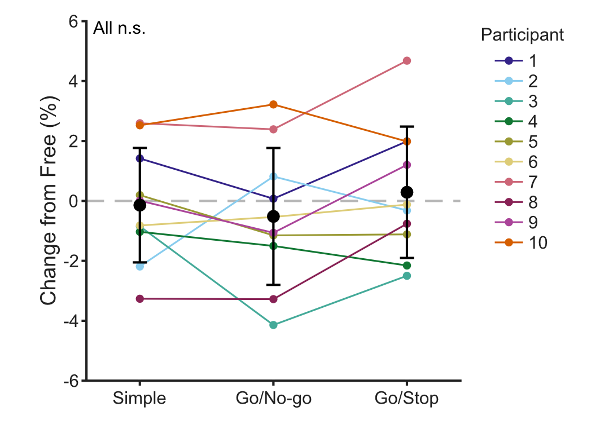
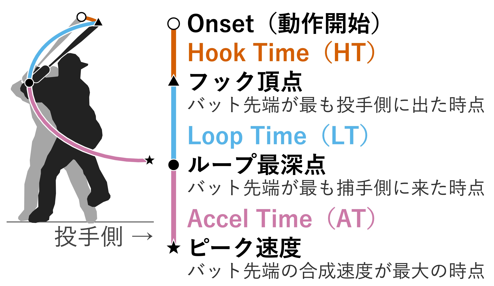
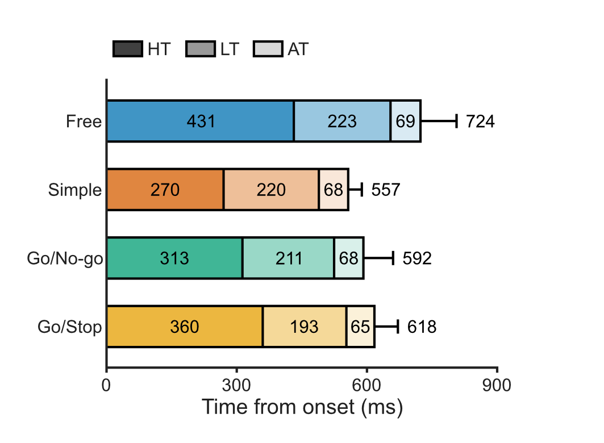

<!--
ポスター発表の後の依頼（フリー条件で正規化したヘッドスピードを対応なしで検定）への返信の原稿。md を正とし、docx は生成物。
値は S04 の再測定（2026-11-16）の後のデータ（../技術説明.md の 8〜10 節、log/2026-11-17_01.md）。
図 1：../headspeed_rate/output/headspeed_rate_A.png
図 2：Manuscript/2026箱根合宿/02_ポスター/figure/HookTime説明図/hooktime_schematic_all_phases.svg（ポスターの Fig.5）を Chrome（headless、3.5 倍）で PNG にしたもの
図 3：../../03_top軌道_MT局面/phase_time_stack/output/phase_time_stack.png（2026-11-17 に新しいデータで作り直した）
変換：./convert.sh（sandbox/6.1_Pandoc/技術説明.md の方式）
2026-11-17 加藤 和太郎（AI 補助で作成）
-->

---
title: Free 条件に対するヘッドスピードの変化率の検定結果
author: 広島大学人間社会科学研究科　加藤 和太郎
---

## ご依頼の内容

先日のポスター発表の際に、自由スイング条件（以下、Free 条件）のヘッドスピードを基準に、ほかの条件のヘッドスピードを正規化し、対応のない検定を行った結果をお見せするよう、ご依頼をいただきました。Free 条件に対する変化率をもとに検定を行う方法とのことでしたので、その方法で解析した結果をご報告いたします。

## 方法

ヘッドスピードは、バット先端の合成速度の 1 試行の中での最大値（ポスターの Peak bat-tip speed）としました。

1. 参加者ごとに、Free 条件のヘッドスピードの平均を求めました。
2. 反応課題の 3 条件（Simple、Go/No‑go、Go/Stop）のヘッドスピードの平均を、その参加者の Free 条件の平均で割り、Free 条件からの変化率（%）にしました。参加者の間の速さの水準の違いを除き、対応なしで比べても条件の差が個人差に埋もれにくくするためです。
3. 3 条件の変化率（各 *n*\ =\ 10）を、対応のない t 検定（Holm 補正）で比較しました。
4. あわせて、各条件の変化率が 0%（Free 条件と同じ）と異なるかを、1 標本 t 検定（Holm 補正）で調べました。

## 結果

いずれの比較でも、有意な差はありませんでした（対応のない t 検定、1 標本 t 検定とも、Holm 補正後の *p*\ =\ 1.00）。変化率（平均 ± SD）は、Simple 条件 −0.1 ± 1.9%、Go/No‑go 条件 −0.5 ± 2.3%、Go/Stop 条件 +0.3 ± 2.2% でした（図 1）。Free 条件のヘッドスピードは、平均 31.6 m/s でした。

{width=10.5cm}

## 有意な差が出なかった理由

1. **条件の間の平均の差が、とても小さかった。** 最も大きい Go/No‑go 条件と Go/Stop 条件の差でも、0.8%（約 0.3 m/s）でした。
2. **条件による変化の向きが、参加者によって違った。** たとえば Go/Stop 条件では、Free 条件より速くなる参加者も、遅くなる参加者もいました。そのため、変化率の参加者の間のばらつき（SD 約 2%）が、条件の間の平均の差（最大 0.8%）より大きくなりました。
3. **参加者が 10 名と少なかった。**

## 考察

### 1. 加速局面の時間は、条件の間でほとんど変わらなかった

動作開始からバット先端の速度が最大になるまでを 3 つの局面に分け（図 2）、局面ごとの時間を条件の間で比べました（図 3。反復測定分散分析〈Greenhouse–Geisser 補正〉と、対応のある t 検定〈Holm 補正〉）。

{width=11cm}

反応課題の 3 条件では、判断が必要な条件ほど HT が長くなりました（Simple 270 ms < Go/No‑go 313 ms < Go/Stop 360 ms、いずれも Holm 補正後の *p*\ ≤\ .023）。一方、AT は 65〜69 ms で、条件の間の差は 5 ms 未満でした（主効果は *p*\ =\ .028 でしたが、対比較で有意な組はありませんでした）。判断に必要な時間は加速局面より前で使われ、加速局面の時間はほとんど変わらなかったため、ヘッドスピードにも差が出なかった可能性があります。ただし、AT の時間がヘッドスピードを左右するかどうかは、まだ確かめていません。

なお、Go/Stop 条件で Go 試行と Stop 試行のバット先端の軌道を比べると、LT の始めのあたりで軌道が分かれ始めました。判断の影響は、HT だけでなく LT の途中まで及んでいる可能性があります。また、Go/Stop 条件の LT は、Free 条件より約 30 ms 短くなりました（Holm 補正後の *p*\ =\ .003）。この理由は、今後検討します。

{width=11cm}

### 2. スイングの速さには上限がある

どの条件でも「全力でスイングしてください」と教示しました。参加者はどの条件でも上限に近い速さで振っていたため、条件の間で速さが変わりにくかった（天井効果）可能性があります。
