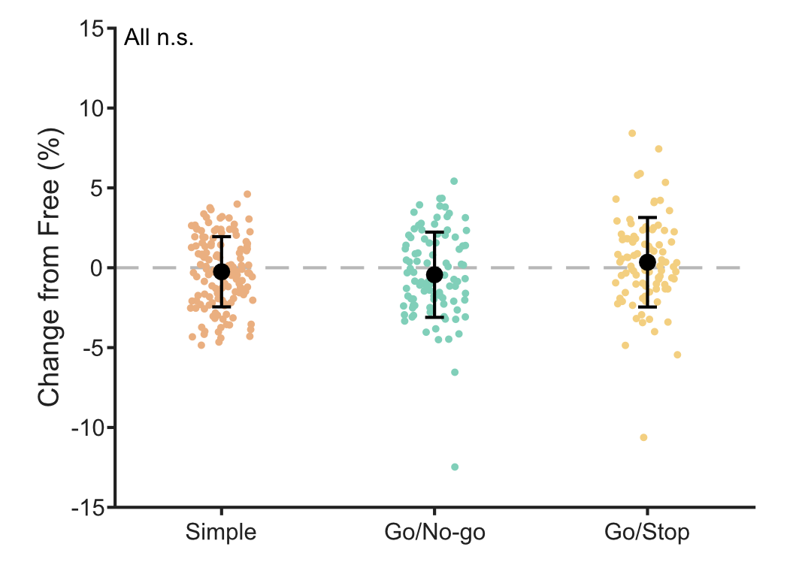
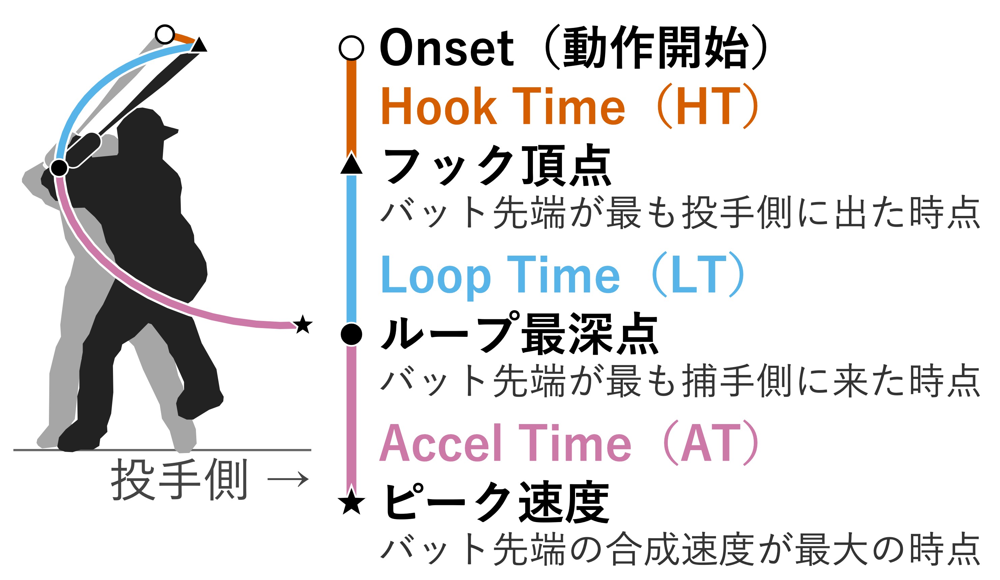
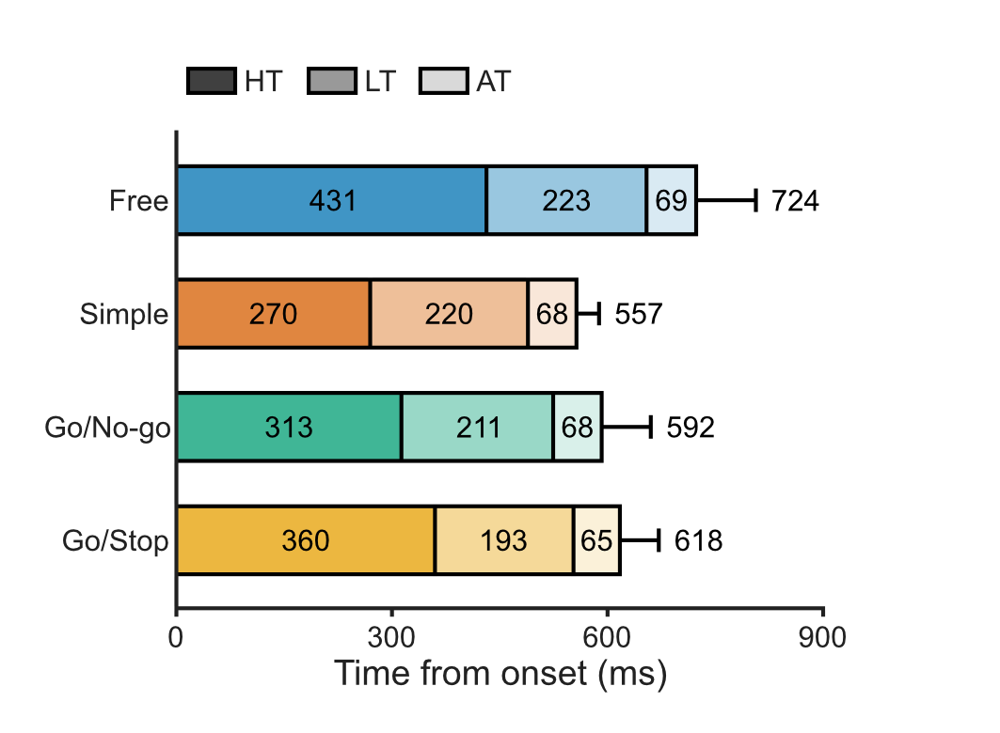

<!--
ポスター発表の後の依頼（フリー条件で正規化したヘッドスピードを対応なしで検定）への返信の原稿のうち、試行単位の版。
被験者単位（図 A）の版は ../返信/。ユーザーの依頼で、B の方だけで作り直したもの（2026-11-17）。md を正とし、docx は生成物。
先方の返事（Free と Go/Stop に統計学的な違いがあるかを知りたい）を受けて、Free と Go/Stop の比較を先頭に置いた。
値は S04 の再測定（2026-11-16）の後のデータ（../技術説明.md の 9.1・10 節）。
図 1：../headspeed_rate/output/headspeed_rate_B3.png
図 2・図 3：../返信/ と同じ（図 2 はポスターの Fig.5、図 3 は phase_time_stack）
変換：./convert.sh（sandbox/6.1_Pandoc/技術説明.md の方式）。reference.docx は ../返信/ の写しの、フォントをすべてメイリオにしたもの（2026-11-17）
2026-11-17 加藤 和太郎（AI 補助で作成）
-->

---
title: Free 条件に対するヘッドスピードの変化率の検定結果
author: 広島大学人間社会科学研究科　加藤 和太郎
---

## ご質問の内容

ポスター発表の際に、自由スイング条件（以下、Free 条件）を基準に正規化したヘッドスピードについて、Free 条件と Go/Stop 条件の間に統計学的な違いが見られるか、ご質問をいただきました。その結果をご報告いたします。

## 方法

- **ヘッドスピード**：1 試行の中での、バット先端の合成速度の最大値
- **変化率（%）**＝（各試行の値\ ÷\ その参加者の\ Free\ 条件の平均\ −\ 1）×\ 100
- **比較**：対応のない検定（各試行を独立な観測とみなす）
    1. Free 条件と Go/Stop 条件：Welch の t 検定
    2. 反応課題の 3 条件（Simple、Go/No‑go、Go/Stop）：一元配置分散分析と、Welch の t 検定（Holm 補正）

## 結果

**Free 条件と Go/Stop 条件の間に、ヘッドスピードの統計学的な違いは見られませんでした。**

- 変化率（平均 ± SD）：Free 条件 0.00\ ±\ 1.43%、Go/Stop 条件 +0.34\ ±\ 2.80%
- 差：0.34%（95% 信頼区間 −0.29〜0.98%、約 0.1\ m/s）
- Welch の t 検定：*t*\ =\ 1.08、*p*\ =\ .283
- 参加者ごとの平均で比べた場合も、差なし：*t*\ =\ 0.42、*p*\ =\ .687（1 標本 t 検定）

反応課題の 3 条件の間にも、差はありませんでした（図\ 1）。

- 変化率：Simple\ −0.25\ ±\ 2.20%、Go/No‑go\ −0.44\ ±\ 2.67%、Go/Stop\ +0.34\ ±\ 2.80%
- 一元配置分散分析：*F*\ =\ 2.49、*p*\ =\ .085（対比較は Holm 補正後 *p*\ ≥\ .15）

{width=8.5cm}

```{=openxml}
<w:p><w:r><w:br w:type="page"/></w:r></w:p>
```

## 考察

### 1. 加速局面の時間は、条件の間でほとんど変わらなかった

動作開始からバット先端の速度が最大になるまでを 3 つの局面に分け、時間を比べました（図\ 2・図\ 3）。

- HT：Simple、Go/No‑go、Go/Stop の順に長かった（Holm 補正後 *p*\ ≤\ .023）\
  Simple\ 270\ ms\ <\ Go/No‑go\ 313\ ms\ <\ Go/Stop\ 360\ ms
- AT：65〜69\ ms で、条件の間の差は 5\ ms 未満（対比較で有意な組なし）

判断に必要な時間が加速局面より前で使われ、加速局面の時間は変わらなかったため、ヘッドスピードにも差が出なかった可能性があります。

{width=7.5cm}

{width=7.5cm}

### 2. スイングの速さには上限がある

どの条件でも、全力でスイングするよう教示しました。参加者は上限に近い速さで振っていたため、条件の間で速さが変わりにくかった可能性があります。
