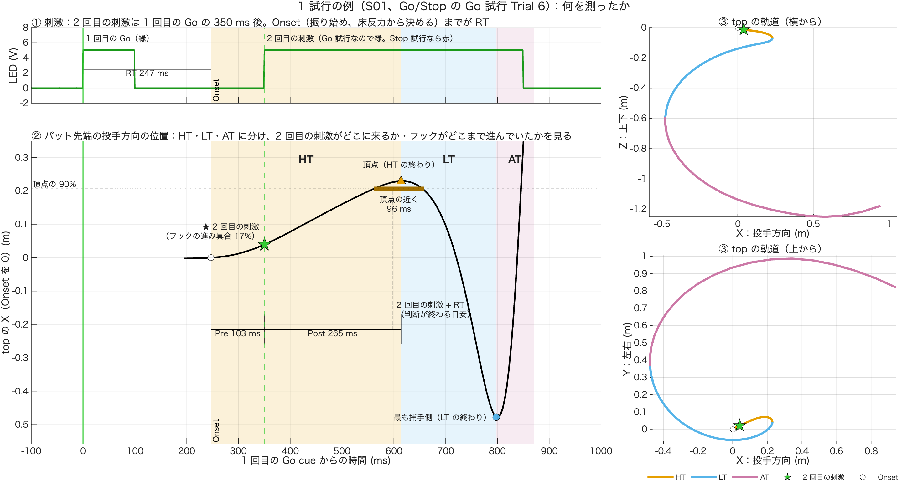
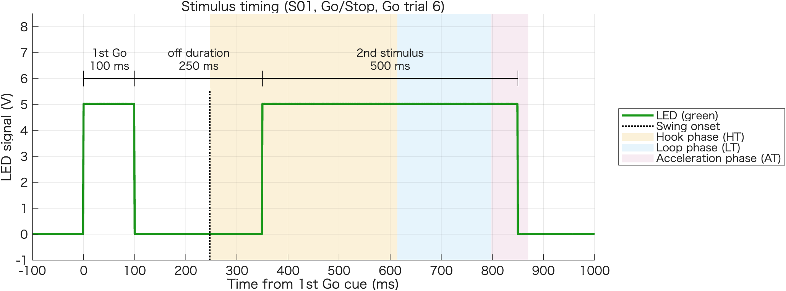

# 1 試行の例で、何を測ったか（技術説明）

作成：2026-11-09　加藤 和太郎（student）、Claude Code

## 1. 目的

`02`〜`05` の分析が、1 試行の中で何を測っているかを 1 枚の図で示す。まとめの結果（README）を読む前に、この図で指標の意味をつかむ。

## 2. 選んだ試行

**S01 の Go/Stop の Go 試行 Trial 6**。Go/Stop の Go 試行の中で、次の 6 つの値が中央値に最も近い試行の 1 つとして選んだ（`05_hook_progress` の CSV から、中央値との差を SD で割った値の 2 乗和が小さい順）。

| 値 | この試行 | Go/Stop の中央値 |
|---|---|---|
| Pre（Onset → 2 回目の刺激） | 103 ms | 111 ms |
| 2 回目の刺激の時点のフックの進み具合 | 17% | 18% |
| 2 回目の刺激 → 頂点の 90% | 212 ms | 191 ms |
| 頂点の近く（90% 以上）にいる時間 | 96 ms | 84 ms |
| 頂点の時刻（HT） | 368 ms | 360 ms |
| フックの頂点の X | 0.229 m | 0.150 m |

この試行の RT は 247 ms、HT 368・LT 184・AT 72 ms、Post（2 回目の刺激 → HT の終わり）は 265 ms。

## 3. 図の見方



| 場所 | 何を描くか | 対応する分析 |
|---|---|---|
| ① 左上 | LED（ch2）。1 回目の Go（緑、100 ms）と、350 ms 後の 2 回目の刺激（Go 試行は緑、Stop 試行は赤）。Go から Onset（振り始め）までが RT | `02` |
| ② 左下 | バット先端（top）の投手方向の位置 X（Onset を 0）。背景の色が HT（橙）・LT（空色）・AT（赤紫） | `02`・`04`・`05` |
| ③ 右 | top の軌道（横から・上から）。線の色が局面、★ が 2 回目の刺激、○ が Onset | `03` |

① だけを独立させた図も作った（`output/single_trial_S01_gostop_T06_stimulus.png`、英語）。LED の点灯・消灯の時間（1st Go 100 ms、off duration 250 ms、2nd stimulus 500 ms）を、この試行の `LEDData` から求めて上に書き、振り始め（点線）と HT・LT・AT（背景の色）を凡例で示す。



② の印：

| 印 | 意味 |
|---|---|
| ○ | Onset（振り始め）。床反力（2 枚の板の前後の力）が動き始めた時点で、m3 が決める |
| ★ | 2 回目の刺激が点いた瞬間。このときフックは頂点の 17% までしか進んでいない |
| ▲ | フックの頂点（X が最も投手側）。HT の終わり |
| ● | X が最も捕手側。LT の終わり |
| 太い横線 | 頂点の近く（頂点の 90% 以上）にいる時間（96 ms） |
| Pre・Post | Onset → 2 回目の刺激（103 ms）、2 回目の刺激 → HT の終わり（265 ms） |
| 破線 | 2 回目の刺激 + RT（判断が終わる目安）。この試行では、頂点（HT の終わり）の少し前 |

この試行で読み取れること：2 回目の刺激は HT の始め（フックがほとんど進んでいないとき）に点き、フックはそこからゆっくり進んで、判断が終わる目安のころに頂点に着き、LT に入る。

## 4. 計算の方法

それぞれのフォルダのコードと同じ。

- 局面の境目：x8 の `HookTime_ms`・`LoopTime_ms`、`TPeakVelTop`（`03` と同じ）
- 2 回目の刺激：`LEDData(:,2)` で 1 回目の Go が点いたサンプル + 350。フレームの端数は軌道を線形補間
- top：NaN の線形補間 → 30 Hz の 2 次 Butterworth で filtfilt → m
- 進み具合・90%・頂点の近く：`05_hook_progress` と同じ
- 上から見た図は、骨盤の向き（ASIS − PSIS の Y）が負の被験者では Y の符号を変える（S01 は正なので変えていない）
- ② の AT の後半（ピーク速度まで）は、フックを見やすくするため上にはみ出している

## 5. 使い方

1. 6 節のコードを、このフォルダに `plot_single_trial_example.m` という名前で保存する
2. MATLAB の現在のフォルダをこのフォルダにして実行する（S01 の x3 を読む）
3. `output/` に 2 枚（全体の図と、① だけの図 `_stimulus`）が保存される
4. 別の試行を描くときは、「設定」の `Subject`・`Trial`・`Cond`・`iCond`（条件の列：free 1、simple 2、gonogo 3、gostop 4）を変える。Go/Stop 以外では「2 回目の刺激」は実際には出ていない

## 6. コード（plot_single_trial_example.m）

```matlab
% plot_single_trial_example.m
%
% 1 試行（S01 の Go/Stop Trial 6）で、05_突っ込みとGoStopの判断 の各分析が何を測っているかを 1 枚の図にする。
% この試行は、Go/Stop の Go 試行の中で、2 回目の刺激の時刻・進み具合・頂点の時刻・頂点の近くにいる時間・
% フックの大きさが中央値に近い試行として選んだ。
%
% 左（時間、1 回目の Go cue を 0）：
%   上段 LED（ch2）：1 回目の Go と 2 回目の刺激（350 ms 後）。Onset までが RT          → 02
%   下段 top の X（Onset を 0）：HT・LT・AT、2 回目の刺激の ★、Pre・Post、90% と頂点の近く → 02・04・05
% 右：top の軌道（横から・上から）。局面の色と ★                                       → 03
% （踏み込み足の Fx2・Fy2（01）は、この図には入れない）
% 背景の色：HT 橙・LT 空色・AT 赤紫（03 の軌道と同じ）
%
% 計算はそれぞれのフォルダのコードと同じ（局面の境目は x8 の値、top は 30 Hz）。
%
% 2026-11-09

%% 設定
Subject = 1 ;  Trial = 6 ;  Cond = 'gostop' ;  iCond = 4 ;
T2ms    = 350 ;
Level   = 0.90 ;
XLim    = [-100 1000] ;
PhaseName  = {'HT', 'LT', 'AT'} ;
PhaseColor = [0.902 0.624 0.000 ; 0.337 0.706 0.914 ; 0.800 0.475 0.655] ;
Green = [0.20 0.80 0.20] ;

scriptFolder   = fileparts(mfilename('fullpath')) ;
projectFolder  = fullfile(scriptFolder, '..', '..', '..', '..') ;   % Project002 のフォルダ
analysisFolder = fullfile(projectFolder, 'Experiments', 'Main experiments', '03_Analysis') ;
outFolder      = fullfile(scriptFolder, 'output') ;
addpath(analysisFolder) ;
Prm = parameters ;

%% データ
load(fullfile(analysisFolder, 'x8_StatTable', 'StatTable.mat'), 'TrialTable') ;
R = TrialTable(TrialTable.Subject == Subject & TrialTable.Condition == Cond & TrialTable.Trial == Trial, :) ;
S = load(fullfile(analysisFolder, 'x3_DataChecked', sprintf('Data%02d.mat', Subject)), 'DataArray') ;
Data = S.DataArray(Trial, iCond) ;
fsA = Data.AnalogFs ;  fsM = Data.FrameRate ;
tCue = find(Data.LEDData(:,2) > Prm.Cue.GoThresholdV, 1, 'first') ;
msA  = @(s) (s - tCue) / fsA * 1000 ;              % アナログのサンプル → Go cue からの ms
msM  = @(f) (f / fsM * fsA - tCue) / fsA * 1000 ;  % マーカーのフレーム → Go cue からの ms

% 局面（x8 の値）
iOn   = max(1, round(R.SwingOnsetForce / fsA * fsM)) ;
iHook = iOn   + round(R.HookTime_ms / 1000 * fsM) ;
iBack = iHook + round(R.LoopTime_ms / 1000 * fsM) ;
iPk   = R.TPeakVelTop ;
tOn = msA(R.SwingOnsetForce) ;  tHook = msM(iHook) ;  tBack = msM(iBack) ;  tPk = msM(iPk) ;
Edges = [tOn, tHook, tBack, tPk] ;                  % 局面の境目（ms）

M = Data.Markers ;                                  % 骨盤の向き（上から見た図の左右をそろえる）
iM = max(1, round((tCue - 0.5*fsA) / fsA * fsM)) : round(tCue / fsA * fsM) ;
facing = mean([M.RASIS(iM,2) ; M.LASIS(iM,2)], 'omitnan') - mean([M.RPSIS(iM,2) ; M.LPSIS(iM,2)], 'omitnan') ;

% top（03・05 と同じ）
top = prepMarker(Data.Markers.top, fsM, Prm.Fc) ;
P   = top - top(iOn, :) ;                           % Onset を原点
tM  = msM((1:size(top,1))') ;
apex = P(iHook, 1) ;
f2   = (tCue + T2ms / 1000 * fsA) / fsA * fsM ;     % 2 回目の刺激（端数のあるフレーム）
p2   = interp1((1:size(top,1))', P, f2) ;
k90  = find(P(iOn:iHook, 1) >= Level * apex, 1, 'first') + iOn - 1 ;
kOut = find(P(iHook:iBack, 1) < Level * apex, 1, 'first') + iHook - 1 ;
t90 = msM(k90) ;  tOut = msM(kOut) ;

fprintf('S%02d %s Trial %d\n', Subject, Cond, Trial) ;
fprintf('  RT %.0f ms | HT %.0f LT %.0f AT %.0f ms | Pre（Onset → 2 回目の刺激）%.0f ms、Post（→ HT の終わり）%.0f ms\n', ...
    R.RTForce_ms, R.HookTime_ms, R.LoopTime_ms, R.AccelTime_ms, T2ms - R.RTForce_ms, R.HookTime_ms - (T2ms - R.RTForce_ms)) ;
fprintf('  フックの頂点の X %.3f m | 2 回目の刺激の時点の進み具合 %.0f%% | 90%% に達した %.0f ms（2 回目の刺激から）| 頂点の近く %.0f ms\n', ...
    apex, 100 * p2(1) / apex, t90 - T2ms, tOut - t90) ;

%% 図
fig = figure('Color', 'w', 'Position', [40 40 1500 760]) ;
tl  = tiledlayout(fig, 4, 3, 'TileSpacing', 'compact', 'Padding', 'compact') ;
title(tl, sprintf('1 試行の例（S%02d、Go/Stop の Go 試行 Trial %d）：何を測ったか', Subject, Trial), 'FontSize', 13) ;
ax = gobjects(2, 1) ;

% 上段：LED と RT
ax(1) = nexttile(tl, 1, [1 2]) ; hold(ax(1), 'on') ;
plot(ax(1), msA((1:size(Data.LEDData,1))'), Data.LEDData(:,2), '-', 'Color', [0.1 0.6 0.1], 'LineWidth', 1.5) ;
ylabel(ax(1), 'LED (V)') ; ylim(ax(1), [-2 8]) ;
text(ax(1), 5, 6.6, '1 回目の Go（緑）', 'FontSize', 9) ;
text(ax(1), T2ms + 5, 6.6, '2 回目の刺激（Go 試行なので緑。Stop 試行なら赤）', 'FontSize', 9) ;
bracket(ax(1), 0, tOn, 2.5, sprintf('RT %.0f ms', R.RTForce_ms)) ;
title(ax(1), '① 刺激：2 回目の刺激は 1 回目の Go の 350 ms 後。Onset（振り始め、床反力から決める）までが RT', ...
    'FontWeight', 'normal', 'HorizontalAlignment', 'left', 'Units', 'normalized', 'Position', [0 1]) ;

% 下段：top の X と局面
ax(2) = nexttile(tl, 4, [3 2]) ; hold(ax(2), 'on') ;
seg = iOn - round(0.05 * fsM) : iPk ;
plot(ax(2), tM(seg), P(seg, 1), 'k-', 'LineWidth', 1.8) ;
yline(ax(2), Level * apex, ':', sprintf('頂点の %.0f%%', 100 * Level), 'LabelHorizontalAlignment', 'left', 'FontSize', 9) ;
plot(ax(2), [t90 tOut], Level * apex * [1 1], '-', 'Color', PhaseColor(1,:) * 0.7, 'LineWidth', 5) ;
text(ax(2), (t90 + tOut)/2, Level * apex - 0.02, sprintf('頂点の近く\n%.0f ms', tOut - t90), 'HorizontalAlignment', 'center', 'VerticalAlignment', 'top', 'FontSize', 9) ;
plot(ax(2), tHook, apex, 'k^', 'MarkerFaceColor', PhaseColor(1,:), 'MarkerSize', 9) ;
text(ax(2), tHook, apex + 0.05, '頂点（HT の終わり）', 'HorizontalAlignment', 'center', 'FontSize', 9) ;
plot(ax(2), tBack, P(iBack,1), 'ko', 'MarkerFaceColor', PhaseColor(2,:), 'MarkerSize', 8) ;
text(ax(2), tBack - 10, P(iBack,1), '最も捕手側（LT の終わり）', 'HorizontalAlignment', 'right', 'FontSize', 9) ;
plot(ax(2), tOn, 0, 'ko', 'MarkerFaceColor', 'w', 'MarkerSize', 7) ;
plot(ax(2), T2ms, p2(1), 'p', 'MarkerSize', 16, 'MarkerFaceColor', Green, 'MarkerEdgeColor', 'k') ;
text(ax(2), T2ms - 10, p2(1) + 0.04, sprintf('★ 2 回目の刺激\n（フックの進み具合 %.0f%%）', 100 * p2(1) / apex), 'HorizontalAlignment', 'right', 'FontSize', 9) ;
yb = 0.45 * min(P(seg,1)) ;
bracket(ax(2), tOn, T2ms, yb, sprintf('Pre %.0f ms', T2ms - R.RTForce_ms)) ;
bracket(ax(2), T2ms, tHook, yb, sprintf('Post %.0f ms', R.HookTime_ms - (T2ms - R.RTForce_ms))) ;
plot(ax(2), (T2ms + R.RTForce_ms) * [1 1], [yb, Level * apex], '--', 'Color', [0.3 0.3 0.3]) ;
text(ax(2), T2ms + R.RTForce_ms + 8, yb + 0.06, sprintf('2 回目の刺激 + RT\n（判断が終わる目安）'), 'FontSize', 9) ;
ylabel(ax(2), 'top の X（Onset を 0）(m)') ;
ylim(ax(2), [min(P(seg,1)) - 0.08, apex + 0.12]) ;   % AT の後半（ピーク速度まで）は上にはみ出す
xlabel(ax(2), '1 回目の Go cue からの時間 (ms)') ;
title(ax(2), '② バット先端の投手方向の位置：HT・LT・AT に分け、2 回目の刺激がどこに来るか・フックがどこまで進んでいたかを見る', ...
    'FontWeight', 'normal', 'HorizontalAlignment', 'left', 'Units', 'normalized', 'Position', [0 1]) ;

% 左の 2 段に共通：局面の背景、刺激と Onset の縦線、x の範囲
for i = 1:2
    yl = ylim(ax(i)) ;
    for ip = 1:3
        hp = patch(ax(i), Edges([ip ip+1 ip+1 ip]), yl([1 1 2 2]), PhaseColor(ip,:), 'FaceAlpha', 0.15, 'EdgeColor', 'none') ;
        uistack(hp, 'bottom') ;
        if i == 2
            text(ax(i), mean(Edges(ip:ip+1)), yl(2) - 0.06 * diff(yl), PhaseName{ip}, 'HorizontalAlignment', 'center', 'FontWeight', 'bold') ;
        end
    end
    xline(ax(i), 0, '-', 'Color', Green, 'LineWidth', 1.5) ;
    xline(ax(i), T2ms, '--', 'Color', Green, 'LineWidth', 1.5) ;
    xline(ax(i), tOn, 'k:', 'Onset', 'LabelVerticalAlignment', 'bottom', 'FontSize', 9) ;
    xlim(ax(i), XLim) ; ylim(ax(i), yl) ;
    ax(i).Layer = 'top' ; grid(ax(i), 'on') ; ax(i).GridAlpha = 0.1 ;
end
ax(1).XTickLabel = [] ;
linkaxes(ax, 'x') ;

% 右：軌道（横から・上から）
for v = 1:2
    axT = nexttile(tl, 3 + 6*(v-1), [2 1]) ; hold(axT, 'on') ; grid(axT, 'on') ; axis(axT, 'equal') ;
    cols = [1, 4 - v] ;   % 横から：X–Z、上から：X–Y
    if facing < 0 && v == 2, sY = -1 ; else, sY = 1 ; end
    k = [iOn, iHook, iBack, iPk] ;
    for ip = 1:3
        sg = k(ip) : k(ip+1) ;
        plot(axT, P(sg, cols(1)), sY * P(sg, cols(2)), '-', 'Color', PhaseColor(ip,:), 'LineWidth', 2.5) ;
    end
    plot(axT, 0, 0, 'ko', 'MarkerFaceColor', 'w', 'MarkerSize', 6) ;
    plot(axT, p2(cols(1)), sY * p2(cols(2)), 'p', 'MarkerSize', 15, 'MarkerFaceColor', Green, 'MarkerEdgeColor', 'k') ;
    xlabel(axT, 'X：投手方向 (m)') ;
    if v == 1
        ylabel(axT, 'Z：上下 (m)') ; title(axT, '③ top の軌道（横から）', 'FontWeight', 'normal') ;
    else
        ylabel(axT, 'Y：左右 (m)') ; title(axT, '③ top の軌道（上から）', 'FontWeight', 'normal') ;
        hl = gobjects(1, 5) ;
        for ip = 1:3, hl(ip) = plot(axT, NaN, NaN, '-', 'Color', PhaseColor(ip,:), 'LineWidth', 2.5) ; end
        hl(4) = plot(axT, NaN, NaN, 'p', 'MarkerSize', 12, 'MarkerFaceColor', Green, 'MarkerEdgeColor', 'k') ;
        hl(5) = plot(axT, NaN, NaN, 'ko', 'MarkerFaceColor', 'w') ;
        legend(axT, hl, [PhaseName, {'2 回目の刺激', 'Onset'}], 'Location', 'southoutside', 'Orientation', 'horizontal', 'FontSize', 8) ;
    end
end

if ~exist(outFolder, 'dir'), mkdir(outFolder) ; end
exportgraphics(fig, fullfile(outFolder, sprintf('single_trial_S%02d_%s_T%02d.png', Subject, Cond, Trial)), 'Resolution', 200) ;

%% 図（① だけを独立させた図。英語）
% LED の点灯・消灯の時間は、この試行の LEDData(:,2) から求める（電圧が 2.5 V を越えた・下回ったサンプル）
led = Data.LEDData(:,2) ;
on  = find(diff(led > 2.5) == 1) + 1 ;     % 点灯（緑）
off = find(diff(led > 2.5) == -1) + 1 ;    % 消灯
tLed = msA([on(1), off(1), on(2), off(2)]) ;   % 1 回目の Go 点灯・消灯、2 回目の刺激 点灯・消灯 [ms]

fig1 = figure('Color', 'w', 'Position', [60 60 1150 380]) ;
a1 = axes(fig1) ; hold(a1, 'on') ;
yl = [-1 8.5] ;
hPh = gobjects(1, 3) ;
for ip = 1:3
    hPh(ip) = patch(a1, Edges([ip ip+1 ip+1 ip]), yl([1 1 2 2]), PhaseColor(ip,:), 'FaceAlpha', 0.15, 'EdgeColor', 'none') ;
end
hLed = plot(a1, msA((1:numel(led))'), led, '-', 'Color', [0.1 0.6 0.1], 'LineWidth', 2) ;
hOn  = plot(a1, tOn * [1 1], [yl(1) 5.6], 'k:', 'LineWidth', 1.5) ;   % 時間の注記と重ならないよう 5.6 V まで
span(a1, tLed(1), tLed(2), 6.0, sprintf('1st Go\n%.0f ms', tLed(2) - tLed(1))) ;
span(a1, tLed(2), tLed(3), 6.0, sprintf('off duration\n%.0f ms', tLed(3) - tLed(2))) ;
span(a1, tLed(3), tLed(4), 6.0, sprintf('2nd stimulus\n%.0f ms', tLed(4) - tLed(3))) ;
xlim(a1, XLim) ; ylim(a1, yl) ;
a1.Layer = 'top' ; grid(a1, 'on') ; a1.GridAlpha = 0.1 ; a1.FontSize = 11 ;
xlabel(a1, 'Time from 1st Go cue (ms)') ; ylabel(a1, 'LED signal (V)') ;
title(a1, sprintf('Stimulus timing (S%02d, Go/Stop, Go trial %d)', Subject, Trial), 'FontWeight', 'normal') ;
legend(a1, [hLed, hOn, hPh], {'LED (green)', 'Swing onset', 'Hook phase (HT)', 'Loop phase (LT)', 'Acceleration phase (AT)'}, ...
    'Location', 'eastoutside', 'FontSize', 10) ;
exportgraphics(fig1, fullfile(outFolder, sprintf('single_trial_S%02d_%s_T%02d_stimulus.png', Subject, Cond, Trial)), 'Resolution', 200) ;
fprintf('output/ に PNG を保存しました\n') ;

%% ローカル関数
function bracket(ax, t1, t2, y, label)
% t1〜t2 に横の括弧と、下にラベルを描く
plot(ax, [t1 t2], [y y], 'k-', 'LineWidth', 1) ;
h = 0.03 * diff(ylim(ax)) ;
plot(ax, [t1 t1], y + [-h h], 'k-') ;
plot(ax, [t2 t2], y + [-h h], 'k-') ;
text(ax, (t1 + t2)/2, y, label, 'HorizontalAlignment', 'center', 'VerticalAlignment', 'top', 'FontSize', 9) ;
end

function span(ax, t1, t2, y, label)
% t1〜t2 に両端の縦線つきの横線と、上にラベルを描く（凡例には出さない）
h = 0.03 * diff(ylim(ax)) ;
plot(ax, [t1 t2], [y y], 'k-', 'LineWidth', 1, 'HandleVisibility', 'off') ;
plot(ax, [t1 t1], y + [-h h], 'k-', 'HandleVisibility', 'off') ;
plot(ax, [t2 t2], y + [-h h], 'k-', 'HandleVisibility', 'off') ;
text(ax, (t1 + t2)/2, y + h, label, 'HorizontalAlignment', 'center', 'VerticalAlignment', 'bottom', 'FontSize', 10) ;
end

function x = prepMarker(x, fs, fc)
% NaN を線形補間して、2 次 Butterworth で filtfilt し、m に直す（top_trajectory_3d と同じ）
t = (1:size(x,1))' ;
for col = 1:3
    nanIdx = isnan(x(:,col)) ;
    if any(nanIdx) && any(~nanIdx)
        x(nanIdx,col) = interp1(t(~nanIdx), x(~nanIdx,col), t(nanIdx), 'linear', 'extrap') ;
    end
end
[b, a] = butter(2, fc/(fs/2)) ;
x = filtfilt(b, a, x) / 1000 ;
end
```
