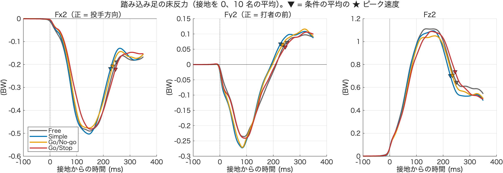
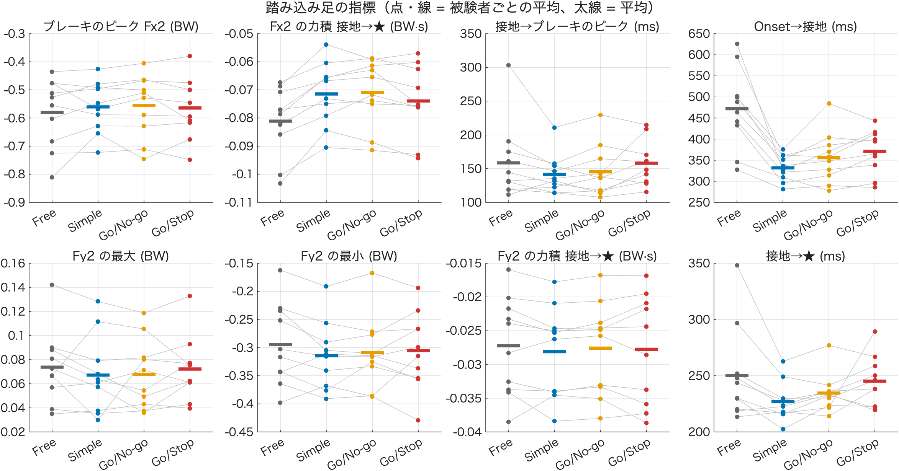

# 踏み込み足の Fx2・Fy2（技術説明）

作成：2026-11-09　加藤 和太郎（student）、Claude Code

## 1. 目的

「体が投手方向へ突っ込んでいる」という予測を、踏み込み足（プレート 2）の床反力で確かめる。突っ込んでいるなら、踏み込み足のブレーキ（捕手方向の力、負の Fx2）が弱い、または遅れるはず。

2026-11-03 の [重心の解析](../../04_重心_Fx/com_fx_analysis/技術説明.md) は 2 枚の板の合成 Fx を使った。ここでは踏み込み足だけを見る。

## 2. 計算の方法

| 手順 | 内容 |
|---|---|
| 試行 | x8 で残った Go 試行のうち、PeakFz2 がある 445 試行（10 名） |
| フィルタ | Force2 を 50 Hz の 2 次 Butterworth で filtfilt（m3・com_fx_analysis と同じ） |
| ゼロ点 | キュー → ピーク速度（★）の間で Fz2 が最も小さい時点（足が板から離れている）の前後 10 ms の中央値を、Fx2・Fy2・Fz2 から引く。生の Fz2 が 100 N 以上なら足が浮いていないとして外す（該当なし） |
| 接地 | Fz2 が最も小さい時点のあとで、Fz2 が 50 N を初めて超えた時点 |
| 正規化 | 体重（x8 の `BWest_N`）で割って BW にする |
| 向き | Fx2：正 = 投手方向、負 = 捕手方向（ブレーキ）。Fy2：**被験者ごとに「打者の前（腹側）が正」にそろえる**（3 節） |

キュー前の構えでは、ほとんどの被験者が踏み込み足を板に乗せている（体重の 3 割ほど）ので、キュー前をゼロ点にはできない。足を上げて板から離れた瞬間をゼロ点にした。

出す値（1 行 1 試行、`output/stride_fxfy_trial_*.csv`）：

| 列 | 内容 |
|---|---|
| `TFC_ms` | Onset → 接地 [ms] |
| `TFCtoPeak_ms` | 接地 → ★ [ms] |
| `Fx2Min_BW`・`TFx2Min_ms` | 接地 → ★ の Fx2 の最小（ブレーキのピーク）[BW] と、接地からその時刻 [ms] |
| `Fx2Imp_BWs` | 接地 → ★ の Fx2 の力積 [BW·s] |
| `Fx2AtPeak_BW` | ★ の Fx2 [BW] |
| `Fy2Max_BW`・`Fy2Min_BW`・`Fy2Imp_BWs` | 接地 → ★ の Fy2 の最大・最小・力積 |
| `Fz2Raw_N`・`Fx2Off_N`・`Fy2Off_N` | ゼロ点に使った値（確認用） |

## 3. Fy の向き（左打者がいる）

構えたとき（キュー前 0.5 s）の骨盤の向き（ASIS の Y の平均 − PSIS の Y の平均）の符号が、被験者で逆だった（3.1 節で、左打者がいることを実験の記録とも確かめた）。

| 正（+0.12〜+0.18 m） | 負（−0.15〜−0.17 m） |
|---|---|
| S01・S04・S06・S07・S10 | S02・S03・S05・S08・S09 |

大きさはどれも骨盤の前後の幅くらいなので、マーカーの間違いではなく、打者の向きが逆（左打者）だった。そろえないと、Fy2 が被験者の間で打ち消し合い、平均がほぼ 0 になる。

### 3.1 左右打の確認（2026-11-11）

骨盤の向きとは別の手がかりで、打者の向きを確かめた（x8 の除外のあとの Go 試行、被験者ごとの中央値）。座標は Z が上の右手系なので、上から見て反時計回りが正。

- **バットの回る向き**：Onset → ★ で、バットの向き（knob → top）が水平面で何度回ったか。右打者は反時計回り（正）、左打者は時計回り（負）。マーカーの左右の名前を使わない
- **骨盤の前とステップの向きの外積**：骨盤の前（ASIS − PSIS）と、構え → ★ の骨盤中心の移動の向きの外積の Z。右打者は投手が体の左にあるので正
- **前の腰**：ステップの向きに対して、LASIS と RASIS のどちらが前か。右打者は左腰が前

| 被験者 | 骨盤の向き（Y）[m] | バットの回転 [°] | 外積 | 判定 | 記録 |
|---|---|---|---|---|---|
| S01 | +0.18 | −249 | − | 左打 | 左打 |
| S02 | −0.17 | +236 | + | 右打 | 右打 |
| S03 | −0.15 | +247 | + | 右打 | 右打 |
| S04 | +0.12 | −238 | − | 左打 | 左打 |
| S05 | −0.16 | +269 | + | 右打 | 右打 |
| S06 | +0.17 | −273 | − | 左打 | 左打 |
| S07 | +0.18 | −265 | − | 左打 | 左打 |
| S08 | −0.17 | +222 | + | 右打 | 右打 |
| S09 | −0.17 | +270 | + | 右打 | 右打 |
| S10 | +0.18 | −287 | − | 左打 | 左打 |

- バットの回転は、10 名とも 93〜100% の試行で同じ向きだった。外積も 88〜100% の試行で一致した
- ステップの向きは全員 +X（投手は +X の側）
- **骨盤の向きが正の S01・S04・S06・S07・S10 が左打、負の S02・S03・S05・S08・S09 が右打**。実験の記録（基礎情報記録用紙の「打席」、2026-11-11 にユーザーが確認）とも 10 名すべて一致した。3 節の分け方は正しく、Fy2 のそろえ方（骨盤の前を正）も変えなくてよい
- 前の腰（RASIS・LASIS の名前を使う方法）は当てにならなかった。同じ被験者の中でも試行によって向きが入れ替わり（S01・S06 など。S06 は 52% の試行だけが一致）、S03・S09 はバットの回転と逆になった。**骨盤のマーカーの左右の名前が入れ替わっている試行がある**ので、左右の ASIS を別々に使う解析（骨盤の回旋角など）をするときは、先に名前を確かめること
- 骨盤のマーカーがない試行も多い（S02 は 50 試行中 11、S04 は 25 試行中 9 試行だけある）

<details>
<summary>確認に使ったコード（check_batting_side.m）</summary>

```matlab
% 左右打の確認：骨盤の向きとは別の手がかりで、打者の向きを被験者ごとに判定する
%  1) 前の腰：ステップの向き（構え→★ の骨盤中心の移動）に対して、LASIS と RASIS のどちらが前か
%     右打者は左腰が投手側
%  2) バットの回る向き：上から見て（Z 上向き）、骨盤中心のまわりの top の角度の変化（Onset → ★）
%     右打者は反時計回り（正）、左打者は時計回り（負）
%  3) 骨盤の前（ASIS − PSIS）とステップの向きの外積の Z
%     右打者は投手が体の左にあるので正
analysisFolder = '/Users/watarokato/mshinyalab_baseball_projects/Project002_反応時間課題バットスイング（加藤）/Experiments/Main experiments/03_Analysis';
addpath(analysisFolder);
Prm = parameters;
load(fullfile(analysisFolder, 'x8_StatTable', 'StatTable.mat'), 'TrialTable');
ConditionNameArray = {'free', 'simple', 'gonogo', 'gostop'};
Out = table();
for iS = 1:10
    S = load(fullfile(analysisFolder, 'x3_DataChecked', sprintf('Data%02d.mat', iS)), 'DataArray');
    T = TrialTable(TrialTable.Subject == iS & TrialTable.IsGo & ~isnan(TrialTable.PeakVelTop) ...
        & ~isnan(TrialTable.SwingOnsetForce), :);
    v = NaN(height(T), 5);
    for r = 1:height(T)
        c = find(strcmp(ConditionNameArray, T.Condition(r)));
        D = S.DataArray(T.Trial(r), c);
        M = D.Markers; fsA = D.AnalogFs; fsM = D.FrameRate;
        tCue = find(D.LEDData(:,2) > Prm.Cue.GoThresholdV, 1, 'first');
        if strcmp(T.Condition(r), 'free') || isempty(tCue), tCue = T.SwingOnsetForce(r); end
        iPre = max(1, round((tCue - 0.5*fsA)/fsA*fsM)) : round(tCue/fsA*fsM);
        iOn  = round(T.SwingOnsetForce(r)/fsA*fsM);
        iPk  = T.TPeakVelTop(r);
        if iPk > size(M.top,1) || iOn < 1, continue, end
        % バットの向き（knob → top）の水平面での回転（骨盤を使わない）
        ii = iOn:iPk;
        b = M.top(ii,1:2) - M.knob(ii,1:2);
        ang = atan2(b(:,2), b(:,1)); ang = unwrap(ang(~isnan(ang)));
        rot = NaN; if numel(ang) > 1, rot = rad2deg(ang(end) - ang(1)); end   % >0：反時計回り（右打者）
        fwdY = NaN; lead = NaN; crs = NaN; sx = NaN;
        if all(isfield(M, {'RASIS','LASIS','RPSIS','LPSIS'}))
            pc = @(i) mean([M.RASIS(i,1:2); M.LASIS(i,1:2); M.RPSIS(i,1:2); M.LPSIS(i,1:2)], 1, 'omitnan');
            p0 = mean(cell2mat(arrayfun(@(i) pc(i), iPre', 'UniformOutput', false)), 1, 'omitnan');
            p1 = pc(iPk);
            step = p1 - p0; step = step / norm(step);                   % ステップの向き（XY）
            asis = mean([M.RASIS(iPre,1:2); M.LASIS(iPre,1:2)], 1, 'omitnan');
            psis = mean([M.RPSIS(iPre,1:2); M.LPSIS(iPre,1:2)], 1, 'omitnan');
            fwd  = asis - psis;                                         % 骨盤の前（XY）
            LmR  = mean(M.LASIS(iPre,1:2), 1, 'omitnan') - mean(M.RASIS(iPre,1:2), 1, 'omitnan');
            lead = dot(LmR, step);                                      % >0：左腰が前（右打者）
            crs  = fwd(1)*step(2) - fwd(2)*step(1);                     % >0：投手が体の左（右打者）
            fwdY = fwd(2); sx = step(1);
        end
        v(r,:) = [fwdY, lead, rot, crs, sx];
    end
    m = median(v, 1, 'omitnan');
    n = sum(~isnan(v(:,3)));
    ok = ~isnan(v(:,2:4)); agree = sum((sign(v(:,2:4)) == sign(m(2:4))) & ok, 1) ./ sum(ok, 1);
    nP = sum(~isnan(v(:,2)));
    Out = [Out; table(iS, n, nP, m(1)/1000, m(2)/1000, m(3), m(4)/1e6, m(5), agree(1), agree(2), agree(3), ...
        'VariableNames', {'Subject','nTrial','nPelvis','FacingY_m','LeadHip_m','BatRot_deg','Cross','StepX','AgreeLead','AgreeRot','AgreeCross'})]; %#ok<AGROW>
    clear S
end
Out.Side = repmat("?", height(Out), 1);
votes = sign([Out.LeadHip_m, Out.BatRot_deg, Out.Cross]); votes(isnan(votes)) = sign(Out.BatRot_deg(any(isnan(votes),2)));
Out.Side(all(votes > 0, 2)) = "右打";
Out.Side(all(votes < 0, 2)) = "左打";
disp(Out)
```

</details>

## 4. 結果（10 名、被験者平均の平均 ± SD）

| 指標 | Free | Simple | Go/No-go | Go/Stop | p（GG） |
|---|---|---|---|---|---|
| Onset → 接地 (ms) | 472 ± 94 | 332 ± 31 | 356 ± 61 | 371 ± 52 | < .001 |
| 接地 → ★ (ms) | 250 ± 42 | 227 ± 17 | 235 ± 17 | 245 ± 22 | .077 |
| ブレーキのピーク Fx2 (BW) | −0.58 ± 0.12 | −0.56 ± 0.09 | −0.56 ± 0.11 | −0.56 ± 0.11 | .392 |
| 接地 → ブレーキのピーク (ms) | 159 ± 57 | 141 ± 29 | 145 ± 38 | 158 ± 33 | .191 |
| Fx2 の力積 接地 → ★ (BW·s) | −0.081 | −0.071 | −0.071 | −0.074 | < .001 |
| ★ の Fx2 (BW) | −0.25 | −0.23 | −0.22 | −0.22 | .299 |
| Fy2 の最大（前側）(BW) | 0.07 | 0.07 | 0.07 | 0.07 | .589 |
| Fy2 の最小（背中側）(BW) | −0.30 | −0.32 | −0.31 | −0.31 | .287 |
| Fy2 の力積 接地 → ★ (BW·s) | −0.027 | −0.028 | −0.028 | −0.028 | .528 |

p は MATLAB の `ranova`（Greenhouse-Geisser 補正）。探索的な値。

### 読み取れること

- **ブレーキの大きさは条件で変わらない**
- Fx2 の力積は Free で大きいが、接地 → ★ が長いため。力積 ÷ 時間（平均の力）は Free 0.32・Simple 0.31・Go/Stop 0.30 BW でほぼ同じ
- Go/Stop は波形全体が Simple より 10〜20 ms 遅れる（ブレーキのピークの時刻 158 vs 141 ms、有意ではない）
- Fy2 は接地の直後に背中側へ（約 85 ms でピーク）、★ の前後で前側へ変わる。条件の差はない
- **踏み込み足の力からは、突っ込みを止めきれていない（ブレーキが弱い・遅い）様子は見えない**

## 5. 図

| ファイル | 内容 |
|---|---|
| `output/stride_fxfy_curve_*.png` | 接地を 0 にした Fx2・Fy2・Fz2（被験者平均の平均）。▼ = 条件の平均の ★ |
| `output/stride_fxfy_metrics_*.png` | 指標 8 つ（被験者ごとの平均を線で結ぶ、太線 = 平均） |





## 6. 注意すること

- 踏み込み足だけの力なので、体全体の前への勢い（重心の速度）はわからない。突っ込みを調べるなら、接地の時点の重心の前向きの速度（どれだけの勢いで踏み込んだか）と合わせて見る
- 接地は Fz2 > 50 N で決めているので、本当に足が着いた瞬間より数 ms 遅い

## 7. 使い方

1. 8 節のコードを、このフォルダに `stride_fxfy_analysis.m` という名前で保存する
2. MATLAB の現在のフォルダをこのフォルダにして、`stride_fxfy_analysis` を実行する（x3 を 10 名分読むので数分かかる）
3. コマンドウィンドウに Fy の向きと条件ごとの平均が出て、`output/` に CSV と PNG 2 枚が保存される

## 8. コード（stride_fxfy_analysis.m）

```matlab
% stride_fxfy_analysis.m
%
% 踏み込み足（プレート 2）の前後の力 Fx2 と左右の力 Fy2 を、接地からピーク速度（★）まで調べる。
% 体が投手方向へ突っ込むなら、踏み込み足のブレーキ（負の Fx2）が条件で変わるはず。
%
% 計算：
%   Force2 を 50 Hz の 2 次 Butterworth で filtfilt（m3・com_fx_analysis と同じ）
%   ゼロ点：キュー → ★ の間で Fz2 が最も小さい時点（足が板から離れている）の前後 10 ms の中央値を
%           Fx2・Fy2・Fz2 のゼロ点として引く
%   接地  ：Fz2 が最も小さい時点のあとで、Fz2 がゼロ点 + 50 N を初めて超えた時点
%   体重で割って BW にする（BWest_N）
%   Fx2 の正 = 投手方向、負 = 捕手方向（ブレーキ）
%   Fy2 の正の向きは、構えたときの骨盤（ASIS − PSIS の Y）で確かめる
%
% 2026-11-09

%% 設定
Subjects   = 1:10 ;
LiftMaxN   = 100 ;          % Fz2 の最小値がゼロ点の推定に使えるのは、生の値がこれ未満のとき [N]（足が浮いている）
PreMs      = 100 ;          % 図：接地の前
PostMs     = 350 ;          % 図：接地のあと
ConditionNameArray = {'free', 'simple', 'gonogo', 'gostop'} ;
ConditionLabel     = {'Free', 'Simple', 'Go/No-go', 'Go/Stop'} ;
ConditionColor     = [0.40 0.40 0.40 ; 0.00 0.45 0.70 ; 0.90 0.62 0.00 ; 0.80 0.20 0.20] ;

scriptFolder   = fileparts(mfilename('fullpath')) ;
projectFolder  = fullfile(scriptFolder, '..', '..', '..', '..') ;   % Project002 のフォルダ
analysisFolder = fullfile(projectFolder, 'Experiments', 'Main experiments', '03_Analysis') ;
outFolder      = fullfile(scriptFolder, 'output') ;
addpath(analysisFolder) ;
Prm = parameters ;

%% 試行を選ぶ（x8 の除外のあと、床反力が使える Go 試行）
load(fullfile(analysisFolder, 'x8_StatTable', 'StatTable.mat'), 'TrialTable') ;
T = TrialTable(TrialTable.IsGo & ~isnan(TrialTable.PeakVelTop) & ~isnan(TrialTable.SwingOnsetForce) ...
    & ~isnan(TrialTable.PeakFz2_BW) & ismember(TrialTable.Subject, Subjects), :) ;

%% 試行ごとに計算する
VarNames = {'TFC_ms', ...           % Onset → 接地 [ms]
            'TFCtoPeak_ms', ...     % 接地 → ★ [ms]
            'Fx2Min_BW', ...        % 接地 → ★ の Fx2 の最小（ブレーキのピーク）[BW]
            'TFx2Min_ms', ...       % 接地 → ブレーキのピーク [ms]
            'Fx2Imp_BWs', ...       % 接地 → ★ の Fx2 の力積 [BW·s]
            'Fx2AtPeak_BW', ...     % ★ の Fx2 [BW]
            'Fy2Max_BW', ...        % 接地 → ★ の Fy2 の最大 [BW]
            'Fy2Min_BW', ...        % 接地 → ★ の Fy2 の最小 [BW]
            'Fy2Imp_BWs', ...       % 接地 → ★ の Fy2 の力積 [BW·s]
            'Fz2Raw_N', ...         % ゼロ点に使った Fz2 の生の値 [N]（足が浮いているか）
            'Fx2Off_N', 'Fy2Off_N'} ;  % Fx2・Fy2 のゼロ点 [N]
nT    = height(T) ;
V     = NaN(nT, numel(VarNames)) ;
Curve = NaN(nT, PreMs + PostMs + 1, 3) ;   % 接地を 0 にした Fx2・Fy2・Fz2 [BW]（1 ms ごと）
TPkRel = NaN(nT, 1) ;                      % 接地 → ★ [ms]（図の印）
Facing = NaN(numel(Subjects), 1) ;         % 骨盤の向き：ASIS − PSIS の Y [m]

for iSubject = unique(T.Subject)'
    fprintf('S%02d の x3 を読み込み中...\n', iSubject) ;
    S = load(fullfile(analysisFolder, 'x3_DataChecked', sprintf('Data%02d.mat', iSubject)), 'DataArray') ;
    rows = find(T.Subject == iSubject)' ;
    fac  = [] ;

    for r = rows
        iCondition = find(strcmp(ConditionNameArray, T.Condition(r))) ;
        Data = S.DataArray(T.Trial(r), iCondition) ;
        fsA  = Data.AnalogFs ;
        fsM  = Data.FrameRate ;
        BW   = T.BWest_N(r) ;

        tCue      = find(Data.LEDData(:,2) > Prm.Cue.GoThresholdV, 1, 'first') ;
        lastValid = find(~any(isnan(Data.Force2), 2), 1, 'last') ;
        [b, a] = butter(2, Prm.RT.FxFc/(fsA/2)) ;
        F2  = filtfilt(b, a, Data.Force2(1:lastValid, :)) ;

        sOn = T.SwingOnsetForce(r) ;
        sPk = round(T.TPeakVelTop(r) / fsM * fsA) ;
        if sPk > lastValid || sPk <= tCue, continue, end

        % ゼロ点（足が浮いている時点）
        [fzMin, k] = min(F2(tCue:sPk, 3)) ;
        sLift = tCue + k - 1 ;
        w     = max(1, sLift-10) : min(lastValid, sLift+10) ;
        off   = median(F2(w, :), 1) ;
        F2    = F2 - off ;

        % 接地
        sFC = find(F2(sLift:sPk, 3) > Prm.RT.FootContactN, 1, 'first') + sLift - 1 ;
        if isempty(sFC), continue, end

        fx = F2(:,1) / BW ;  fy = F2(:,2) / BW ;
        seg = sFC:sPk ;
        [fxMin, kx] = min(fx(seg)) ;
        V(r,:) = [(sFC - sOn) / fsA * 1000, (sPk - sFC) / fsA * 1000, ...
                  fxMin, (kx - 1) / fsA * 1000, trapz(fx(seg)) / fsA, fx(sPk), ...
                  max(fy(seg)), min(fy(seg)), trapz(fy(seg)) / fsA, ...
                  fzMin + off(3), off(1), off(2)] ;
        if fzMin + off(3) > LiftMaxN, V(r, 1:9) = NaN ; end   % 足が浮いていない試行はゼロ点が取れない

        % 図の曲線（1 kHz 前提）
        idx = sFC - PreMs : sFC + PostMs ;
        ok  = idx >= 1 & idx <= lastValid ;
        Curve(r, ok, :) = F2(idx(ok), :) / BW ;
        TPkRel(r) = (sPk - sFC) / fsA * 1000 ;

        % 骨盤の向き（キュー前 0.5 s）
        iM = max(1, round((tCue - 0.5*fsA) / fsA * fsM)) : round(tCue / fsA * fsM) ;
        M  = Data.Markers ;
        if all(isfield(M, {'RASIS', 'LASIS', 'RPSIS', 'LPSIS'}))   % 骨盤のマーカーがない被験者もいる
            asisY = mean([M.RASIS(iM,2) ; M.LASIS(iM,2)], 'omitnan') ;
            psisY = mean([M.RPSIS(iM,2) ; M.LPSIS(iM,2)], 'omitnan') ;
            fac(end+1) = (asisY - psisY) / 1000 ; %#ok<SAGROW>
        end
    end
    if ~isempty(fac), Facing(Subjects == iSubject) = median(fac, 'omitnan') ; end
    clear S
end

% Fy の向きをそろえる：骨盤の前（ASIS の側）を正にする（左打者と右打者で Y の向きが逆になる）
sgn = sign(Facing) ;
for r = 1:nT
    s = sgn(Subjects == T.Subject(r)) ;
    iMax = strcmp(VarNames, 'Fy2Max_BW') ; iMin = strcmp(VarNames, 'Fy2Min_BW') ; iImp = strcmp(VarNames, 'Fy2Imp_BWs') ;
    if s < 0
        [V(r, iMax), V(r, iMin)] = deal(-V(r, iMin), -V(r, iMax)) ;
        V(r, iImp)    = -V(r, iImp) ;
        Curve(r, :, 2) = -Curve(r, :, 2) ;
    end
end

Res = [T(:, {'Subject', 'Condition', 'Trial'}), array2table(V, 'VariableNames', VarNames)] ;
keep   = ~isnan(Res.Fx2Min_BW) ;
fprintf('\n足が浮いていない・接地が見つからないなどで外した試行：%d / %d\n', sum(~keep), nT) ;
disp(Res(~keep, {'Subject', 'Condition', 'Trial', 'Fz2Raw_N'})) ;
Res    = Res(keep, :) ;
Curve  = Curve(keep, :, :) ;
TPkRel = TPkRel(keep) ;

%% Fy の向き
fprintf('\n骨盤の向き（ASIS − PSIS の Y、キュー前 0.5 s）[m]：\n') ;
disp(array2table([Subjects(:), Facing], 'VariableNames', {'Subject', 'ASISminusPSIS_Y'})) ;

%% 条件ごとの平均（被験者ごとの平均の平均 ± 被験者間 SD）
Mv = {'TFC_ms', 'TFCtoPeak_ms', 'Fx2Min_BW', 'TFx2Min_ms', 'Fx2Imp_BWs', 'Fx2AtPeak_BW', 'Fy2Max_BW', 'Fy2Min_BW', 'Fy2Imp_BWs'} ;
G = groupsummary(Res, {'Subject', 'Condition'}, 'mean', Mv) ;
fprintf('\n条件ごとの平均 ± SD（被験者平均の平均、%d 名）\n', numel(unique(Res.Subject))) ;
W = struct() ;
for v = Mv
    X = NaN(numel(Subjects), 4) ;
    for ic = 1:4
        for is = 1:numel(Subjects)
            g = G(G.Subject == Subjects(is) & string(G.Condition) == ConditionNameArray{ic}, :) ;
            if ~isempty(g), X(is, ic) = g.(['mean_' v{1}]) ; end
        end
    end
    W.(v{1}) = X ;
    Xc = X(all(~isnan(X), 2), :) ;
    tb = array2table(Xc, 'VariableNames', {'free', 'simple', 'gonogo', 'gostop'}) ;
    rm = fitrm(tb, 'free-gostop ~ 1', 'WithinDesign', table(categorical(ConditionNameArray'), 'VariableNames', {'Cond'})) ;
    ra = ranova(rm) ;
    fprintf('%-13s', v{1}) ;
    fprintf('  %8.3f ± %6.3f', [mean(X, 'omitnan') ; std(X, 'omitnan')]) ;
    fprintf('   RM-ANOVA（GG）p = %.3f\n', ra.pValueGG(1)) ;
end
fprintf('（列：Free・Simple・Go/No-go・Go/Stop）\n') ;

%% 図 1：接地を 0 にした Fx2・Fy2・Fz2（被験者平均の平均）
tAx  = -PreMs : PostMs ;
fig1 = figure('Color', 'w', 'Position', [60 60 1350 420]) ;
tl   = tiledlayout(fig1, 1, 3, 'TileSpacing', 'compact') ;
title(tl, sprintf('踏み込み足の床反力（接地を 0、%d 名の平均）。▼ = 条件の平均の ★ ピーク速度', numel(unique(Res.Subject)))) ;
Comp = {'Fx2（正 = 投手方向）', 'Fy2（正 = 打者の前）', 'Fz2'} ;
for c = 1:3
    ax = nexttile(tl) ; hold(ax, 'on') ; grid(ax, 'on') ;
    h = gobjects(1, 4) ;
    for ic = 1:4
        Ms = [] ; tp = [] ;
        for s = unique(Res.Subject)'
            k = Res.Subject == s & strcmp(Res.Condition, ConditionNameArray{ic}) ;
            if any(k), Ms(end+1, :) = mean(Curve(k, :, c), 1, 'omitnan') ; tp(end+1) = mean(TPkRel(k)) ; end %#ok<SAGROW>
        end
        m = mean(Ms, 1, 'omitnan') ;
        h(ic) = plot(ax, tAx, m, '-', 'Color', ConditionColor(ic,:), 'LineWidth', 1.8) ;
        tpm = mean(tp) ;
        plot(ax, tpm, interp1(tAx, m, tpm), 'v', 'MarkerFaceColor', ConditionColor(ic,:), 'MarkerEdgeColor', 'k') ;
    end
    xline(ax, 0, 'k:') ; yline(ax, 0, 'k-') ;
    xlabel(ax, '接地からの時間 (ms)') ; ylabel(ax, '(BW)') ; title(ax, Comp{c}) ;
    if c == 1, legend(ax, h, ConditionLabel, 'Location', 'southwest') ; end
end

%% 図 2：指標（被験者ごとの平均、線で結ぶ）
Show  = {'Fx2Min_BW', 'Fx2Imp_BWs', 'TFx2Min_ms', 'TFC_ms', 'Fy2Max_BW', 'Fy2Min_BW', 'Fy2Imp_BWs', 'TFCtoPeak_ms'} ;
Title = {'ブレーキのピーク Fx2 (BW)', 'Fx2 の力積 接地→★ (BW·s)', '接地→ブレーキのピーク (ms)', 'Onset→接地 (ms)', ...
         'Fy2 の最大 (BW)', 'Fy2 の最小 (BW)', 'Fy2 の力積 接地→★ (BW·s)', '接地→★ (ms)'} ;
fig2 = figure('Color', 'w', 'Position', [60 60 1350 620]) ;
tl2  = tiledlayout(fig2, 2, 4, 'TileSpacing', 'compact') ;
title(tl2, '踏み込み足の指標（点・線 = 被験者ごとの平均、太線 = 平均）') ;
for p = 1:numel(Show)
    ax = nexttile(tl2) ; hold(ax, 'on') ; grid(ax, 'on') ;
    X = W.(Show{p}) ;
    plot(ax, 1:4, X', '-', 'Color', [0.75 0.75 0.75]) ;
    for ic = 1:4
        scatter(ax, ic * ones(size(X,1),1), X(:,ic), 18, ConditionColor(ic,:), 'filled') ;
        plot(ax, ic + [-0.25 0.25], mean(X(:,ic), 'omitnan') * [1 1], '-', 'Color', ConditionColor(ic,:), 'LineWidth', 3) ;
    end
    ax.XTick = 1:4 ; ax.XTickLabel = ConditionLabel ; xlim(ax, [0.5 4.5]) ;
    title(ax, Title{p}) ;
end

%% 保存
if ~exist(outFolder, 'dir'), mkdir(outFolder) ; end
stamp = char(datetime('now', 'Format', 'yyyyMMdd_HHmm')) ;
writetable(Res, fullfile(outFolder, sprintf('stride_fxfy_trial_%s.csv', stamp))) ;
exportgraphics(fig1, fullfile(outFolder, sprintf('stride_fxfy_curve_%s.png', stamp)), 'Resolution', 200) ;
exportgraphics(fig2, fullfile(outFolder, sprintf('stride_fxfy_metrics_%s.png', stamp)), 'Resolution', 200) ;
fprintf('output/ に CSV と PNG を保存しました\n') ;
```
