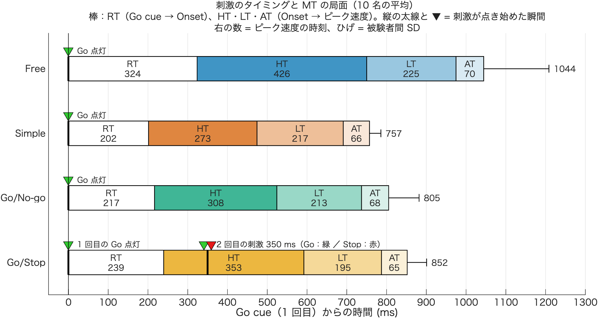
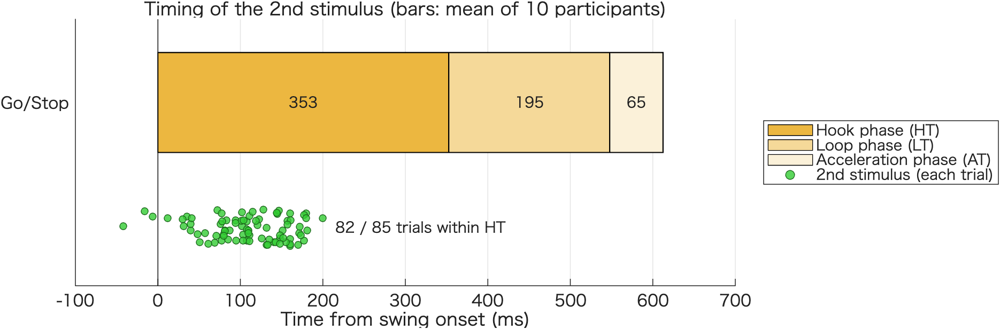
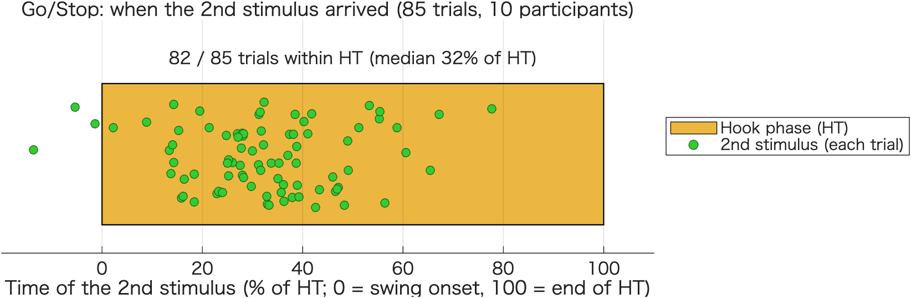
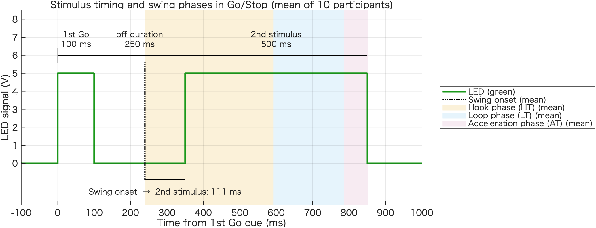

# 刺激のタイミングと RT・HT・LT・AT（技術説明）

作成：2026-11-09　加藤 和太郎（student）、Claude Code

## 1. 目的

条件ごとに、刺激（LED）がいつ点くかと、RT・HT・LT・AT（MT の局面）を 1 つの時間軸に並べる。Go/Stop は 2 回目の刺激も描き、2 回目の刺激がスイングのどの局面に来るかを数える。

## 2. 刺激の時刻（LED の記録と実験スクリプトで確認）

S06 の `LEDData` と、`Experiments/Main experiments/02_Script/demo_5_4_*_main_experiments.m` で確かめた。

| 条件 | 刺激（Go cue を 0） |
|---|---|
| Free・Simple・Go/No-go | Go（緑、ch2 の +5 V）を 0〜500 ms 点灯 |
| Go/Stop | 1 回目の Go を 0〜100 ms → 消灯 250 ms → 2 回目を 350〜850 ms（Go 試行は緑 +5 V、Stop 試行は赤 −5 V） |
| すべて | Ready（白、ch1 の −5 V を反転して点灯）は Go の 1.2〜1.8 s 前（Free は 1.5 s 前に固定）。この図の範囲の外 |

**2 回目の刺激は 1 回目の Go の点灯から 350 ms 後**（スクリプトの `first_go_signal_duration = 0.1` + `go_to_branch_off_duration = 0.25`）。

Methods と違う点が 2 つある（README の 4 節）：Methods は「0.25 秒後」としているが実際は 0.35 秒後。Methods は「Free は Go cue を呈示しない」としているが、Free でも緑が点灯している（スクリプトのコメントは「LED キュー有り、フォアピリオド固定」）。図の Free の RT は、この緑からの時間。

## 3. 計算の方法

| 項目 | 内容 |
|---|---|
| 棒 | x8 の `SubjectTable`（被験者 × 条件の平均）の `RTForce_ms`・`HookTime_ms`・`LoopTime_ms`・`AccelTime_ms` の、被験者間の平均。RT は白、HT・LT・AT はポスターと同じ色（Okabe-Ito、濃さ 75%・40%・15%） |
| ひげ | 棒の右端（RT + MT = ピーク速度の時刻）の被験者間の SD |
| 刺激 | 点き始めた瞬間を、棒を貫く縦の太線と ▼ で描く（Go は緑、Go/Stop の 2 回目は緑と赤を並べる） |
| 2 回目の刺激が来る局面 | x8 の `TrialTable` の Go/Stop の Go 試行ごとに、Onset → 2 回目の刺激（350 − RT）を HT・LT・AT の境目と比べる |

## 4. 結果（10 名）

| 条件 | RT | HT | LT | AT | ピーク速度の時刻（Go cue から） |
|---|---|---|---|---|---|
| Free | 324 | 426 | 225 | 70 | 1044 ± 164 ms |
| Simple | 202 | 273 | 217 | 66 | 757 ± 29 ms |
| Go/No-go | 217 | 308 | 213 | 68 | 805 ± 76 ms |
| Go/Stop | 239 | 353 | 195 | 65 | 852 ± 49 ms |

Go/Stop の 2 回目の刺激が来る局面（Go 試行 85 本）：

| 局面 | 試行数 |
|---|---|
| Onset の前 | 3 本（3.5%） |
| **HT** | **82 本（96.5%）** |
| LT・AT・ピーク速度のあと | 0 本 |

- Onset から 2 回目の刺激まで：中央値 110 ms（範囲 −42〜200 ms）
- HT の中の位置：中央値 32%（HT の前から 3 割あたり）



## 5. 全体の結果の図（Go/Stop だけ、英語）

報告用に、Go/Stop だけを描いた図も作った（`output/2nd_stimulus_on_phases.png`、コードは 7.2 節）。

- 振り始め（Onset）を 0 にして、HT・LT・AT を平均の積み上げ横棒（10 名）で描く
- 棒の下に、全 Go 試行（85 本）の 2 回目の刺激の時刻（Onset から 350 − RT ms）を点で並べる。点の縦の位置は、重ならないように乱数で散らしている
- 「82 / 85 trials within HT」は、試行ごとの HT と比べて数えた値（棒は平均なので、点と棒の位置関係とは少し違いうる）
- 他の条件を入れない理由：この図で伝えたいのは「2 回目の刺激がどの局面に来るか」なので。HT が Simple より延びていることは、別の図・統計で示す



### 5.1 HT だけの帯に描いた版（おすすめ）

`output/2nd_stimulus_in_HT.png`（コードは 7.3 節）。HT だけを帯で描き、その中に 2 回目の刺激のタイミングを点で描く。

- 横軸は、**試行ごとの HT に対する割合**（0% = 振り始め、100% = HT の終わり）。割合 = (350 − RT) ÷ その試行の HT × 100
- 試行ごとの HT で割るので、帯の中の点は、その試行の HT の中で刺激が来たことをそのまま表す（上の ms の図では、平均の棒と試行ごとの HT が違うので、見た目と数が少し食い違いうる）
- 結果：82 / 85 試行が HT の中、中央値は HT の 32%（範囲 −14〜78%）。HT の後半（80% 以上）に来た試行はない



### 5.2 1 試行の図と同じ形の、全体の平均の版

`output/stimulus_timing_mean_gostop.png`（コードは 7.4 節）。[1 試行の刺激の図](../00_single_trial_example/output/single_trial_S01_gostop_T06_stimulus.png) と同じ形（Go cue を 0、LED と局面の背景、英語）で、Go/Stop の全体を描く。

- LED（実験スクリプトの設定どおりの波形）と、平均の振り始め（点線）・HT・LT・AT（背景の色、10 名の平均）。平均の振り始めは 239 ms、HT の終わり 592 ms、LT の終わり 787 ms、AT の終わり 852 ms（Go cue から）
- 平均の振り始めから 2 回目の刺激までの時間（350 − 239 = **111 ms**）を下に書き入れた
- 試行ごとの数（82 / 85 試行で 2 回目の刺激が HT の中）は、図には入れず、コマンドウィンドウに出す



## 6. 使い方

1. 7.1 節のコードを、このフォルダに `plot_stimulus_phase_timeline.m` という名前で保存する（報告用の図は 7.2 節を `plot_2nd_stimulus_on_phases.m`、7.3 節を `plot_2nd_stimulus_in_HT.m`、7.4 節を `plot_stimulus_timing_mean.m` で保存）
2. MATLAB の現在のフォルダをこのフォルダにして実行する（x8 の StatTable.mat だけを読むので数秒）
3. コマンドウィンドウに条件ごとの平均と、2 回目の刺激が来る局面の数が出て、`output/stimulus_phase_timeline.png` が保存される

## 7. コード

### 7.1 plot_stimulus_phase_timeline.m

```matlab
% plot_stimulus_phase_timeline.m
%
% Go cue を 0 にした時間軸に、条件ごとの刺激（LED の点灯）と、RT・MT の局面（HT・LT・AT）を並べる。
% Go/Stop は 2 回目の刺激（1 回目の Go から 350 ms 後）も描き、2 回目の刺激が MT のどの局面に来るかを数える。
%
% 刺激の時刻（LED の記録 LEDData(:,2) と 02_Script の実験スクリプトで確認、2026-11-09）
%   Free・Simple・Go/No-go：Go（緑）を 0〜500 ms 点灯
%   Go/Stop：1 回目の Go を 0〜100 ms → 消灯 250 ms → 2 回目（Go 試行は緑、Stop 試行は赤）を 350〜850 ms
%   Ready（白）は Go の 1.2〜1.8 s 前（Free は 1.5 s 前に固定）なので、この図の範囲の外
%
% データ：x8_StatTable/StatTable.mat
%   棒   ：SubjectTable（被験者 × 条件の平均）の RTForce_ms・HookTime_ms・LoopTime_ms・AccelTime_ms の、被験者間の平均
%   誤差棒：棒の右端（RT + MT、ピーク速度の時刻）の被験者間の SD
%   2 回目の刺激の局面：TrialTable の Go/Stop の Go 試行（x8 の除外のあと）で、試行ごとに数える
%
% 2026-11-09

%% 設定
ConditionNameArray = {'free', 'simple', 'gonogo', 'gostop'} ;
ConditionLabel     = {'Free', 'Simple', 'Go/No-go', 'Go/Stop'} ;
ConditionColor     = [0.000 0.447 0.698 ;    % Free     青（ポスターと同じ Okabe-Ito）
                      0.835 0.369 0.000 ;    % Simple   朱
                      0.000 0.620 0.451 ;    % Go/No-go 緑
                      0.902 0.624 0.000] ;   % Go/Stop  橙
PhaseCol   = {'RTForce_ms', 'HookTime_ms', 'LoopTime_ms', 'AccelTime_ms'} ;
PhaseLabel = {'RT', 'HT', 'LT', 'AT'} ;
PhaseShare = [0, 0.75, 0.40, 0.15] ;     % 色の濃さ（RT は白、HT・LT・AT はポスターと同じ）
LedGreen   = [0.20 0.80 0.20] ;
LedRed     = [0.90 0.10 0.10] ;
Stim       = {[0 500], [0 500], [0 500], [0 100 ; 350 850]} ;   % LED の点灯 [ms]（Go cue から）
T2         = 350 ;                                              % Go/Stop の 2 回目の刺激 [ms]

scriptFolder   = fileparts(mfilename('fullpath')) ;
projectFolder  = fullfile(scriptFolder, '..', '..', '..', '..') ;   % Project002 のフォルダ
analysisFolder = fullfile(projectFolder, 'Experiments', 'Main experiments', '03_Analysis') ;
outFolder      = fullfile(scriptFolder, 'output') ;
load(fullfile(analysisFolder, 'x8_StatTable', 'StatTable.mat'), 'SubjectTable', 'TrialTable') ;

%% 条件ごとの平均（被験者平均の平均）
nC = numel(ConditionNameArray) ;
nP = numel(PhaseCol) ;
M  = NaN(nC, nP) ;
EndSd = NaN(nC, 1) ;
for ic = 1:nC
    S = SubjectTable(SubjectTable.Condition == ConditionNameArray{ic}, :) ;
    for ip = 1:nP
        M(ic, ip) = mean(S.(PhaseCol{ip}), 'omitnan') ;
    end
    EndSd(ic) = std(S.RTForce_ms + S.MT_ms, 'omitnan') ;
    fprintf('%-9s RT %4.0f | HT %4.0f  LT %4.0f  AT %4.0f | ピーク速度 %4.0f ± %3.0f ms（Go cue から、%d 名）\n', ...
        ConditionLabel{ic}, M(ic, :), sum(M(ic, :)), EndSd(ic), height(S)) ;
end

%% Go/Stop：2 回目の刺激が来る局面（試行ごと）
G = TrialTable(TrialTable.IsGo & TrialTable.Condition == "gostop" & ~isnan(TrialTable.RTForce_ms) ...
    & ~isnan(TrialTable.HookTime_ms), :) ;
tFromOnset = T2 - G.RTForce_ms ;                       % Onset から 2 回目の刺激まで [ms]
where = repmat("", height(G), 1) ;
where(tFromOnset < 0) = "Onset の前" ;
where(tFromOnset >= 0 & tFromOnset < G.HookTime_ms) = "HT" ;
where(tFromOnset >= G.HookTime_ms & tFromOnset < G.HookTime_ms + G.LoopTime_ms) = "LT" ;
where(tFromOnset >= G.HookTime_ms + G.LoopTime_ms & tFromOnset < G.MT_ms) = "AT" ;
where(tFromOnset >= G.MT_ms) = "ピーク速度のあと" ;
cats = ["Onset の前", "HT", "LT", "AT", "ピーク速度のあと"] ;
fprintf('\nGo/Stop の 2 回目の刺激（Go cue から %d ms）が来る局面（Go 試行 %d 本、%d 名）\n', T2, height(G), numel(unique(G.Subject))) ;
for c = cats
    fprintf('  %-16s %3d 本（%4.1f%%）\n', c, sum(where == c), 100 * mean(where == c)) ;
end
fprintf('  Onset から 2 回目の刺激まで：中央値 %.0f ms（範囲 %.0f〜%.0f）、HT の中での位置：中央値 %.0f%%\n', ...
    median(tFromOnset), min(tFromOnset), max(tFromOnset), 100 * median(tFromOnset(where == "HT") ./ G.HookTime_ms(where == "HT"))) ;

%% 図
fig = figure('Color', 'w', 'Position', [80 80 1000 480]) ;
ax  = axes(fig) ; hold(ax, 'on') ;
yPos  = nC:-1:1 ;     % 上から Free・Simple・Go/No-go・Go/Stop
barH  = 0.38 ;        % 局面の棒の高さ

for ic = 1:nC
    y = yPos(ic) ;
    % 局面の棒（RT → HT → LT → AT）
    left = 0 ;
    for ip = 1:nP
        w = M(ic, ip) ;
        col = PhaseShare(ip) * ConditionColor(ic, :) + (1 - PhaseShare(ip)) ;
        rectangle(ax, 'Position', [left, y - barH/2, w, barH], 'FaceColor', col, 'EdgeColor', 'k', 'LineWidth', 0.8) ;
        if w > 45
            text(ax, left + w/2, y, sprintf('%s\n%.0f', PhaseLabel{ip}, w), 'HorizontalAlignment', 'center', ...
                'VerticalAlignment', 'middle', 'FontSize', 9) ;
        else
            text(ax, left + w/2, y - barH/2 - 0.04, sprintf('%s %.0f', PhaseLabel{ip}, w), 'HorizontalAlignment', 'center', ...
                'VerticalAlignment', 'top', 'FontSize', 8) ;
        end
        left = left + w ;
    end
    % ピーク速度の時刻の SD（被験者間）
    plot(ax, left + [0 EndSd(ic)], [y y], 'k-', 'LineWidth', 0.8) ;
    plot(ax, left + EndSd(ic) * [1 1], y + [-0.06 0.06], 'k-', 'LineWidth', 0.8) ;
    text(ax, left + EndSd(ic) + 12, y, sprintf('%.0f', left), 'VerticalAlignment', 'middle', 'FontSize', 9) ;

    % 刺激が点き始めた瞬間：棒を貫く縦線と、棒の上の ▼（Go は緑、Go/Stop の 2 回目は緑と赤を並べる）
    St = Stim{ic} ;
    for k = 1:size(St, 1)
        t0 = St(k, 1) ;
        plot(ax, t0 * [1 1], y + [-barH/2, barH/2], '-', 'Color', 'k', 'LineWidth', 2) ;
        yMk = y + barH/2 + 0.09 ;
        if ic == 4 && k == 2
            plot(ax, t0 - 9, yMk, 'v', 'MarkerSize', 9, 'MarkerFaceColor', LedGreen, 'MarkerEdgeColor', 'k') ;
            plot(ax, t0 + 9, yMk, 'v', 'MarkerSize', 9, 'MarkerFaceColor', LedRed,   'MarkerEdgeColor', 'k') ;
            label = sprintf('2 回目の刺激 %d ms（Go：緑 ／ Stop：赤）', t0) ;
        else
            plot(ax, t0, yMk, 'v', 'MarkerSize', 9, 'MarkerFaceColor', LedGreen, 'MarkerEdgeColor', 'k') ;
            label = 'Go 点灯' ;
            if ic == 4, label = '1 回目の Go 点灯' ; end
        end
        text(ax, t0 + 22, yMk, label, 'VerticalAlignment', 'middle', 'FontSize', 8.5) ;
    end
end

xline(ax, 0, 'k-', 'LineWidth', 0.8) ;
xlim(ax, [-50 1300]) ;
ylim(ax, [0.5, nC + 0.55]) ;
ax.YTick = 1:nC ; ax.YTickLabel = flip(ConditionLabel) ; ax.YAxis.TickLength = [0 0] ;
ax.XTick = 0:100:1300 ;
ax.XGrid = 'on' ; ax.GridAlpha = 0.12 ;
ax.FontSize = 10 ;
xlabel(ax, 'Go cue（1 回目）からの時間 (ms)') ;
title(ax, {sprintf('刺激のタイミングと MT の局面（%d 名の平均）', numel(unique(SubjectTable.Subject))), ...
    '棒：RT（Go cue → Onset）、HT・LT・AT（Onset → ピーク速度）。縦の太線と ▼ = 刺激が点き始めた瞬間', ...
    '右の数 = ピーク速度の時刻、ひげ = 被験者間 SD'}, ...
    'FontWeight', 'normal', 'FontSize', 10) ;

%% 保存
if ~exist(outFolder, 'dir'), mkdir(outFolder) ; end
exportgraphics(fig, fullfile(outFolder, 'stimulus_phase_timeline.png'), 'Resolution', 200) ;
fprintf('output/stimulus_phase_timeline.png を保存しました\n') ;
```

### 7.2 plot_2nd_stimulus_on_phases.m（報告用の図）

```matlab
% plot_2nd_stimulus_on_phases.m
%
% 全体の結果の図：振り始め（Onset）を 0 にして、Go/Stop の HT・LT・AT を平均の積み上げ横棒で描き、
% 棒の下に、全 Go 試行の 2 回目の刺激の時刻を点で並べる（英語）。
%
% データ：x8_StatTable/StatTable.mat
%   棒：SubjectTable（被験者 × 条件の平均）の Go/Stop の HookTime_ms・LoopTime_ms・AccelTime_ms の、被験者間の平均（10 名）
%   点：TrialTable の Go/Stop の Go 試行（x8 の除外のあと、RT と HT がある 85 本）。
%       Onset から 2 回目の刺激まで = 350 − RT [ms]（2 回目の刺激は 1 回目の Go の 350 ms 後）
%   「HT の中」の数は、試行ごとの HT と比べて数える（棒は平均なので、点と棒の位置関係とは少し違いうる）
% 色：ポスターの Go/Stop の色（Okabe-Ito の橙）。HT 75%・LT 40%・AT 15%
% 点の縦の位置は、重なりを避けるために乱数で散らしている（rng(1) で毎回同じ）
%
% 2026-11-09

%% 設定
T2ms = 350 ;
ConditionNameArray = {'gostop'} ;
ConditionLabel     = {'Go/Stop'} ;
ConditionColor     = [0.902 0.624 0.000] ;   % ポスターの Go/Stop の色
PhaseCol   = {'HookTime_ms', 'LoopTime_ms', 'AccelTime_ms'} ;
PhaseLabel = {'Hook phase (HT)', 'Loop phase (LT)', 'Acceleration phase (AT)'} ;
PhaseShare = [0.75, 0.40, 0.15] ;
DotColor   = [0.20 0.80 0.20] ;

scriptFolder   = fileparts(mfilename('fullpath')) ;
projectFolder  = fullfile(scriptFolder, '..', '..', '..', '..') ;   % Project002 のフォルダ
analysisFolder = fullfile(projectFolder, 'Experiments', 'Main experiments', '03_Analysis') ;
outFolder      = fullfile(scriptFolder, 'output') ;
load(fullfile(analysisFolder, 'x8_StatTable', 'StatTable.mat'), 'SubjectTable', 'TrialTable') ;

%% データ
nC = numel(ConditionNameArray) ;
M  = NaN(nC, 3) ;
for ic = 1:nC
    S = SubjectTable(SubjectTable.Condition == ConditionNameArray{ic}, :) ;
    for ip = 1:3
        M(ic, ip) = mean(S.(PhaseCol{ip}), 'omitnan') ;
    end
end
nSub = numel(unique(SubjectTable.Subject)) ;
G  = TrialTable(TrialTable.IsGo & TrialTable.Condition == "gostop" & ~isnan(TrialTable.RTForce_ms) ...
     & ~isnan(TrialTable.HookTime_ms), :) ;
t2 = T2ms - G.RTForce_ms ;                                 % Onset → 2 回目の刺激 [ms]
inHT = t2 >= 0 & t2 < G.HookTime_ms ;
fprintf('2 回目の刺激が HT の中：%d / %d 試行（%d 名）。Onset の前：%d 試行\n', sum(inHT), height(G), ...
    numel(unique(G.Subject)), sum(t2 < 0)) ;
fprintf('Onset から 2 回目の刺激まで：中央値 %.0f ms（範囲 %.0f〜%.0f ms）\n', median(t2), min(t2), max(t2)) ;

%% 図
fig = figure('Color', 'w', 'Position', [60 60 1000 300]) ;
ax  = axes(fig) ; hold(ax, 'on') ;
yPos = 1.4 ;      % 棒の位置（下に点の場所をあける）
barH = 0.6 ;
for ic = 1:nC
    left = 0 ;
    for ip = 1:3
        col = PhaseShare(ip) * ConditionColor(ic, :) + (1 - PhaseShare(ip)) ;
        rectangle(ax, 'Position', [left, yPos(ic) - barH/2, M(ic, ip), barH], 'FaceColor', col, 'EdgeColor', 'k', 'LineWidth', 0.8) ;
        text(ax, left + M(ic, ip)/2, yPos(ic), sprintf('%.0f', M(ic, ip)), 'HorizontalAlignment', 'center', 'FontSize', 10) ;
        left = left + M(ic, ip) ;
    end
end
rng(1) ;
yDot = 0.65 + 0.22 * (rand(height(G), 1) - 0.5) ;
hDot = scatter(ax, t2, yDot, 22, DotColor, 'filled', 'MarkerEdgeColor', [0.1 0.4 0.1], 'MarkerFaceAlpha', 0.8) ;
text(ax, max(t2) + 15, 0.65, sprintf('%d / %d trials within HT', sum(inHT), height(G)), 'FontSize', 10, 'VerticalAlignment', 'middle') ;
xline(ax, 0, 'k-', 'LineWidth', 0.8) ;

% 凡例（局面は Go/Stop の色の濃さ、点は 2 回目の刺激）
hL = gobjects(1, 3) ;
for ip = 1:3
    hL(ip) = patch(ax, NaN, NaN, PhaseShare(ip) * ConditionColor(1, :) + (1 - PhaseShare(ip)), 'EdgeColor', 'k') ;
end
legend(ax, [hL, hDot], [PhaseLabel, {'2nd stimulus (each trial)'}], 'Location', 'eastoutside', 'FontSize', 10) ;

xlim(ax, [-100 700]) ; ylim(ax, [0.3 1.9]) ;
ax.YTick = fliplr(yPos) ; ax.YTickLabel = fliplr(ConditionLabel) ; ax.YAxis.TickLength = [0 0] ;
ax.XTick = -100:100:700 ; ax.XGrid = 'on' ; ax.GridAlpha = 0.12 ; ax.FontSize = 11 ;
xlabel(ax, 'Time from swing onset (ms)') ;
title(ax, sprintf('Timing of the 2nd stimulus (bars: mean of %d participants)', nSub), 'FontWeight', 'normal') ;

if ~exist(outFolder, 'dir'), mkdir(outFolder) ; end
exportgraphics(fig, fullfile(outFolder, '2nd_stimulus_on_phases.png'), 'Resolution', 200) ;
fprintf('output/2nd_stimulus_on_phases.png を保存しました\n') ;
```

### 7.3 plot_2nd_stimulus_in_HT.m（報告用の図、HT だけの帯）

```matlab
% plot_2nd_stimulus_in_HT.m
%
% 全体の結果の図：Go/Stop の HT だけを帯で描き、その中に全 Go 試行の 2 回目の刺激のタイミングを点で描く（英語）。
% 横軸は、試行ごとの HT に対する割合（0% = 振り始め（Onset）、100% = HT の終わり（フックの頂点））。
%   割合 = (Onset → 2 回目の刺激) ÷ その試行の HT × 100、Onset → 2 回目の刺激 = 350 − RT [ms]
% 試行ごとの HT で割るので、帯の中にある点は、その試行の HT の中で刺激が来たことを表す。
%
% データ：x8_StatTable/StatTable.mat の TrialTable。Go/Stop の Go 試行（x8 の除外のあと、RT と HT がある 85 本）
% 色：ポスターの Go/Stop の色（Okabe-Ito の橙）の 75%（HT）。点は 2 回目の刺激の緑
% 点の縦の位置は、重なりを避けるために乱数で散らしている（rng(1) で毎回同じ）
%
% 2026-11-09

%% 設定
T2ms      = 350 ;
HTColor   = 0.75 * [0.902 0.624 0.000] + 0.25 ;   % ポスターの HT の色（Go/Stop）
DotColor  = [0.20 0.80 0.20] ;

scriptFolder   = fileparts(mfilename('fullpath')) ;
projectFolder  = fullfile(scriptFolder, '..', '..', '..', '..') ;   % Project002 のフォルダ
analysisFolder = fullfile(projectFolder, 'Experiments', 'Main experiments', '03_Analysis') ;
outFolder      = fullfile(scriptFolder, 'output') ;
load(fullfile(analysisFolder, 'x8_StatTable', 'StatTable.mat'), 'TrialTable') ;

%% データ
G  = TrialTable(TrialTable.IsGo & TrialTable.Condition == "gostop" & ~isnan(TrialTable.RTForce_ms) ...
     & ~isnan(TrialTable.HookTime_ms), :) ;
t2   = T2ms - G.RTForce_ms ;                 % Onset → 2 回目の刺激 [ms]
pct  = 100 * t2 ./ G.HookTime_ms ;           % HT に対する割合 [%]
inHT = pct >= 0 & pct < 100 ;
nSub = numel(unique(G.Subject)) ;
fprintf('2 回目の刺激が HT の中：%d / %d 試行（%d 名）。Onset の前：%d 試行\n', sum(inHT), height(G), nSub, sum(pct < 0)) ;
fprintf('HT に対する割合：中央値 %.0f%%（範囲 %.0f〜%.0f%%）\n', median(pct), min(pct), max(pct)) ;

%% 図
fig = figure('Color', 'w', 'Position', [60 60 950 260]) ;
ax  = axes(fig) ; hold(ax, 'on') ;
hHT = rectangle(ax, 'Position', [0, 0.5, 100, 1], 'FaceColor', HTColor, 'EdgeColor', 'k', 'LineWidth', 0.8) ; %#ok<NASGU>
hBand = patch(ax, NaN, NaN, HTColor, 'EdgeColor', 'k') ;   % 凡例用
rng(1) ;
yDot = 1 + 0.75 * (rand(height(G), 1) - 0.5) ;
hDot = scatter(ax, pct, yDot, 30, DotColor, 'filled', 'MarkerEdgeColor', [0.1 0.4 0.1]) ;
text(ax, 50, 1.62, sprintf('%d / %d trials within HT (median %.0f%% of HT)', sum(inHT), height(G), median(pct)), ...
    'HorizontalAlignment', 'center', 'VerticalAlignment', 'bottom', 'FontSize', 11) ;
xlim(ax, [-20 110]) ; ylim(ax, [0.3 1.95]) ;
ax.XTick = 0:20:100 ; ax.YTick = [] ; ax.YColor = 'none' ; ax.FontSize = 11 ;
ax.XGrid = 'on' ; ax.GridAlpha = 0.15 ; ax.Layer = 'top' ;
xlabel(ax, 'Time of the 2nd stimulus (% of HT; 0 = swing onset, 100 = end of HT)') ;
title(ax, sprintf('Go/Stop: when the 2nd stimulus arrived (%d trials, %d participants)', height(G), nSub), 'FontWeight', 'normal') ;
legend(ax, [hBand, hDot], {'Hook phase (HT)', '2nd stimulus (each trial)'}, 'Location', 'eastoutside', 'FontSize', 10) ;

if ~exist(outFolder, 'dir'), mkdir(outFolder) ; end
exportgraphics(fig, fullfile(outFolder, '2nd_stimulus_in_HT.png'), 'Resolution', 200) ;
fprintf('output/2nd_stimulus_in_HT.png を保存しました\n') ;
```

### 7.4 plot_stimulus_timing_mean.m（報告用の図、1 試行の図と同じ形の全体の平均）

```matlab
% plot_stimulus_timing_mean.m
%
% 全体の結果の図：1 試行の図（single_trial_*_stimulus.png）と同じ形で、Go/Stop の全体の平均を描く（英語）。
%   LED（実験スクリプトの設定どおりの波形：1st Go 0〜100 ms、消灯 250 ms、2nd stimulus 350〜850 ms）と、
%   平均の振り始め（Onset）・HT・LT・AT（背景の色）。平均の Onset から 2 回目の刺激までの時間（350 − 平均の RT）を書き入れる
%
% データ：x8_StatTable/StatTable.mat
%   背景：SubjectTable の Go/Stop の RTForce_ms・HookTime_ms・LoopTime_ms・AccelTime_ms の被験者間の平均（10 名）
%   試行ごとの数（2 回目の刺激が HT の中だった試行）は、TrialTable の Go/Stop の Go 試行で数えてコマンドウィンドウに出す
%
% 2026-11-09

%% 設定
T2ms       = 350 ;
Led        = [0 100 ; 350 850] ;            % LED の点灯 [ms]（02_Script の実験スクリプトの設定）
XLim       = [-100 1000] ;
PhaseName  = {'Hook phase (HT)', 'Loop phase (LT)', 'Acceleration phase (AT)'} ;
PhaseColor = [0.902 0.624 0.000 ; 0.337 0.706 0.914 ; 0.800 0.475 0.655] ;   % 1 試行の図と同じ
LedColor   = [0.1 0.6 0.1] ;

scriptFolder   = fileparts(mfilename('fullpath')) ;
projectFolder  = fullfile(scriptFolder, '..', '..', '..', '..') ;   % Project002 のフォルダ
analysisFolder = fullfile(projectFolder, 'Experiments', 'Main experiments', '03_Analysis') ;
outFolder      = fullfile(scriptFolder, 'output') ;
load(fullfile(analysisFolder, 'x8_StatTable', 'StatTable.mat'), 'SubjectTable', 'TrialTable') ;

%% データ
S = SubjectTable(SubjectTable.Condition == "gostop", :) ;
m = [mean(S.RTForce_ms), mean(S.HookTime_ms), mean(S.LoopTime_ms), mean(S.AccelTime_ms)] ;
Edges = cumsum(m) ;                         % 平均の Onset・HT の終わり・LT の終わり・AT の終わり（Go cue から）
G = TrialTable(TrialTable.IsGo & TrialTable.Condition == "gostop" & ~isnan(TrialTable.RTForce_ms) ...
    & ~isnan(TrialTable.HookTime_ms), :) ;
tOn  = G.RTForce_ms ;                       % 試行ごとの Onset
tHT  = G.RTForce_ms + G.HookTime_ms ;       % 試行ごとの HT の終わり
inHT = tOn <= T2ms & tHT > T2ms ;
fprintf('平均（%d 名）：Onset %.0f、HT の終わり %.0f、LT の終わり %.0f、AT の終わり %.0f ms（Go cue から）\n', height(S), Edges) ;
fprintf('2 回目の刺激が HT の中：%d / %d 試行。Onset が 2 回目の刺激より後：%d 試行。HT の終わりが 2 回目の刺激より前：%d 試行\n', ...
    sum(inHT), height(G), sum(tOn > T2ms), sum(tHT <= T2ms)) ;

%% 図
fig = figure('Color', 'w', 'Position', [60 60 1150 400]) ;
a1  = axes(fig) ; hold(a1, 'on') ;
yl  = [-2.3 8.5] ;
hPh = gobjects(1, 3) ;
for ip = 1:3
    hPh(ip) = patch(a1, Edges([ip ip+1 ip+1 ip]), yl([1 1 2 2]), PhaseColor(ip,:), 'FaceAlpha', 0.15, 'EdgeColor', 'none') ;
end
tLed = [XLim(1), Led(1,1), Led(1,1), Led(1,2), Led(1,2), Led(2,1), Led(2,1), Led(2,2), Led(2,2), XLim(2)] ;
vLed = [0, 0, 5, 5, 0, 0, 5, 5, 0, 0] ;
hLed = plot(a1, tLed, vLed, '-', 'Color', LedColor, 'LineWidth', 2) ;
hOn  = plot(a1, Edges(1) * [1 1], [-0.9 5.6], 'k:', 'LineWidth', 1.5) ;   % 注記と重ならない範囲
span(a1, Led(1,1), Led(1,2), 6.0, sprintf('1st Go\n%d ms', diff(Led(1,:))), 'above') ;
span(a1, Led(1,2), Led(2,1), 6.0, sprintf('off duration\n%d ms', Led(2,1) - Led(1,2)), 'above') ;
span(a1, Led(2,1), Led(2,2), 6.0, sprintf('2nd stimulus\n%d ms', diff(Led(2,:))), 'above') ;
span(a1, Edges(1), T2ms, -0.9, sprintf('Swing onset \\rightarrow 2nd stimulus: %.0f ms', T2ms - Edges(1)), 'below') ;
xlim(a1, XLim) ; ylim(a1, yl) ;
a1.Layer = 'top' ; grid(a1, 'on') ; a1.GridAlpha = 0.1 ; a1.FontSize = 11 ;
a1.YTick = 0:1:8 ;
xlabel(a1, 'Time from 1st Go cue (ms)') ; ylabel(a1, 'LED signal (V)') ;
title(a1, sprintf('Stimulus timing and swing phases in Go/Stop (mean of %d participants)', height(S)), 'FontWeight', 'normal') ;
legend(a1, [hLed, hOn, hPh], {'LED (green)', 'Swing onset (mean)', [PhaseName{1} ' (mean)'], [PhaseName{2} ' (mean)'], [PhaseName{3} ' (mean)']}, ...
    'Location', 'eastoutside', 'FontSize', 10) ;

if ~exist(outFolder, 'dir'), mkdir(outFolder) ; end
exportgraphics(fig, fullfile(outFolder, 'stimulus_timing_mean_gostop.png'), 'Resolution', 200) ;
fprintf('output/stimulus_timing_mean_gostop.png を保存しました（平均の Onset → 2 回目の刺激：%.0f ms）\n', T2ms - Edges(1)) ;

%% ローカル関数
function span(ax, t1, t2, y, label, where)
% t1〜t2 に両端の縦線つきの横線と、ラベルを描く（where = 'above' なら上、'below' なら下。凡例には出さない）
h = 0.03 * diff(ylim(ax)) ;
plot(ax, [t1 t2], [y y], 'k-', 'LineWidth', 1, 'HandleVisibility', 'off') ;
plot(ax, [t1 t1], y + [-h h], 'k-', 'HandleVisibility', 'off') ;
plot(ax, [t2 t2], y + [-h h], 'k-', 'HandleVisibility', 'off') ;
if strcmp(where, 'above')
    text(ax, (t1 + t2)/2, y + h, label, 'HorizontalAlignment', 'center', 'VerticalAlignment', 'bottom', 'FontSize', 10) ;
else
    text(ax, (t1 + t2)/2, y - h, label, 'HorizontalAlignment', 'center', 'VerticalAlignment', 'top', 'FontSize', 10) ;
end
end
```
