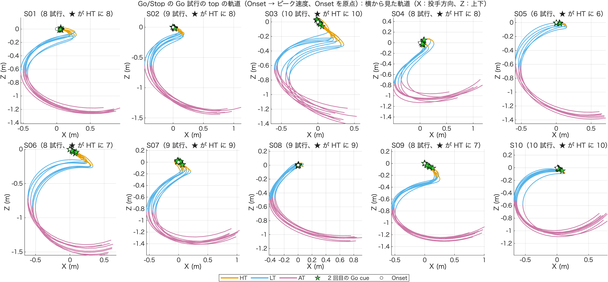
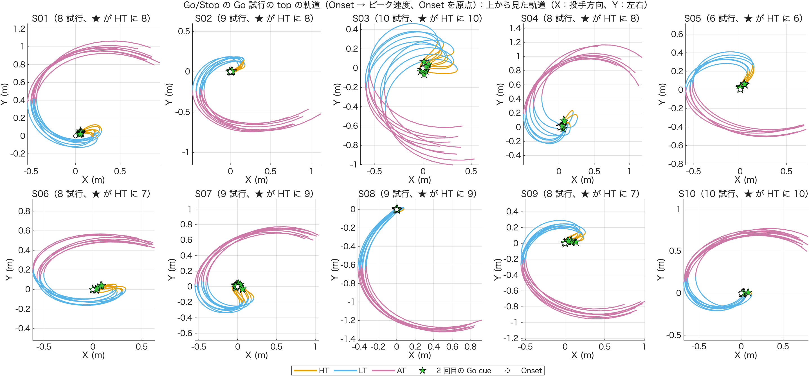

# Go/Stop の top の軌道と 2 回目の Go cue（技術説明）

作成：2026-11-09　加藤 和太郎（student）、Claude Code

## 1. 目的

Go/Stop の Go 試行すべてについて、バット先端（top）の軌道を局面（HT・LT・AT）で色分けして描き、2 回目の Go cue が点いた瞬間に ★ を付ける。2 回目の刺激が、スイングのどこで（バットがどこにあるときに）点いているかを、試行ごとに見る。

## 2. 計算の方法

| 項目 | 内容 |
|---|---|
| 試行 | x8 の除外のあとの、局面（HookTime_ms）がある Go/Stop の Go 試行 85 本（10 名） |
| top の前処理 | NaN の線形補間 → 30 Hz の 2 次 Butterworth で filtfilt → m（top_trajectory_3d と同じ） |
| 描く区間 | Onset → ピーク速度。原点は Onset の top の位置 |
| 局面の境目 | x8 の値をそのまま使う（統計と同じ区切り）。Onset（`SwingOnsetForce`、1000 Hz）をフレーム（250 Hz）に直し（m3 と同じ `round`）、+ `HookTime_ms` で HT の終わり、さらに + `LoopTime_ms` で LT の終わり、`TPeakVelTop` で AT の終わり |
| ★ 2 回目の Go cue | `LEDData(:,2)` で 1 回目の Go が点いたサンプル + 350。フレームに直すと端数が出るので、軌道を線形補間して ★ の位置を出す |
| 色 | HT 橙・LT 空色・AT 赤紫、★ は緑 |
| パネル | 被験者ごと（2 × 5）。上から見た図（X–Y）と横から見た図（X–Z）の 2 枚 |

局面の名前は、HT = フック（Onset → top が最も投手側に出た時点）、LT = ループ（→ 最も捕手側）、AT = 加速（→ ピーク速度）。

## 3. 結果

★ が来た局面：

| 局面 | 試行数 |
|---|---|
| Onset の前 | 3 本（S02・S06・S09 で 1 本ずつ） |
| **HT** | **82 本** |
| LT・AT・ピーク速度のあと | 0 本 |

被験者ごと（HT に入った本数 / 試行数）：S01 8/8、S02 8/9、S03 10/10、S04 8/8、S05 6/6、S06 7/8、S07 9/9、S08 9/9、S09 7/8、S10 10/10

### 読み取れること

- ★ はどの被験者でも原点（Onset）のすぐ近く。HT の間は top があまり動かない（橙の線が短い）ので、**2 回目の Go cue は、バットがまだ構えの近くにあるときに点いている**
- 上から見た図では、S02・S03・S05・S08・S09 と、S01・S04・S06・S07・S10 とで Y の向きが逆。2026-11-11 に、S01・S04・S06・S07・S10 が左打、S02・S03・S05・S08・S09 が右打と実験の記録で確かめた（[01_stride_fxfy](../01_stride_fxfy/技術説明.md) の 3.1 節。2026-11-09 の時点では「S02・S03… が左打者」と逆に書いていた）。この図では Y の向きをそろえていない





## 4. 使い方

1. 5 節のコードを、このフォルダに `plot_gostop_top_trajectory.m` という名前で保存する
2. MATLAB の現在のフォルダをこのフォルダにして実行する（x3 を 10 名分読むので数分かかる）
3. コマンドウィンドウに ★ が来た局面の数が出て、`output/` に PNG が 2 枚（`_xy_`・`_xz_`）保存される

条件を変えるときは、「設定」の `Cond` と、`S.DataArray(T.Trial(r), 4)` の 4（条件の列）を合わせて変える。

## 5. コード（plot_gostop_top_trajectory.m）

```matlab
% plot_gostop_top_trajectory.m
%
% Go/Stop の Go 試行すべてについて、バット先端（top）の軌道を Onset → ピーク速度まで描く。
% 線は局面（HT・LT・AT）で色を分け、2 回目の Go cue が点いた瞬間に ★ を付ける。
% 被験者ごとのパネル（2 × 5）を、上から見た図（X–Y）と横から見た図（X–Z）の 2 枚にする。
%
% 局面の境目：x8 の TrialTable の値をそのまま使う（統計と同じ区切り）
%   Onset      = SwingOnsetForce（1000 Hz のサンプル）をフレーム（250 Hz）に直す（m3 と同じ round）
%   HT の終わり = Onset + HookTime_ms、LT の終わり = さらに + LoopTime_ms、AT の終わり = TPeakVelTop
% 2 回目の Go cue：LEDData(:,2) で 1 回目の Go が点いたサンプル + 350（実験スクリプトの 0.1 s + 0.25 s）
%   フレームに直すと端数が出るので、軌道を線形補間して ★ の位置を出す
% top の前処理：NaN の線形補間 → 30 Hz の 2 次 Butterworth で filtfilt → m（top_trajectory_3d と同じ）
% 原点：Onset の top の位置
%
% 2026-11-09

%% 設定
Cond      = 'gostop' ;
T2ms      = 350 ;                        % 1 回目の Go → 2 回目の刺激 [ms]
PhaseName = {'HT', 'LT', 'AT'} ;
PhaseColor = [0.902 0.624 0.000 ;        % HT 橙
              0.337 0.706 0.914 ;        % LT 空色
              0.800 0.475 0.655] ;       % AT 赤紫
StarColor = [0.20 0.80 0.20] ;           % ★（2 回目の Go cue の色の緑）

scriptFolder   = fileparts(mfilename('fullpath')) ;
projectFolder  = fullfile(scriptFolder, '..', '..', '..', '..') ;   % Project002 のフォルダ
analysisFolder = fullfile(projectFolder, 'Experiments', 'Main experiments', '03_Analysis') ;
outFolder      = fullfile(scriptFolder, 'output') ;
addpath(analysisFolder) ;
Prm = parameters ;

%% 試行を選ぶ（x8 の除外のあと、局面がある Go/Stop の Go 試行）
load(fullfile(analysisFolder, 'x8_StatTable', 'StatTable.mat'), 'TrialTable') ;
T = TrialTable(TrialTable.IsGo & TrialTable.Condition == Cond & ~isnan(TrialTable.HookTime_ms), :) ;
Subjects = unique(T.Subject)' ;
fprintf('%s の Go 試行：%d 本（%d 名）\n', Cond, height(T), numel(Subjects)) ;

%% 試行ごとに軌道を取り出す
Traj = cell(height(T), 1) ;
StarPhase = strings(height(T), 1) ;
for iSubject = Subjects
    fprintf('S%02d の x3 を読み込み中...\n', iSubject) ;
    S = load(fullfile(analysisFolder, 'x3_DataChecked', sprintf('Data%02d.mat', iSubject)), 'DataArray') ;
    for r = find(T.Subject == iSubject)'
        Data = S.DataArray(T.Trial(r), 4) ;   % 4 = gostop
        fsA  = Data.AnalogFs ;
        fsM  = Data.FrameRate ;
        top  = prepMarker(Data.Markers.top, fsM, Prm.Fc) ;

        iOn   = max(1, round(T.SwingOnsetForce(r) / fsA * fsM)) ;
        iHook = iOn   + round(T.HookTime_ms(r) / 1000 * fsM) ;
        iBack = iHook + round(T.LoopTime_ms(r) / 1000 * fsM) ;
        iPk   = T.TPeakVelTop(r) ;

        tCue  = find(Data.LEDData(:,2) > Prm.Cue.GoThresholdV, 1, 'first') ;
        f2    = (tCue + T2ms / 1000 * fsA) / fsA * fsM ;              % 2 回目の Go cue（端数のあるフレーム）
        p2    = interp1((1:size(top,1))', top, f2) - top(iOn, :) ;

        Traj{r} = struct('P', top(iOn:iPk, :) - top(iOn, :), ...
                         'k', [1, iHook - iOn + 1, iBack - iOn + 1, iPk - iOn + 1], ...   % 区切り（Onset からのフレーム番号）
                         'p2', p2) ;
        if     f2 <  iOn,   StarPhase(r) = "Onset の前" ;
        elseif f2 <  iHook, StarPhase(r) = "HT" ;
        elseif f2 <  iBack, StarPhase(r) = "LT" ;
        elseif f2 <= iPk,   StarPhase(r) = "AT" ;
        else,               StarPhase(r) = "ピークのあと" ;
        end
    end
    clear S
end

fprintf('\n★（2 回目の Go cue）が来た局面：\n') ;
for c = ["Onset の前", "HT", "LT", "AT", "ピークのあと"]
    fprintf('  %-12s %3d 本\n', c, sum(StarPhase == c)) ;
end
G = groupsummary(table(T.Subject, StarPhase == "HT", 'VariableNames', {'Subject', 'InHT'}), 'Subject', 'sum', 'InHT') ;
fprintf('被験者ごと（HT に入った本数 / 試行数）：%s\n', strjoin(compose('S%02d %d/%d', [G.Subject, G.sum_InHT, G.GroupCount]), '、')) ;

%% 図（上から見た図・横から見た図）
View = {[1 2], '上から見た軌道（X：投手方向、Y：左右）', 'Y (m)', 'xy' ; ...
        [1 3], '横から見た軌道（X：投手方向、Z：上下）', 'Z (m)', 'xz'} ;
stamp = char(datetime('now', 'Format', 'yyyyMMdd_HHmm')) ;
if ~exist(outFolder, 'dir'), mkdir(outFolder) ; end
for iv = 1:size(View, 1)
    cols = View{iv, 1} ;
    fig = figure('Color', 'w', 'Position', [40 40 1500 650]) ;
    tl  = tiledlayout(fig, 2, 5, 'TileSpacing', 'compact', 'Padding', 'compact') ;
    title(tl, sprintf('Go/Stop の Go 試行の top の軌道（Onset → ピーク速度、Onset を原点）：%s', View{iv, 2}), 'FontSize', 11) ;
    for iSubject = Subjects
        ax = nexttile(tl) ; hold(ax, 'on') ; grid(ax, 'on') ; axis(ax, 'equal') ;
        rows = find(T.Subject == iSubject)' ;
        for r = rows
            P = Traj{r}.P ; k = Traj{r}.k ;
            for ip = 1:3
                seg = k(ip) : k(ip+1) ;
                plot(ax, P(seg, cols(1)), P(seg, cols(2)), '-', 'Color', PhaseColor(ip, :), 'LineWidth', 1.2) ;
            end
        end
        for r = rows   % ★ は線の上に描く
            p2 = Traj{r}.p2 ;
            plot(ax, p2(cols(1)), p2(cols(2)), 'p', 'MarkerSize', 11, 'MarkerFaceColor', StarColor, 'MarkerEdgeColor', 'k') ;
        end
        plot(ax, 0, 0, 'ko', 'MarkerFaceColor', 'w', 'MarkerSize', 5) ;
        title(ax, sprintf('S%02d（%d 試行、★ が HT に %d）', iSubject, numel(rows), sum(StarPhase(rows) == "HT")), 'FontWeight', 'normal') ;
        xlabel(ax, 'X (m)') ; ylabel(ax, View{iv, 3}) ;
    end
    % 凡例（最後のパネルの外に置く）
    lg = gobjects(1, 5) ;
    for ip = 1:3, lg(ip) = plot(ax, NaN, NaN, '-', 'Color', PhaseColor(ip, :), 'LineWidth', 2) ; end
    lg(4) = plot(ax, NaN, NaN, 'p', 'MarkerSize', 11, 'MarkerFaceColor', StarColor, 'MarkerEdgeColor', 'k') ;
    lg(5) = plot(ax, NaN, NaN, 'ko', 'MarkerFaceColor', 'w', 'MarkerSize', 5) ;
    l = legend(ax, lg, [PhaseName, {'2 回目の Go cue', 'Onset'}], 'Orientation', 'horizontal') ;
    l.Layout.Tile = 'south' ;
    exportgraphics(fig, fullfile(outFolder, sprintf('gostop_top_trajectory_%s_%s.png', View{iv, 4}, stamp)), 'Resolution', 200) ;
end
fprintf('output/ に PNG を 2 枚保存しました\n') ;

%% ローカル関数
function x = prepMarker(x, fs, fc)
% NaN を線形補間して、2 次 Butterworth で filtfilt し、m に直す（top_trajectory_3d と同じ）
t = (1:size(x,1))' ;
for col = 1:3
    nanIdx = isnan(x(:,col)) ;
    if any(nanIdx) && any(~nanIdx)
        x(nanIdx,col) = interp1(t(~nanIdx), x(~nanIdx,col), t(nanIdx), 'linear', 'extrap') ;
    end
end
[b, a] = butter(2, fc/(fs/2)) ;
x = filtfilt(b, a, x) / 1000 ;
end
```
