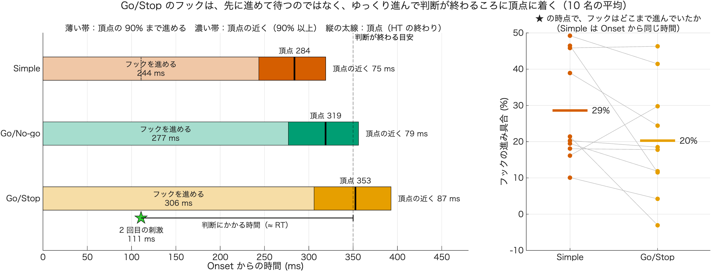
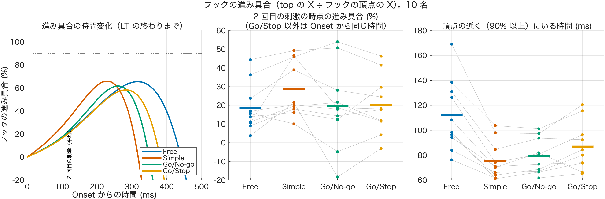

# フックの進み具合（技術説明）

作成：2026-11-09　加藤 和太郎（student）、Claude Code

## 1. 目的

[04_ht_after_cue](../04_ht_after_cue/技術説明.md) で、Go/Stop は平均では「2 回目の刺激から RT ほどたったころに LT に入る」ことがわかった。そこで、判断を待つ間のフックの進め方として、次の 2 つのどちらに近いかを調べる。

| 考え | 内容 | 予測 |
|---|---|---|
| (A) 先に進めて待つ | 判断を待つ間にフックを頂点の近くまで進めておき（いつでも振り出せる状態）、判断が終わったらすぐ LT に入る | 2 回目の刺激の時点で、フックは Simple より進んでいる。頂点の近くにいる時間が長い |
| (B) 引き延ばす | フック全体を大きく・ゆっくり進めて時間をかせぎ、判断が終わるころに頂点に着く | 2 回目の刺激の時点で、フックは Simple ほど進んでいない。頂点の近くにいる時間は変わらない |

## 2. 計算の方法

| 項目 | 内容 |
|---|---|
| 試行 | x8 の除外のあとの、局面と RT がある Go 試行（4 条件、10 名） |
| top の前処理 | NaN の線形補間 → 30 Hz の 2 次 Butterworth で filtfilt → m |
| 局面の境目 | x8 の `HookTime_ms`・`LoopTime_ms`（[03_gostop_top_trajectory](../03_gostop_top_trajectory/技術説明.md) と同じ） |
| 進み具合 | top の X（Onset を 0）÷ フックの頂点（HT の終わり）の X。頂点 = 100% |
| 比べる時刻 | Go/Stop は 2 回目の刺激の時点（Onset から 350 − RT ms）。ほかの条件は Onset から同じ時間（被験者ごとの Go/Stop の平均） |
| 90% に達した時刻 | Onset → 頂点の間で、進み具合が初めて 90% 以上になった時刻 |
| 頂点の近くにいる時間 | 90% に達してから、頂点のあと 90% を下回るまで |
| 外す試行 | フックの頂点の X が 20 mm 未満の 26 試行（S02・S07・S08・S10）。割り算が不安定になるため |

2 回目の刺激から RT ほどたった時刻（判断が終わる目安）は、試行ごとに (350 − RT) + RT = **Onset から 350 ms** になる。

出す値（1 行 1 試行、`output/hook_progress_trial_*.csv`）：`Tau_ms`（比べる時刻）、`HookX_m`（頂点の X）、`ProgAtCue`（比べる時刻の進み具合、1 = 100%）、`T90_ms`、`T90FromCue_ms`（2 回目の刺激から 90% まで）、`Dwell_ms`（頂点の近くにいる時間）、`TApex_ms`（頂点の時刻）

## 3. 結果（10 名、被験者平均の平均）

| 指標 | Free | Simple | Go/No-go | Go/Stop | Go/Stop − Simple |
|---|---|---|---|---|---|
| 2 回目の刺激の時点の進み具合 | 19% | 29% | 20% | 20% | −8%、p = .086（Go/Stop が大きい被験者 2/10） |
| 90% に達した時刻（Onset から） | 365 | 244 | 277 | 306 ms | +62 ms、p = .002 |
| 頂点の近く（90% 以上）にいる時間 | 112 | 75 | 79 | 87 ms | +11 ms、p = .003 |
| 頂点の時刻（HT） | 426 | 284 | 319 | 353 ms | +69 ms、p = .002 |
| フックの頂点の X | 0.184 | 0.109 | 0.123 | 0.158 m | +0.048 m、p = .006 |

p は対応のある t 検定（探索的）。HT が x8 の値（273 ms など）と少し違うのは、頂点が小さい試行を外したため。

- Go/Stop で 90% に達したのは、**85 本すべてで 2 回目の刺激のあと**（平均 195 ms 後、被験者の範囲 75〜297 ms）

### 読み取れること

- **(A)「先に進めて待つ」ではなかった**。2 回目の刺激の時点で、Go/Stop のフックは Simple よりむしろ進んでいない（20% vs 29%）。頂点の近くにいる時間の延長も 11 ms と小さい
- **(B)「引き延ばす」に近い**。Go/Stop のフックは大きく（0.158 m）・ゆっくり進み、判断が終わる目安（Onset から 350 ms）のころに頂点（353 ms）に着いて LT に入る





| ファイル | 内容 |
|---|---|
| `output/hook_progress_timeline.png` | わかりやすい図。条件ごとに、薄い帯 = 頂点の 90% まで進める、濃い帯 = 頂点の近く、縦の太線 = 頂点。Go/Stop の下に ★（2 回目の刺激）と判断にかかる時間。右は ★ の時点の進み具合（被験者ごと） |
| `output/hook_progress_*.png` | 計算用の図。左の進み具合の曲線は、試行ごとに頂点の時刻がずれるので、平均すると 100% に届かない（読み取りにくい） |

## 4. 注意すること

- 90% の基準と、外した 26 試行で結果が変わらないかは、まだ確かめていない（80%・95% で計算し直す、外した試行を入れて中央値で比べる、など）
- 進み具合は X（投手方向）だけで見ている。フックの頂点の近くでは、top は Y・Z 方向にも動いている

## 5. 使い方

1. 6 節の 2 つのコードを、このフォルダに `hook_progress_analysis.m`・`plot_hook_progress_timeline.m` という名前で保存する
2. MATLAB の現在のフォルダをこのフォルダにして、先に `hook_progress_analysis` を実行する（x3 を 10 名分読むので数分かかる）。コマンドウィンドウに 3 節の表が出て、`output/` に CSV と PNG が保存される
3. 続けて `plot_hook_progress_timeline` を実行する。`output/` の最新の CSV を読んで、`output/hook_progress_timeline.png` を作る

## 6. コード

### 6.1 hook_progress_analysis.m（計算）

```matlab
% hook_progress_analysis.m
%
% 「Go/Stop では、判断を待つ間にフックを先に進めておき、いつでも振り出せる状態で待っている」かを確かめる。
%   1. フックの進み具合：top の X（Onset を 0）÷ フックの頂点の X [%]
%      Go/Stop は 2 回目の刺激の時点（Onset から 350 − RT ms）、ほかの条件は Onset から同じ時間（被験者ごとの Go/Stop の平均）
%   2. 頂点の近くにいる時間：進み具合が 90% 以上の時間（初めて 90% に達してから、頂点のあと 90% を下回るまで）
%   3. 90% に達した時刻：Onset から [ms]。Go/Stop は 2 回目の刺激からの時間も出す
%
% 局面の境目は x8 の HookTime_ms・LoopTime_ms（統計と同じ区切り）。top は NaN の線形補間 → 30 Hz の filtfilt → m
% フックの頂点の X が MinHookM 未満の試行は、割り算が不安定になるので外す
%
% 2026-11-09

%% 設定
Subjects  = 1:10 ;
T2ms      = 350 ;       % 1 回目の Go → 2 回目の刺激 [ms]
Level     = 0.90 ;      % 「頂点の近く」の基準
MinHookM  = 0.02 ;      % フックの頂点の X がこれ未満の試行は外す [m]
CurveMs   = 600 ;       % 図：Onset から描く長さ
ConditionNameArray = {'free', 'simple', 'gonogo', 'gostop'} ;
ConditionLabel     = {'Free', 'Simple', 'Go/No-go', 'Go/Stop'} ;
ConditionColor     = [0.000 0.447 0.698 ; 0.835 0.369 0.000 ; 0.000 0.620 0.451 ; 0.902 0.624 0.000] ;

scriptFolder   = fileparts(mfilename('fullpath')) ;
projectFolder  = fullfile(scriptFolder, '..', '..', '..', '..') ;   % Project002 のフォルダ
analysisFolder = fullfile(projectFolder, 'Experiments', 'Main experiments', '03_Analysis') ;
outFolder      = fullfile(scriptFolder, 'output') ;
addpath(analysisFolder) ;
Prm = parameters ;

%% 試行を選ぶ（x8 の除外のあと、局面と RT がある Go 試行）
load(fullfile(analysisFolder, 'x8_StatTable', 'StatTable.mat'), 'TrialTable') ;
T = TrialTable(TrialTable.IsGo & ~isnan(TrialTable.HookTime_ms) & ~isnan(TrialTable.RTForce_ms) ...
    & ismember(TrialTable.Subject, Subjects), :) ;
% Go/Stop 以外の条件で使う「Onset から 2 回目の刺激まで」：被験者ごとの Go/Stop の平均
Gs  = T(T.Condition == "gostop", :) ;
Tau = groupsummary(table(Gs.Subject, T2ms - Gs.RTForce_ms, 'VariableNames', {'Subject', 'Tau'}), 'Subject', 'mean', 'Tau') ;

%% 試行ごとに計算する
fsM = 250 ;
nCurve = round(CurveMs / 1000 * fsM) + 1 ;
VarNames = {'Tau_ms', 'HookX_m', 'ProgAtCue', 'T90_ms', 'T90FromCue_ms', 'Dwell_ms', 'TApex_ms'} ;
V      = NaN(height(T), numel(VarNames)) ;
Curve  = NaN(height(T), nCurve) ;      % 進み具合（Onset から 4 ms ごと）
for iSubject = unique(T.Subject)'
    fprintf('S%02d の x3 を読み込み中...\n', iSubject) ;
    S = load(fullfile(analysisFolder, 'x3_DataChecked', sprintf('Data%02d.mat', iSubject)), 'DataArray') ;
    tauSub = Tau.mean_Tau(Tau.Subject == iSubject) ;
    for r = find(T.Subject == iSubject)'
        ic   = find(strcmp(ConditionNameArray, T.Condition(r))) ;
        Data = S.DataArray(T.Trial(r), ic) ;
        fsA  = Data.AnalogFs ;
        fsM  = Data.FrameRate ;
        top  = prepMarker(Data.Markers.top, fsM, Prm.Fc) ;

        iOn   = max(1, round(T.SwingOnsetForce(r) / fsA * fsM)) ;
        iHook = iOn   + round(T.HookTime_ms(r) / 1000 * fsM) ;
        iBack = iHook + round(T.LoopTime_ms(r) / 1000 * fsM) ;
        x     = top(:, 1) - top(iOn, 1) ;
        apex  = x(iHook) ;
        if apex < MinHookM, continue, end
        p = x / apex ;                                   % 進み具合（頂点 = 1）

        if ic == 4, tau = T2ms - T.RTForce_ms(r) ; else, tau = tauSub ; end
        pCue = interp1((0:numel(p)-iOn)' / fsM * 1000, p(iOn:end), tau) ;   % Onset から tau ms の進み具合

        k90   = find(p(iOn:iHook) >= Level, 1, 'first') + iOn - 1 ;          % 初めて 90% に達した
        kOut  = find(p(iHook:iBack) < Level, 1, 'first') + iHook - 1 ;       % 頂点のあと 90% を下回った
        t90   = (k90 - iOn) / fsM * 1000 ;
        dwell = (kOut - k90) / fsM * 1000 ;
        V(r, :) = [tau, apex, pCue, t90, t90 - tau, dwell, (iHook - iOn) / fsM * 1000] ;

        n = min(nCurve, numel(p) - iOn + 1) ;
        Curve(r, 1:n) = p(iOn : iOn + n - 1) ;
        Curve(r, (iBack - iOn + 2):end) = NaN ;          % LT の終わりより後は描かない
    end
    clear S
end
Res = [T(:, {'Subject', 'Condition', 'Trial'}), array2table(V, 'VariableNames', VarNames)] ;
drop = isnan(Res.HookX_m) ;
fprintf('\nフックの頂点が %.0f mm 未満で外した試行：%d 本（%s）\n', MinHookM * 1000, sum(drop), ...
    strjoin(compose('S%02d', unique(Res.Subject(drop))'), '・')) ;
Res = Res(~drop, :) ;  Curve = Curve(~drop, :) ;

%% 被験者ごとの平均と、条件の比較（Go/Stop と Simple は対応のある t 検定、探索的）
Mv = {'ProgAtCue', 'T90_ms', 'Dwell_ms', 'TApex_ms', 'HookX_m'} ;
G  = groupsummary(Res, {'Subject', 'Condition'}, 'mean', [Mv, {'T90FromCue_ms'}]) ;
subs = unique(Res.Subject)' ;
W = struct() ;
for v = [Mv, {'T90FromCue_ms'}]
    X = NaN(numel(subs), 4) ;
    for is = 1:numel(subs)
        for ic = 1:4
            g = G(G.Subject == subs(is) & string(G.Condition) == ConditionNameArray{ic}, :) ;
            if ~isempty(g), X(is, ic) = g.(['mean_' v{1}]) ; end
        end
    end
    W.(v{1}) = X ;
end
Lab = {'進み具合（2 回目の刺激の時点）', '90% に達した時刻（Onset から, ms）', '頂点の近くにいる時間（ms）', ...
       '頂点の時刻 = HT（ms）', 'フックの頂点の X（m）'} ;
fprintf('\n被験者平均の平均（%d 名）       Free     Simple   Go/No-go  Go/Stop | Go/Stop − Simple\n', numel(subs)) ;
for iv = 1:numel(Mv)
    X = W.(Mv{iv}) ;
    ok = ~isnan(X(:, 2)) & ~isnan(X(:, 4)) ;
    [~, pv, ~, st] = ttest(X(ok, 4), X(ok, 2)) ;
    fprintf('%-30s %8.3f %8.3f %8.3f %8.3f | %+8.3f  t(%d) = %5.2f, p = %.3f、Go/Stop が大きい被験者 %d/%d\n', ...
        Lab{iv}, mean(X, 'omitnan'), mean(X(ok, 4) - X(ok, 2)), st.df, st.tstat, pv, sum(X(ok, 4) > X(ok, 2)), sum(ok)) ;
end
X = W.T90FromCue_ms(:, 4) ;
fprintf('Go/Stop：90%% に達した時刻（2 回目の刺激から）  平均 %.0f ms（被験者の範囲 %.0f〜%.0f）\n', mean(X, 'omitnan'), min(X), max(X)) ;
fprintf('Go/Stop：90%% に達したのが 2 回目の刺激より前の試行  %d / %d 本\n', ...
    sum(Res.T90FromCue_ms(Res.Condition == "gostop") < 0), sum(Res.Condition == "gostop")) ;

%% 図
fig = figure('Color', 'w', 'Position', [60 60 1450 430]) ;
tl  = tiledlayout(fig, 1, 3, 'TileSpacing', 'compact') ;
title(tl, sprintf('フックの進み具合（top の X ÷ フックの頂点の X）。%d 名', numel(subs))) ;
tAx = (0:nCurve-1) / fsM * 1000 ;

% 左：進み具合の時間変化（Onset から、被験者平均の平均）
ax = nexttile(tl) ; hold(ax, 'on') ; grid(ax, 'on') ;
h = gobjects(1, 4) ;
for ic = 1:4
    Ms = [] ;
    for s = subs
        k = Res.Subject == s & Res.Condition == ConditionNameArray{ic} ;
        if any(k), Ms(end+1, :) = mean(Curve(k, :), 1, 'omitnan') ; end %#ok<SAGROW>
    end
    h(ic) = plot(ax, tAx, 100 * mean(Ms, 1, 'omitnan'), '-', 'Color', ConditionColor(ic, :), 'LineWidth', 2) ;
end
xline(ax, mean(Tau.mean_Tau), 'k--', '2 回目の刺激（平均）', 'LabelVerticalAlignment', 'bottom', 'FontSize', 8) ;
yline(ax, 100 * Level, 'k:') ;
xlabel(ax, 'Onset からの時間 (ms)') ; ylabel(ax, 'フックの進み具合 (%)') ;
ylim(ax, [-20 110]) ;
legend(ax, h, ConditionLabel, 'Location', 'southeast') ;
title(ax, '進み具合の時間変化（LT の終わりまで）', 'FontWeight', 'normal') ;

% 中央・右：被験者ごとの平均（線で結ぶ）
for iv = [1 3]
    ax = nexttile(tl) ; hold(ax, 'on') ; grid(ax, 'on') ;
    X = W.(Mv{iv}) ;
    if iv == 1, X = 100 * X ; end
    plot(ax, 1:4, X', '-', 'Color', [0.75 0.75 0.75]) ;
    for ic = 1:4
        scatter(ax, ic * ones(size(X, 1), 1), X(:, ic), 20, ConditionColor(ic, :), 'filled') ;
        plot(ax, ic + [-0.25 0.25], mean(X(:, ic), 'omitnan') * [1 1], '-', 'Color', ConditionColor(ic, :), 'LineWidth', 3) ;
    end
    ax.XTick = 1:4 ; ax.XTickLabel = ConditionLabel ; xlim(ax, [0.5 4.5]) ;
    if iv == 1
        title(ax, {'2 回目の刺激の時点の進み具合 (%)', '（Go/Stop 以外は Onset から同じ時間）'}, 'FontWeight', 'normal') ;
    else
        title(ax, sprintf('頂点の近く（%.0f%% 以上）にいる時間 (ms)', 100 * Level), 'FontWeight', 'normal') ;
    end
end

if ~exist(outFolder, 'dir'), mkdir(outFolder) ; end
stamp = char(datetime('now', 'Format', 'yyyyMMdd_HHmm')) ;
exportgraphics(fig, fullfile(outFolder, sprintf('hook_progress_%s.png', stamp)), 'Resolution', 200) ;
writetable(Res, fullfile(outFolder, sprintf('hook_progress_trial_%s.csv', stamp))) ;
fprintf('output/ に PNG と CSV を保存しました\n') ;

%% ローカル関数
function x = prepMarker(x, fs, fc)
% NaN を線形補間して、2 次 Butterworth で filtfilt し、m に直す（top_trajectory_3d と同じ）
t = (1:size(x,1))' ;
for col = 1:3
    nanIdx = isnan(x(:,col)) ;
    if any(nanIdx) && any(~nanIdx)
        x(nanIdx,col) = interp1(t(~nanIdx), x(~nanIdx,col), t(nanIdx), 'linear', 'extrap') ;
    end
end
[b, a] = butter(2, fc/(fs/2)) ;
x = filtfilt(b, a, x) / 1000 ;
end
```

### 6.2 plot_hook_progress_timeline.m（わかりやすい図）

```matlab
% plot_hook_progress_timeline.m
%
% hook_progress_analysis.m の結果（output/hook_progress_trial_*.csv の最新）から、わかりやすい図を 1 枚作る。
%   左：Onset からの時間軸に、フックを進めている間（→ 90%）と頂点の近く（90% 以上）を条件ごとの帯で描く。
%       Go/Stop には 2 回目の刺激（★）と、そこから RT ほどたった時刻（判断が終わる目安）を描く。
%       ★ から RT たった時刻は、試行ごとに (350 − RT) + RT = 350 ms（Onset から）になる。
%   右：★ の時点のフックの進み具合。Go/Stop と、Simple の Onset から同じ時間（被験者ごと、線で結ぶ）。
% 値は被験者平均の平均（帯）と被験者ごとの平均（右）。
%
% 2026-11-09

%% データ
scriptFolder = fileparts(mfilename('fullpath')) ;
f = dir(fullfile(scriptFolder, 'output', 'hook_progress_trial_*.csv')) ;
[~, k] = max([f.datenum]) ;
Res = readtable(fullfile(f(k).folder, f(k).name), 'TextType', 'string') ;
Res.Leave_ms = Res.T90_ms + Res.Dwell_ms ;

Cond  = {'simple', 'gonogo', 'gostop'} ;
Label = {'Simple', 'Go/No-go', 'Go/Stop'} ;
Color = [0.835 0.369 0.000 ; 0.000 0.620 0.451 ; 0.902 0.624 0.000] ;
G = groupsummary(Res, {'Subject', 'Condition'}, 'mean', {'T90_ms', 'TApex_ms', 'Leave_ms', 'Tau_ms', 'ProgAtCue'}) ;
nC = numel(Cond) ;
M  = NaN(nC, 4) ;     % 90% に達した・頂点・90% を下回った・★（Onset から ms）
for ic = 1:nC
    g = G(G.Condition == Cond{ic}, :) ;
    M(ic, :) = [mean(g.mean_T90_ms), mean(g.mean_TApex_ms), mean(g.mean_Leave_ms), mean(g.mean_Tau_ms)] ;
end
subs = unique(G.Subject)' ;
P = NaN(numel(subs), 2) ;   % ★ の時点の進み具合：Simple・Go/Stop
for is = 1:numel(subs)
    for j = 1:2
        g = G(G.Subject == subs(is) & G.Condition == Cond{2*j - 1}, :) ;   % simple（1）・gostop（3）
        if ~isempty(g), P(is, j) = 100 * g.mean_ProgAtCue ; end
    end
end

%% 図
fig = figure('Color', 'w', 'Position', [60 60 1350 470]) ;
tl  = tiledlayout(fig, 1, 3, 'TileSpacing', 'loose') ;
title(tl, sprintf('Go/Stop のフックは、先に進めて待つのではなく、ゆっくり進んで判断が終わるころに頂点に着く（%d 名の平均）', numel(subs)), ...
    'FontSize', 12) ;

% 左（2 タイル分）：時間の帯
ax = nexttile(tl, [1 2]) ; hold(ax, 'on') ;
yPos = nC:-1:1 ;
h = 0.36 ;
for ic = 1:nC
    y = yPos(ic) ;
    rectangle(ax, 'Position', [0, y - h/2, M(ic,1), h], 'FaceColor', 0.35 * Color(ic,:) + 0.65, 'EdgeColor', 'k') ;
    rectangle(ax, 'Position', [M(ic,1), y - h/2, M(ic,3) - M(ic,1), h], 'FaceColor', Color(ic,:), 'EdgeColor', 'k') ;
    plot(ax, M(ic,2) * [1 1], y + [-h/2 h/2], 'k-', 'LineWidth', 2) ;
    text(ax, M(ic,2), y + h/2 + 0.04, sprintf('頂点 %.0f', M(ic,2)), 'HorizontalAlignment', 'center', 'VerticalAlignment', 'bottom', 'FontSize', 9) ;
    text(ax, M(ic,1)/2, y, sprintf('フックを進める\n%.0f ms', M(ic,1)), 'HorizontalAlignment', 'center', 'FontSize', 9) ;
    text(ax, M(ic,3) + 8, y, sprintf('頂点の近く %.0f ms', M(ic,3) - M(ic,1)), 'VerticalAlignment', 'middle', 'FontSize', 9) ;
end
% ★（2 回目の刺激）と、判断が終わる目安（Onset から 350 ms）
yG = yPos(3) ;
tau = M(3, 4) ;
plot(ax, tau, yG - h/2 - 0.12, 'p', 'MarkerSize', 16, 'MarkerFaceColor', [0.2 0.8 0.2], 'MarkerEdgeColor', 'k') ;
text(ax, tau, yG - h/2 - 0.25, sprintf('2 回目の刺激\n%.0f ms', tau), 'HorizontalAlignment', 'center', 'VerticalAlignment', 'top', 'FontSize', 9) ;
plot(ax, [tau 350], (yG - h/2 - 0.12) * [1 1], 'k-', 'LineWidth', 1) ;
plot(ax, 350 * [1 1], yG - h/2 - 0.12 + [-0.05 0.05], 'k-', 'LineWidth', 1) ;
text(ax, (tau + 350)/2, yG - h/2 - 0.17, '判断にかかる時間（≈ RT）', 'HorizontalAlignment', 'center', 'VerticalAlignment', 'top', 'FontSize', 9) ;
xline(ax, 350, 'k--', '判断が終わる目安', 'LabelVerticalAlignment', 'top', 'LabelOrientation', 'horizontal', 'FontSize', 9) ;
% Simple の同じ時刻
plot(ax, tau * [1 1], yPos(1) + [-h/2 h/2], ':', 'Color', [0.2 0.2 0.2], 'LineWidth', 1.2) ;
xlim(ax, [0 480]) ; ylim(ax, [0.2, nC + 0.55]) ;
ax.YTick = 1:nC ; ax.YTickLabel = flip(Label) ; ax.YAxis.TickLength = [0 0] ;
ax.XGrid = 'on' ; ax.GridAlpha = 0.12 ; ax.FontSize = 10 ;
xlabel(ax, 'Onset からの時間 (ms)') ;
title(ax, '薄い帯：頂点の 90% まで進める　濃い帯：頂点の近く（90% 以上）　縦の太線：頂点（HT の終わり）', 'FontWeight', 'normal', 'FontSize', 10) ;

% 右：★ の時点の進み具合
ax = nexttile(tl) ; hold(ax, 'on') ; grid(ax, 'on') ;
plot(ax, 1:2, P', '-', 'Color', [0.7 0.7 0.7]) ;
cc = Color([1 3], :) ;
for j = 1:2
    scatter(ax, j * ones(numel(subs), 1), P(:, j), 30, cc(j, :), 'filled') ;
    plot(ax, j + [-0.2 0.2], mean(P(:, j), 'omitnan') * [1 1], '-', 'Color', cc(j, :), 'LineWidth', 3) ;
    text(ax, j + 0.25, mean(P(:, j), 'omitnan'), sprintf('%.0f%%', mean(P(:, j), 'omitnan')), 'FontSize', 10) ;
end
ax.XTick = 1:2 ; ax.XTickLabel = {'Simple', 'Go/Stop'} ; xlim(ax, [0.5 2.6]) ;
ylabel(ax, 'フックの進み具合 (%)') ; ax.FontSize = 10 ;
title(ax, {'★ の時点で、フックはどこまで進んでいたか', '（Simple は Onset から同じ時間）'}, 'FontWeight', 'normal', 'FontSize', 10) ;

exportgraphics(fig, fullfile(scriptFolder, 'output', 'hook_progress_timeline.png'), 'Resolution', 200) ;
fprintf('output/hook_progress_timeline.png を保存しました\n') ;
disp(array2table(round(M), 'RowNames', Label, 'VariableNames', {'T90', 'Apex', 'Leave', 'Tau'})) ;
```
