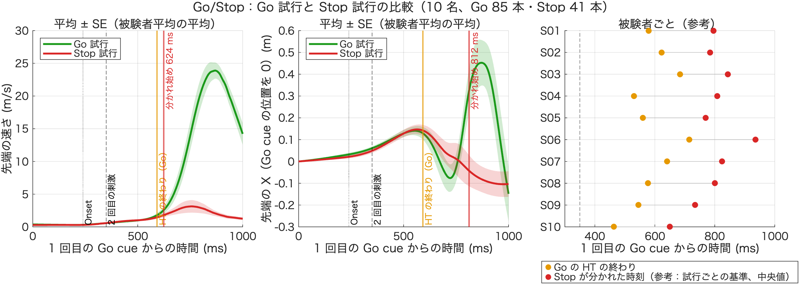
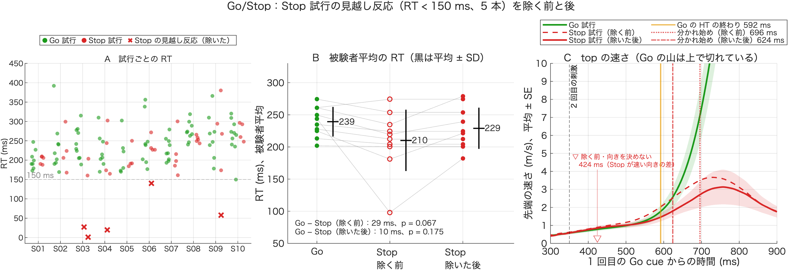
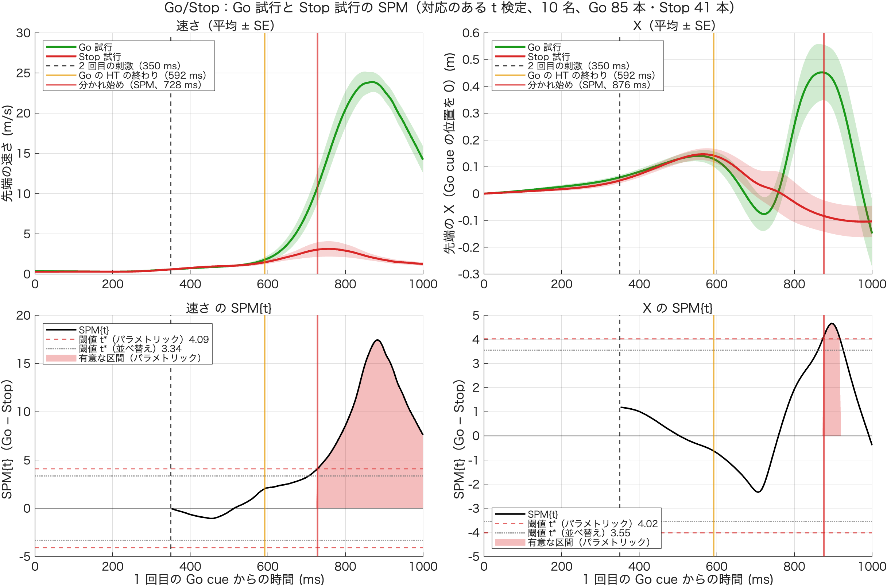

# Go 試行と Stop 試行の比較（技術説明）

作成：2026-11-09（保存 2026-11-10、更新 2026-11-11）　加藤 和太郎（student）、Claude Code

## 1. 目的

Go/Stop 条件で、2 回目の刺激のあとに **Go 試行と Stop 試行のバットの動きがいつ分かれるか**を調べる。分かれる時刻が HT の中なら、HT の間に判断が動きに表れていると言える。HT の終わりのあとなら、判断は「LT に進むか止まるか」に表れていると言える。

## 2. 計算の方法

| 項目 | 内容 |
|---|---|
| 試行 | Go/Stop 条件のみ（10 名）。Go 試行 = x8 の除外のあと MT と HT がある 85 本。Stop 試行 = Onset（`SwingOnsetForce`）があり、top の品質に問題がなく（`~IsBadTop`）、RT ≥ 150 ms の 41 本（Stop 試行 51 本のうち） |
| 時刻のそろえ方 | 1 回目の Go cue（LED ch2 が 2 V を超えた時点）を 0。2 回目の刺激は Go でも Stop でも 350 ms |
| top の前処理 | NaN の線形補間 → 30 Hz の 2 次 Butterworth で filtfilt → m |
| 比べる曲線 | top の速さ（中心差分、250 Hz）と、top の X（Go cue の時点の位置を 0）。−100〜1000 ms を 4 ms ごとに補間 |
| 分かれ始めた時刻（主に使う） | 被験者ごとに Go・Stop の平均の曲線を作り、各時刻で 10 名の対応のある t 検定。2 回目の刺激（350 ms）より後で、p < .05 が 20 ms 続いた最初の時刻 |
| 分かれた時刻（参考） | Stop 試行ごとに、同じ被験者の Go 試行の速さの「平均 − 2 SD」を下回り、20 ms 続いた最初の時刻 |
| 比べる相手 | Go 試行の HT の終わり（Go cue から RT + HT、被験者平均の平均） |

Stop 試行の RT ≥ 150 ms：x8 の見越し反応の印（`IsShortRT`、RT < 150 ms）は Go 試行にしか付かないので、Stop 試行はここで除く。2026-11-10 の版ではこれを除いておらず、Stop 試行に見越し反応が 5 本入っていた。そのため Stop の振り始めが早く見え（RT 210 vs 239 ms）、向きを決めずに比べると 424 ms に「Stop のほうが速い」差が出ていた。それを避けるため、速さは「Stop のほうが遅い」向きの差だけを数えていた。見越し反応を除くとこの差は消えるので、2026-11-11 に向きの限定もやめた（4.1 節）。

出す値（1 行 1 試行、`output/compare_go_stop_trial.csv`）：`Subject`、`Trial`、`CueText`（Go / Stop）、`RTForce_ms`、`HookTime_ms`、`TDiv_ms`（Stop 試行が分かれた時刻、参考の基準。Go 試行は NaN）

## 3. 結果（10 名）

| 指標 | 値 |
|---|---|
| RT（被験者平均の平均） | Go 239 ms、Stop 229 ms（p = .175） |
| Go の HT の終わり | Go cue から 592 ms |
| **速さが分かれ始めた時刻** | **Go cue から 624 ms**（2 回目の刺激から 274 ms、Go の HT の終わりの約 30 ms 後） |
| X が分かれ始めた時刻 | Go cue から 812 ms（2 回目の刺激から 462 ms） |
| （参考）Stop 試行ごとの基準 | 被験者の中央値の平均 795 ms（2 回目の刺激から 445 ms）。Go の HT の終わりより前の被験者 0/10。分かれた Stop 試行 40/41 本、そのうち HT の終わりより前 3 本 |



- 左：速さ、中：X（平均 ± SE）。緑 = Go 試行、赤 = Stop 試行。縦線は Onset（点線）・2 回目の刺激（破線）・Go の HT の終わり（橙）・分かれ始め（赤）
- 右：被験者ごとの Go の HT の終わり（橙）と、Stop が分かれた時刻（赤、参考の基準）
- 2026-11-11 に、Stop 試行の見越し反応 5 本を除いた版に差し替えた（元の版は 696 ms・824 ms。4.1 節）

### 読み取れること

- **HT が終わるまで（約 600 ms まで）、Go と Stop の動きはほぼ同じ**。HT の間に、Stop が遅くなる向きの差は見られない
- HT の終わりの約 30 ms 後から、Go は一気に加速し、Stop は加速しない（Stop の速さのピークは約 3 m/s）
- 止めるかどうかの判断は、HT の間の動きには表れず、**HT から LT に移るところで表れる**。[04_ht_after_cue](../04_ht_after_cue/技術説明.md) の「HT の終わり ≈ 2 回目の刺激 + RT」と合わせると、「HT の間に 2 回目の刺激を処理し、HT の終わりで進む（LT に入る）か止まるかが分かれる」と読める
- [05_hook_progress](../05_hook_progress/技術説明.md) の「フックは前もって大きく・ゆっくり計画されている」とも矛盾しない

p 値は MATLAB で出した確認用の値で、本番の統計（JASP）ではない。

## 4. 注意すること

- 2026-11-10 の版では、Stop 試行の振り始めが早かった（210 vs 239 ms）。原因は、Stop 試行に RT < 150 ms の見越し反応が 5 本残っていたことで、2026-11-11 に除いた（4.1 節）。外れた Stop 試行に、振り始めが遅い試行が偏って入っていることはなかった
- 被験者 10 名、Stop 試行は 1 人 2〜5 本と少ない（S03 は 2 本）
- 分かれ始めの時刻は基準（p < .05、20 ms 続く）の決め方で変わる。試行ごとの基準（−2 SD）は、Go の加速の時期のばらつきで SD が大きくなり、遅めに出る
- 時刻ごとの t 検定は多重比較の補正をしていない。→ 2026-11-11 に SPM で確かめた（4.2 節。分かれ始めは 705〜728 ms）

### 4.1 選ばれ方の偏りの確認（2026-11-11）

**外れた Stop 試行（51 本中 5 本）**

| 試行 | 外れた理由 | 踏み込み足の接地（Go cue から） | top の速さの最大 | 様子 |
|---|---|---|---|---|
| S02 T7 | Onset なし | 367 ms | 1.8 m/s | 止めた |
| S03 T11 | Onset なし | 321 ms | 29.2 m/s | 振り切った（止め損ね） |
| S05 T2 | Onset なし | 265 ms | 3.4 m/s | 止めた |
| S05 T6 | Onset なし | 375 ms | 13.7 m/s | 途中まで振った |
| S10 T9 | top の欠け（`IsBadTop`） | 697 ms | 2.5 m/s | 止めた。RT 416 ms |

- Onset のない 4 本は、**踏み込み足の接地がとても早かった**（265〜375 ms。ほかの試行はおよそ 470〜700 ms）。Onset は「Go cue → 踏み込み足の接地」の区間で Fx から探すため（`m3_analyze_single_trial.m`）、区間が短いと見つからない。振り始めが遅くて止めた試行ではなく、むしろ早く動いた試行と考えられる
- 「振り始めが遅かった Stop 試行が外れた」という偏りは見られなかった。RT が長い試行で外れたのは S10 T9（416 ms）の 1 本だけ

**Stop 試行に残っていた見越し反応**

x8 の `IsShortRT`（RT < 150 ms）は Go 試行にしか付けていない（`T.IsShortRT = (T.CueText == "Go") & ...`）。そのため、Stop 試行には次の 5 本が残っていた。

| 試行 | RT |
|---|---|
| S03 T3 | 27 ms |
| S03 T13 | 1 ms |
| S04 T14 | 20 ms |
| S06 T6 | 140 ms |
| S09 T6 | 58 ms |

**RT の比べ直し（被験者平均の平均、対応のある t 検定）**

| 試行の選び方 | Go | Stop | 差 | p |
|---|---|---|---|---|
| 元の選び方（2026-11-10 の版） | 239 ± 23 ms（85 本） | 210 ± 48 ms（46 本） | 29 ms | .067 |
| Stop も RT ≥ 150 ms | 239 ± 23 ms（85 本） | 229 ± 32 ms（41 本） | 10 ms | .175 |
| RT だけで選ぶ（両方 RT ≥ 150 ms、top は問わない） | 239 ± 23 ms（87 本） | 232 ± 37 ms（42 本） | 8 ms | .390 |

- 2 回目の刺激（350 ms）は振り始め（約 230 ms）より後なので、Go と Stop の RT に本来差は出ないはず。見越し反応を除くと差はほぼなくなる

**図（`output/gostop_bias_check.png`、コードは 6.2 節）**



- A：試行ごとの RT。緑 = Go 試行、赤 = Stop 試行、× = Stop の見越し反応（除いた 5 本）。破線は 150 ms
- B：被験者平均の RT。Go と、Stop（除く前：白抜き、除いた後：塗り）を被験者ごとに線で結んだ。黒は平均 ± SD。除く前は S03 の Stop が約 100 ms まで下がり、平均を引き下げていた
- C：top の速さ（平均 ± SE、帯は Go と除いた後の Stop）。赤の破線 = 除く前の Stop、赤の実線 = 除いた後の Stop。縦線は Go の HT の終わり（橙）、分かれ始め（除く前：点線、除いた後：一点鎖線）。▽ は、除く前に向きを決めずに比べたときに出た 424 ms の差（Stop が速い向き）。除く前の Stop の曲線は、400〜600 ms で Go より少し上にある

**分かれ始めた時刻の出し直し（Stop も RT ≥ 150 ms、Go 85 本・Stop 41 本）**

| | 元の選び方 | 見越し反応を除く |
|---|---|---|
| 速さが分かれ始めた時刻（Stop が遅い向きだけ） | 696 ms | **624 ms**（2 回目の刺激から 274 ms） |
| 速さ（向きを決めない） | 424 ms（Stop のほうが速い向き） | **624 ms** |
| X が分かれ始めた時刻 | 824 ms | 812 ms |
| Go の HT の終わり | 592 ms | 592 ms |
| （参考）Stop 試行ごとの基準 | 795 ms | 795 ms |

- 見越し反応を除くと、424 ms の「Stop のほうが速い」差は消え、向きの限定がなくても同じ 624 ms になる。**向きの限定は要らなくなる**
- 速さが分かれ始めるのは **Go の HT の終わり（592 ms）の約 30 ms 後**（元は約 100 ms 後）。「HT が終わるまでは同じで、HT から LT に移るところで分かれる」という読み取りは変わらず、むしろはっきりする
- 2026-11-11 に、この版を 2・3・6 節に反映した（`T.Use` の Stop 側に `& T.RTForce_ms >= Prm.RT.FloorMs` を足し、向きの限定を外した）

### 4.2 SPM（spm1d）での確認（2026-11-11）

3 節の分かれ始めの時刻は、時刻ごとの対応のある t 検定で、多重比較の補正をしていない。そこで、同じ曲線（被験者平均、10 名、Go 85 本・Stop 41 本）を SPM の対応のある t 検定で比べ直した（2 回目の刺激〜1000 ms、α = .05、両側）。パラメトリック（ランダム場理論）と並べ替え（10 名なので全 1024 通り）の両方で出した。

| | 速さ | X |
|---|---|---|
| 補正なしの時刻ごとの t 検定（3 節） | 624 ms | 812 ms |
| SPM パラメトリック | **728 ms**（t* = 4.09、728〜1000 ms、p < .001） | 873 ms（t* = 4.02、873〜917 ms、p = .020） |
| SPM 並べ替え | **705 ms**（t* = 3.34、705〜1000 ms、p < .001） | 860 ms（t* = 3.55、860〜926 ms、p < .001） |
| Go の HT の終わり | 592 ms | 592 ms |



- 上：平均 ± SE（緑 = Go、赤 = Stop）。縦線は 2 回目の刺激（黒の破線）、Go の HT の終わり（橙）、SPM の分かれ始め（赤）
- 下：SPM{t}（Go − Stop）。赤の破線 = パラメトリックの閾値 t*、灰の点線 = 並べ替えの t*、赤い塗り = パラメトリックで有意な区間。縦線の説明は凡例にまとめた
- 多重比較を考えると閾値が上がるので、分かれ始めは補正なしより 80〜100 ms 遅い（705〜728 ms、Go の HT の終わりの 110〜140 ms 後）。**HT の間は分かれず、HT の終わりより後に分かれるという結論は変わらない**
- 2 回目の刺激〜HT の終わりの SPM{t} は −1〜+2 で、閾値から遠い
- 並べ替え（正規性を仮定しない）でもほぼ同じなので、10 名でも結論は安定している
- 論文で集団の分かれ始めを示すなら、SPM の値を使うほうが説明しやすい（どちらを主にするかは未定）
- spm1d：https://github.com/0todd0000/spm1dmatlab の 2026-09-18 の版（M.0.4.53）で確認した。`spm1dmatlab` と、その中の `spm8` フォルダの両方をパスに足す必要がある
- 文献（引用前に原典を確認すること）：Pataky (2010) J Biomech（SPM の 1 次元への応用）

## 5. 使い方

1. 6.1 節のコードを、このフォルダに `compare_go_stop.m` という名前で保存する
2. MATLAB の現在のフォルダをこのフォルダにして、`compare_go_stop` を実行する（x3 を 10 名分読むので数分かかる）。コマンドウィンドウに 3 節の値と被験者ごとの表が出て、`output/` に `compare_go_stop.png`・`compare_go_stop_trial.csv` が保存される
3. 4.1 節の図は、6.2 節のコードを `plot_gostop_bias_check.m` という名前でこのフォルダに保存して実行する。`output/gostop_bias_check.png` が保存される
4. 4.2 節の SPM は、spm1dmatlab をこのフォルダに置き（または `spm1dFolder` を置いた場所に直す）、6.3 節のコードを `spm_go_stop.m` として保存して実行する。`output/spm_go_stop.png` が保存され、コマンドウィンドウにクラスターの範囲と p 値が出る

## 6. コード

### 6.1 compare_go_stop.m

```matlab
% compare_go_stop.m
%
% Go/Stop 条件の Go 試行と Stop 試行で、バット先端（top）の動きがいつ分かれるかを調べる。
% 1 回目の Go cue を 0 にそろえる（2 回目の刺激は Go でも Stop でも 350 ms 後）。
%
% 分かれ始めた時刻（主に使う）：
%   被験者ごとに Go 試行・Stop 試行の平均の曲線を作り、各時刻で 10 名の対応のある t 検定をする。
%   2 回目の刺激より後で、p < .05 が MinDurMs 続いた最初の時刻（速さと X のそれぞれ）。
% 分かれた時刻（Stop 試行ごと、参考）：
%   同じ被験者の Go 試行の速さの「平均 − 2 SD」を Stop 試行の速さが下回り、MinDurMs 続いた最初の時刻。
%   Go 試行は振り始めのばらつきで加速の時期がずれ、SD が大きくなるので、この基準は遅めに出る
% 比べる相手：Go 試行の HT の終わり（Go cue から、RT + HT の平均）
%
% 試行：Go 試行 = x8 の除外のあと MT がある Go 試行。Stop 試行 = Onset があり、top の品質に問題がなく、RT ≥ 150 ms の試行
%   （x8 の IsShortRT は Go 試行にしか付かないので、Stop 試行の見越し反応はここで除く）
% top：NaN の線形補間 → 30 Hz の 2 次 Butterworth で filtfilt → m。速さは中心差分（250 Hz）
%
% 2026-11-09（2026-11-11：Stop 試行の見越し反応を除き、速さの向きの限定をやめた）

%% 設定
T2ms     = 350 ;
WinMs    = [-100 1000] ;    % Go cue からの範囲
MinDurMs = 20 ;             % 下回った状態が続く長さ
NSD      = 2 ;

scriptFolder   = fileparts(mfilename('fullpath')) ;
projectFolder  = fullfile(scriptFolder, '..', '..', '..', '..') ;   % Project002 のフォルダ
analysisFolder = fullfile(projectFolder, 'Experiments', 'Main experiments', '03_Analysis') ;
outFolder      = fullfile(scriptFolder, 'output') ;
addpath(analysisFolder) ;
Prm = parameters ;
load(fullfile(analysisFolder, 'x8_StatTable', 'StatTable.mat'), 'TrialTable') ;
T = TrialTable(TrialTable.Condition == "gostop", :) ;
T.Use = (T.CueText == "Go"   & ~isnan(T.MT_ms) & ~isnan(T.HookTime_ms)) | ...
        (T.CueText == "Stop" & ~isnan(T.SwingOnsetForce) & ~T.IsBadTop & T.RTForce_ms >= Prm.RT.FloorMs) ;
T = T(T.Use, :) ;
Subjects = unique(T.Subject)' ;

fsM  = 250 ;
tAx  = (WinMs(1) : 1000/fsM : WinMs(2))' ;   % Go cue からの時刻 [ms]（4 ms ごと）
nT   = numel(tAx) ;
Spd  = NaN(height(T), nT) ;                   % top の速さ [m/s]
PosX = NaN(height(T), nT) ;                   % top の X（Go cue の位置を 0）[m]

%% 試行ごとに曲線を取り出す
for iSubject = Subjects
    fprintf('S%02d の x3 を読み込み中...\n', iSubject) ;
    S = load(fullfile(analysisFolder, 'x3_DataChecked', sprintf('Data%02d.mat', iSubject)), 'DataArray') ;
    for r = find(T.Subject == iSubject)'
        Data = S.DataArray(T.Trial(r), 4) ;
        fsA = Data.AnalogFs ;  fsMk = Data.FrameRate ;
        top = prepMarker(Data.Markers.top, fsMk, Prm.Fc) ;
        v   = [NaN(1,3) ; (top(3:end,:) - top(1:end-2,:)) * fsMk / 2 ; NaN(1,3)] ;
        sp  = sqrt(sum(v.^2, 2)) ;
        tCue = find(Data.LEDData(:,2) > Prm.Cue.GoThresholdV, 1, 'first') ;
        tM   = ((1:size(top,1))' / fsMk * fsA - tCue) / fsA * 1000 ;   % 各フレームの Go cue からの時刻
        Spd(r, :)  = interp1(tM, sp, tAx) ;
        x0         = interp1(tM, top(:,1), 0) ;
        PosX(r, :) = interp1(tM, top(:,1), tAx) - x0 ;
    end
    clear S
end

%% 分かれ始めた時刻（被験者平均の曲線どうしの、各時刻の対応のある t 検定）
isGo = T.CueText == "Go" ;
nDur = round(MinDurMs / (1000/fsM)) ;
kStart = find(tAx >= T2ms, 1) ;
TDivGroup = NaN(1, 2) ;  Pt = cell(1, 2) ;
for p = 1:2
    Y = Spd ;  if p == 2, Y = PosX ; end
    Mg = NaN(numel(Subjects), nT) ;  Ms = Mg ;
    for is = 1:numel(Subjects)
        Mg(is, :) = mean(Y(isGo  & T.Subject == Subjects(is), :), 1, 'omitnan') ;
        Ms(is, :) = mean(Y(~isGo & T.Subject == Subjects(is), :), 1, 'omitnan') ;
    end
    [~, pv] = ttest(Mg, Ms) ;
    sig = pv < 0.05 ;  sig(1:kStart-1) = false ;
    run = conv(double(sig), ones(1, nDur), 'valid') == nDur ;
    k = find(run, 1, 'first') ;
    if ~isempty(k), TDivGroup(p) = tAx(k) ; end
    Pt{p} = pv ;
end
fprintf('分かれ始めた時刻（対応のある t 検定、p < .05 が %d ms 続いた最初）：速さ %.0f ms、X %.0f ms（Go cue から）\n', MinDurMs, TDivGroup) ;
rg = groupsummary(T(isGo, :), 'Subject', 'mean', 'RTForce_ms') ;  rs = groupsummary(T(~isGo, :), 'Subject', 'mean', 'RTForce_ms') ;
[~, pRT] = ttest(rs.mean_RTForce_ms, rg.mean_RTForce_ms) ;
fprintf('RT：Go %.0f ms、Stop %.0f ms（p = %.3f）\n', mean(rg.mean_RTForce_ms), mean(rs.mean_RTForce_ms), pRT) ;
fprintf('  2 回目の刺激から：速さ %.0f ms、X %.0f ms\n', TDivGroup - T2ms) ;

%% 分かれた時刻（Stop 試行ごと、参考）
T.TDiv_ms = NaN(height(T), 1) ;
SubRes = table() ;
for iSubject = Subjects
    g = isGo & T.Subject == iSubject ;
    s = ~isGo & T.Subject == iSubject ;
    lo = mean(Spd(g, :), 1, 'omitnan') - NSD * std(Spd(g, :), 0, 1, 'omitnan') ;
    for r = find(s)'
        below = Spd(r, :) < lo ;
        below(1:kStart-1) = false ;
        run = conv(double(below), ones(1, nDur), 'valid') == nDur ;
        k = find(run, 1, 'first') ;
        if ~isempty(k), T.TDiv_ms(r) = tAx(k) ; end
    end
    htEnd = mean(T.RTForce_ms(g) + T.HookTime_ms(g)) ;
    onGo  = mean(T.RTForce_ms(g)) ;
    SubRes = [SubRes ; table(iSubject, sum(g), sum(s), onGo, htEnd, median(T.TDiv_ms(s), 'omitnan'), sum(~isnan(T.TDiv_ms(s))), ...
        'VariableNames', {'Subject', 'nGo', 'nStop', 'GoOnset_ms', 'GoHTEnd_ms', 'StopDiv_ms', 'nDiv'})] ; %#ok<AGROW>
end
disp(SubRes) ;
d = SubRes.StopDiv_ms - SubRes.GoHTEnd_ms ;
fprintf('（参考）Stop 試行ごとの分かれた時刻（Go cue から、被験者の中央値の平均）：%.0f ms（2 回目の刺激から %.0f ms）\n', mean(SubRes.StopDiv_ms, 'omitnan'), mean(SubRes.StopDiv_ms, 'omitnan') - T2ms) ;
fprintf('Go の HT の終わり（平均）：%.0f ms。分かれた時刻 − HT の終わり：平均 %.0f ms（範囲 %.0f〜%.0f）、HT の終わりより前の被験者 %d/%d\n', ...
    mean(SubRes.GoHTEnd_ms), mean(d, 'omitnan'), min(d), max(d), sum(d < 0), sum(~isnan(d))) ;
sd = T(~isGo, :) ;
dTrial = sd.TDiv_ms - SubRes.GoHTEnd_ms(arrayfun(@(x) find(SubRes.Subject == x), sd.Subject)) ;
fprintf('Stop 試行ごと：分かれた %d / %d 本。そのうち Go の HT の終わりより前 %d 本\n', sum(~isnan(dTrial)), height(sd), sum(dTrial < 0)) ;

%% 図
fig = figure('Color', 'w', 'Position', [60 60 1300 430]) ;
tl  = tiledlayout(fig, 1, 3, 'TileSpacing', 'compact') ;
title(tl, sprintf('Go/Stop：Go 試行と Stop 試行の比較（%d 名、Go %d 本・Stop %d 本）', numel(Subjects), sum(isGo), sum(~isGo))) ;
Col = [0.10 0.60 0.10 ; 0.85 0.15 0.15] ;
for p = 1:2
    ax = nexttile(tl) ; hold(ax, 'on') ; grid(ax, 'on') ;
    Y = Spd ; yl = '先端の速さ (m/s)' ;
    if p == 2, Y = PosX ; yl = '先端の X（Go cue の位置を 0）(m)' ; end
    for c = 1:2
        k = isGo == (c == 1) ;
        M = NaN(numel(Subjects), nT) ;
        for is = 1:numel(Subjects)
            M(is, :) = mean(Y(k & T.Subject == Subjects(is), :), 1, 'omitnan') ;
        end
        mu = mean(M, 1, 'omitnan') ; se = std(M, 0, 1, 'omitnan') / sqrt(numel(Subjects)) ;
        fill(ax, [tAx ; flipud(tAx)], [mu - se, fliplr(mu + se)]', Col(c,:), 'FaceAlpha', 0.2, 'EdgeColor', 'none', 'HandleVisibility', 'off') ;
        h(c) = plot(ax, tAx, mu, '-', 'Color', Col(c,:), 'LineWidth', 2) ; %#ok<SAGROW>
    end
    xline(ax, T2ms, 'k--', '2 回目の刺激', 'LabelVerticalAlignment', 'bottom', 'FontSize', 9) ;
    xline(ax, mean(SubRes.GoOnset_ms), 'k:', 'Onset', 'LabelVerticalAlignment', 'bottom', 'FontSize', 9) ;
    xline(ax, mean(SubRes.GoHTEnd_ms), '-', 'HT の終わり（Go）', 'Color', [0.9 0.6 0], 'LineWidth', 1.5, 'LabelVerticalAlignment', 'bottom', 'FontSize', 9) ;
    if ~isnan(TDivGroup(p))
        xline(ax, TDivGroup(p), '-', sprintf('分かれ始め %.0f ms', TDivGroup(p)), 'Color', Col(2,:), 'LineWidth', 1.5, 'LabelVerticalAlignment', 'top', 'FontSize', 9) ;
    end
    xlabel(ax, '1 回目の Go cue からの時間 (ms)') ; ylabel(ax, yl) ; xlim(ax, [0 1000]) ;
    legend(ax, h, {'Go 試行', 'Stop 試行'}, 'Location', 'northwest') ;
    title(ax, '平均 ± SE（被験者平均の平均）', 'FontWeight', 'normal') ;
end
ax = nexttile(tl) ; hold(ax, 'on') ; grid(ax, 'on') ;
for is = 1:numel(Subjects)
    plot(ax, [SubRes.GoHTEnd_ms(is) SubRes.StopDiv_ms(is)], is * [1 1], '-', 'Color', [0.7 0.7 0.7]) ;
end
h1 = scatter(ax, SubRes.GoHTEnd_ms, 1:numel(Subjects), 40, [0.9 0.6 0], 'filled') ;
h2 = scatter(ax, SubRes.StopDiv_ms, 1:numel(Subjects), 40, Col(2,:), 'filled') ;
xline(ax, T2ms, 'k--') ;
ax.YTick = 1:numel(Subjects) ; ax.YTickLabel = compose('S%02d', Subjects) ; ax.YDir = 'reverse' ;
xlabel(ax, '1 回目の Go cue からの時間 (ms)') ; xlim(ax, [300 1000]) ;
legend(ax, [h1 h2], {'Go の HT の終わり', 'Stop が分かれた時刻（参考：試行ごとの基準、中央値）'}, 'Location', 'southoutside') ;
title(ax, '被験者ごと（参考）', 'FontWeight', 'normal') ;

if ~exist(outFolder, 'dir'), mkdir(outFolder) ; end
exportgraphics(fig, fullfile(outFolder, 'compare_go_stop.png'), 'Resolution', 200) ;
writetable(T(:, {'Subject', 'Trial', 'CueText', 'RTForce_ms', 'HookTime_ms', 'TDiv_ms'}), fullfile(outFolder, 'compare_go_stop_trial.csv')) ;
fprintf('output/ に PNG と CSV を保存しました\n') ;

%% ローカル関数
function x = prepMarker(x, fs, fc)
% NaN を線形補間して、2 次 Butterworth で filtfilt し、m に直す（top_trajectory_3d と同じ）
t = (1:size(x,1))' ;
for col = 1:3
    nanIdx = isnan(x(:,col)) ;
    if any(nanIdx) && any(~nanIdx)
        x(nanIdx,col) = interp1(t(~nanIdx), x(~nanIdx,col), t(nanIdx), 'linear', 'extrap') ;
    end
end
[b, a] = butter(2, fc/(fs/2)) ;
x = filtfilt(b, a, x) / 1000 ;
end
```

### 6.2 plot_gostop_bias_check.m

```matlab
% plot_gostop_bias_check.m
%
% Go/Stop 条件で、Stop 試行に残っていた見越し反応（RT < 150 ms）を除く前と後を図で比べる。
%   A：試行ごとの RT（被験者ごと）。Go 試行と Stop 試行、見越し反応の 5 本を印で示す
%   B：被験者平均の RT。Go と、Stop（除く前・除いた後）を被験者ごとに線で結ぶ
%   C：top の速さ（被験者平均の平均）。Go と、Stop（除く前・除いた後）。分かれ始めた時刻と Go の HT の終わり
%
% 試行の選び方は compare_go_stop.m と同じ。
%   Go 試行   = x8 の除外のあと MT と HT がある Go 試行
%   Stop 試行 = Onset があり、top の品質に問題がない試行（除く前）、さらに RT ≥ 150 ms（除いた後）
% 分かれ始めた時刻：各時刻で 10 名の対応のある t 検定、2 回目の刺激（350 ms）より後で p < .05 が 20 ms 続いた最初。
%   除く前は「Stop のほうが遅い」向きの差だけを数えた（2026-11-10 の版）。除いた後は向きを決めない
%
% 2026-11-11

%% 設定
T2ms     = 350 ;
WinMs    = [-100 1000] ;
MinDurMs = 20 ;

scriptFolder   = fileparts(mfilename('fullpath')) ;
projectFolder  = fullfile(scriptFolder, '..', '..', '..', '..') ;   % Project002 のフォルダ
analysisFolder = fullfile(projectFolder, 'Experiments', 'Main experiments', '03_Analysis') ;
outFolder      = fullfile(scriptFolder, 'output') ;
addpath(analysisFolder) ;
Prm = parameters ;
load(fullfile(analysisFolder, 'x8_StatTable', 'StatTable.mat'), 'TrialTable') ;
T = TrialTable(TrialTable.Condition == "gostop", :) ;
T = T((T.CueText == "Go"   & ~isnan(T.MT_ms) & ~isnan(T.HookTime_ms)) | ...
      (T.CueText == "Stop" & ~isnan(T.SwingOnsetForce) & ~T.IsBadTop), :) ;
isGo  = T.CueText == "Go" ;
isStO = T.CueText == "Stop" ;                                 % Stop 試行（除く前）
isAnt = isStO & T.RTForce_ms < Prm.RT.FloorMs ;               % 見越し反応
isStN = isStO & ~isAnt ;                                      % Stop 試行（除いた後）
Subjects = unique(T.Subject)' ;
nS = numel(Subjects) ;

%% top の速さの曲線（compare_go_stop.m と同じ）
fsM = 250 ;
tAx = (WinMs(1) : 1000/fsM : WinMs(2))' ;
nT  = numel(tAx) ;
Spd = NaN(height(T), nT) ;
for iSubject = Subjects
    fprintf('S%02d の x3 を読み込み中...\n', iSubject) ;
    S = load(fullfile(analysisFolder, 'x3_DataChecked', sprintf('Data%02d.mat', iSubject)), 'DataArray') ;
    for r = find(T.Subject == iSubject)'
        Data = S.DataArray(T.Trial(r), 4) ;
        fsA = Data.AnalogFs ;  fsMk = Data.FrameRate ;
        top = prepMarker(Data.Markers.top, fsMk, Prm.Fc) ;
        v   = [NaN(1,3) ; (top(3:end,:) - top(1:end-2,:)) * fsMk / 2 ; NaN(1,3)] ;
        tCue = find(Data.LEDData(:,2) > Prm.Cue.GoThresholdV, 1, 'first') ;
        tM   = ((1:size(top,1))' / fsMk * fsA - tCue) / fsA * 1000 ;
        Spd(r, :) = interp1(tM, sqrt(sum(v.^2, 2)), tAx) ;
    end
    clear S
end

%% 被験者平均
subMean = @(Y, k) cell2mat(arrayfun(@(s) mean(Y(k & T.Subject == s, :), 1, 'omitnan'), Subjects', 'UniformOutput', false)) ;
RTg  = subMean(T.RTForce_ms, isGo) ;
RTo  = subMean(T.RTForce_ms, isStO) ;
RTn  = subMean(T.RTForce_ms, isStN) ;
[~, pO] = ttest(RTg, RTo) ;  [~, pN] = ttest(RTg, RTn) ;
Mg = subMean(Spd, isGo) ;  Mo = subMean(Spd, isStO) ;  Mn = subMean(Spd, isStN) ;
HTEnd = mean(subMean(T.RTForce_ms + T.HookTime_ms, isGo)) ;

kStart = find(tAx >= T2ms, 1) ;
nDur   = round(MinDurMs / (1000/fsM)) ;
TDivO  = firstSig(Mg, Mo, kStart, nDur, true, tAx) ;    % 除く前（Stop が遅い向きだけ）
TDivO2 = firstSig(Mg, Mo, kStart, nDur, false, tAx) ;   % 除く前（向きを決めない）
TDivN  = firstSig(Mg, Mn, kStart, nDur, false, tAx) ;   % 除いた後
fprintf('RT：Go %.0f、Stop 除く前 %.0f（p = %.3f）、除いた後 %.0f（p = %.3f）\n', mean(RTg), mean(RTo), pO, mean(RTn), pN) ;
fprintf('分かれ始め：除く前 %.0f ms（向きを決めないと %.0f ms）、除いた後 %.0f ms。Go の HT の終わり %.0f ms\n', TDivO, TDivO2, TDivN, HTEnd) ;

%% 図
ColG = [0.10 0.60 0.10] ;  ColS = [0.85 0.15 0.15] ;  ColHT = [0.90 0.60 0.00] ;  Gray = [0.55 0.55 0.55] ;
fig = figure('Color', 'w', 'Position', [60 60 1400 460]) ;
tl  = tiledlayout(fig, 1, 3, 'TileSpacing', 'compact', 'Padding', 'compact') ;
title(tl, sprintf('Go/Stop：Stop 試行の見越し反応（RT < %d ms、%d 本）を除く前と後', Prm.RT.FloorMs, sum(isAnt)), 'FontSize', 13) ;

% A：試行ごとの RT
ax = nexttile(tl) ; hold(ax, 'on') ; grid(ax, 'on') ;
rng(1) ;
jit = @(n) (rand(n, 1) - 0.5) * 0.25 ;
for is = 1:nS
    s = Subjects(is) ;
    k = isGo & T.Subject == s ;   scatter(ax, is - 0.18 + jit(sum(k)), T.RTForce_ms(k), 22, ColG, 'filled', 'MarkerFaceAlpha', 0.6) ;
    k = isStN & T.Subject == s ;  scatter(ax, is + 0.18 + jit(sum(k)), T.RTForce_ms(k), 22, ColS, 'filled', 'MarkerFaceAlpha', 0.6) ;
    k = isAnt & T.Subject == s ;  scatter(ax, is + 0.18 + jit(sum(k)), T.RTForce_ms(k), 70, ColS, 'x', 'LineWidth', 2) ;
end
yline(ax, Prm.RT.FloorMs, '--', sprintf('%d ms', Prm.RT.FloorMs), 'Color', Gray, 'LabelHorizontalAlignment', 'left', 'FontSize', 9) ;
h = [scatter(ax, NaN, NaN, 22, ColG, 'filled') ; scatter(ax, NaN, NaN, 22, ColS, 'filled') ; scatter(ax, NaN, NaN, 70, ColS, 'x', 'LineWidth', 2)] ;
legend(ax, h, {'Go 試行', 'Stop 試行', 'Stop の見越し反応（除いた）'}, 'Location', 'northoutside', 'Orientation', 'horizontal', 'FontSize', 9) ;
ax.XTick = 1:nS ; ax.XTickLabel = compose('S%02d', Subjects) ; ax.XTickLabelRotation = 0 ; ax.FontSize = 9 ;
xlim(ax, [0.4 nS + 0.6]) ; ylim(ax, [-15 450]) ;
ylabel(ax, 'RT (ms)') ;
title(ax, 'A　試行ごとの RT', 'FontWeight', 'normal') ;

% B：被験者平均の RT
ax = nexttile(tl) ; hold(ax, 'on') ; grid(ax, 'on') ;
X = [1 2 3] ;
for is = 1:nS
    plot(ax, X, [RTg(is) RTo(is) RTn(is)], '-', 'Color', [Gray 0.5]) ;
end
scatter(ax, X(1) * ones(nS,1), RTg, 30, ColG, 'filled') ;
scatter(ax, X(2) * ones(nS,1), RTo, 30, ColS, 'MarkerEdgeColor', ColS, 'LineWidth', 1.2) ;
scatter(ax, X(3) * ones(nS,1), RTn, 30, ColS, 'filled') ;
mu = [mean(RTg) mean(RTo) mean(RTn)] ;  sd = [std(RTg) std(RTo) std(RTn)] ;
errorbar(ax, X + 0.22, mu, sd, 'k_', 'LineWidth', 1.5, 'CapSize', 0, 'MarkerSize', 14) ;
for i = 1:3, text(ax, X(i) + 0.30, mu(i), sprintf('%.0f', mu(i)), 'FontSize', 10, 'VerticalAlignment', 'middle') ; end
ax.XTick = X ; ax.TickLabelInterpreter = 'tex' ; ax.XTickLabel = {'Go', 'Stop\newline除く前', 'Stop\newline除いた後'} ; ax.XTickLabelRotation = 0 ;
xlim(ax, [0.6 3.7]) ; ylim(ax, [50 330]) ;
ylabel(ax, 'RT (ms)、被験者平均') ;
text(ax, 0.7, 75, sprintf('Go − Stop（除く前）：%.0f ms、p = %.3f\nGo − Stop（除いた後）：%.0f ms、p = %.3f', mu(1) - mu(2), pO, mu(1) - mu(3), pN), 'FontSize', 9, 'VerticalAlignment', 'middle') ;
title(ax, 'B　被験者平均の RT（黒は平均 ± SD）', 'FontWeight', 'normal') ;

% C：top の速さ
ax = nexttile(tl) ; hold(ax, 'on') ; grid(ax, 'on') ;
seband = @(M, c) fill(ax, [tAx ; flipud(tAx)], [mean(M,1,'omitnan') - std(M,0,1,'omitnan')/sqrt(nS), fliplr(mean(M,1,'omitnan') + std(M,0,1,'omitnan')/sqrt(nS))]', c, 'FaceAlpha', 0.15, 'EdgeColor', 'none', 'HandleVisibility', 'off') ;
seband(Mg, ColG) ;  seband(Mn, ColS) ;
h1 = plot(ax, tAx, mean(Mg, 1, 'omitnan'), '-',  'Color', ColG, 'LineWidth', 2) ;
h2 = plot(ax, tAx, mean(Mo, 1, 'omitnan'), '--', 'Color', ColS, 'LineWidth', 1.5) ;
h3 = plot(ax, tAx, mean(Mn, 1, 'omitnan'), '-',  'Color', ColS, 'LineWidth', 2) ;
xline(ax, T2ms, 'k--', '2 回目の刺激', 'LabelVerticalAlignment', 'top', 'LabelHorizontalAlignment', 'right', 'FontSize', 9, 'HandleVisibility', 'off') ;
h4 = xline(ax, HTEnd, '-', 'Color', ColHT, 'LineWidth', 1.5) ;
h5 = xline(ax, TDivO, ':', 'Color', ColS, 'LineWidth', 1.5) ;
h6 = xline(ax, TDivN, '-.', 'Color', ColS, 'LineWidth', 1.5) ;
if ~isnan(TDivO2)
    plot(ax, TDivO2, 0.3, 'v', 'Color', ColS, 'MarkerFaceColor', 'w', 'MarkerSize', 8, 'HandleVisibility', 'off') ;
    plot(ax, [TDivO2 TDivO2], [0.45 4.1], '-', 'Color', [ColS 0.6], 'HandleVisibility', 'off') ;
    text(ax, T2ms + 8, 4.6, sprintf('▽ 除く前・向きを決めない\n　%.0f ms（Stop が速い向きの差）', TDivO2), 'FontSize', 8, 'Color', ColS) ;
end
legend(ax, [h1 h2 h3 h4 h5 h6], {'Go 試行', 'Stop 試行（除く前）', 'Stop 試行（除いた後）', sprintf('Go の HT の終わり %.0f ms', HTEnd), sprintf('分かれ始め（除く前）%.0f ms', TDivO), sprintf('分かれ始め（除いた後）%.0f ms', TDivN)}, ...
    'Location', 'northoutside', 'NumColumns', 2, 'FontSize', 9) ;
xlim(ax, [300 900]) ; ylim(ax, [0 10]) ;
xlabel(ax, '1 回目の Go cue からの時間 (ms)') ; ylabel(ax, '先端の速さ (m/s)、平均 ± SE') ;
title(ax, 'C　top の速さ（Go の山は上で切れている）', 'FontWeight', 'normal') ;

if ~exist(outFolder, 'dir'), mkdir(outFolder) ; end
exportgraphics(fig, fullfile(outFolder, 'gostop_bias_check.png'), 'Resolution', 200) ;
fprintf('output/gostop_bias_check.png を保存しました\n') ;

%% ローカル関数
function tDiv = firstSig(Mg, Ms, kStart, nDur, onlySlower, tAx)
% 各時刻の対応のある t 検定で、kStart 以降に p < .05 が nDur 点続いた最初の時刻
[~, pv] = ttest(Mg, Ms) ;
sig = pv < 0.05 ;  sig(1:kStart-1) = false ;
if onlySlower, sig = sig & mean(Mg - Ms, 1, 'omitnan') > 0 ; end
run = conv(double(sig), ones(1, nDur), 'valid') == nDur ;
k = find(run, 1, 'first') ;
tDiv = NaN ;  if ~isempty(k), tDiv = tAx(k) ; end
end

function x = prepMarker(x, fs, fc)
% NaN を線形補間して、2 次 Butterworth で filtfilt し、m に直す（compare_go_stop.m と同じ）
t = (1:size(x,1))' ;
for col = 1:3
    nanIdx = isnan(x(:,col)) ;
    if any(nanIdx) && any(~nanIdx)
        x(nanIdx,col) = interp1(t(~nanIdx), x(~nanIdx,col), t(nanIdx), 'linear', 'extrap') ;
    end
end
[b, a] = butter(2, fc/(fs/2)) ;
x = filtfilt(b, a, x) / 1000 ;
end
```

### 6.3 spm_go_stop.m

```matlab
% spm_go_stop.m
%
% Go/Stop 条件の Go 試行と Stop 試行の top の速さ・X を、SPM（spm1d）の対応のある t 検定で比べる。
% compare_go_stop.m の「時刻ごとの対応のある t 検定」を、多重比較を考えた形でやり直す。
%
% 試行：compare_go_stop.m と同じ（Go 試行 = x8 の除外のあと MT と HT がある Go 試行、
%       Stop 試行 = Onset があり、top の品質に問題がなく、RT ≥ 150 ms の試行）
% 曲線：被験者ごとの Go・Stop の平均（10 名 × 時刻）。Go cue を 0、4 ms ごと（250 Hz）
% 検定：spm1d.stats.ttest_paired（パラメトリック）と spm1d.stats.nonparam.ttest_paired（並べ替え、10 名なら 2^10 = 1024 通り）
%       α = .05、両側。範囲は 2 回目の刺激（350 ms）〜 1000 ms
%       分かれ始めた時刻 = 閾値を超えたクラスターのうち、最初のものの始まり
%
% spm1d：https://github.com/0todd0000/spm1dmatlab（M.0.4.53、2026-09-18 の版で確認）
%   ダウンロードしたフォルダを addpath する（下の spm1dFolder を自分の場所に直す）
%
% 2026-11-11

%% 設定
T2ms     = 350 ;
WinMs    = [-100 1000] ;
SpmWinMs = [T2ms 1000] ;   % SPM の範囲
Alpha    = 0.05 ;

scriptFolder   = fileparts(mfilename('fullpath')) ;
projectFolder  = fullfile(scriptFolder, '..', '..', '..', '..') ;   % Project002 のフォルダ
analysisFolder = fullfile(projectFolder, 'Experiments', 'Main experiments', '03_Analysis') ;
outFolder      = fullfile(scriptFolder, 'output') ;
spm1dFolder    = fullfile(scriptFolder, 'spm1dmatlab') ;            % spm1d を置いた場所
addpath(analysisFolder) ;  addpath(spm1dFolder) ;  addpath(fullfile(spm1dFolder, 'spm8')) ;   % spm8 は RFT の閾値の計算に使う
Prm = parameters ;
load(fullfile(analysisFolder, 'x8_StatTable', 'StatTable.mat'), 'TrialTable') ;
T = TrialTable(TrialTable.Condition == "gostop", :) ;
T = T((T.CueText == "Go"   & ~isnan(T.MT_ms) & ~isnan(T.HookTime_ms)) | ...
      (T.CueText == "Stop" & ~isnan(T.SwingOnsetForce) & ~T.IsBadTop & T.RTForce_ms >= Prm.RT.FloorMs), :) ;
isGo = T.CueText == "Go" ;
Subjects = unique(T.Subject)' ;
nS = numel(Subjects) ;

%% top の速さと X の曲線（compare_go_stop.m と同じ）
fsM  = 250 ;
tAx  = (WinMs(1) : 1000/fsM : WinMs(2))' ;
nT   = numel(tAx) ;
Spd  = NaN(height(T), nT) ;
PosX = NaN(height(T), nT) ;
for iSubject = Subjects
    fprintf('S%02d の x3 を読み込み中...\n', iSubject) ;
    S = load(fullfile(analysisFolder, 'x3_DataChecked', sprintf('Data%02d.mat', iSubject)), 'DataArray') ;
    for r = find(T.Subject == iSubject)'
        Data = S.DataArray(T.Trial(r), 4) ;
        fsA = Data.AnalogFs ;  fsMk = Data.FrameRate ;
        top = prepMarker(Data.Markers.top, fsMk, Prm.Fc) ;
        v   = [NaN(1,3) ; (top(3:end,:) - top(1:end-2,:)) * fsMk / 2 ; NaN(1,3)] ;
        tCue = find(Data.LEDData(:,2) > Prm.Cue.GoThresholdV, 1, 'first') ;
        tM   = ((1:size(top,1))' / fsMk * fsA - tCue) / fsA * 1000 ;
        Spd(r, :)  = interp1(tM, sqrt(sum(v.^2, 2)), tAx) ;
        PosX(r, :) = interp1(tM, top(:,1), tAx) - interp1(tM, top(:,1), 0) ;
    end
    clear S
end

%% SPM（被験者平均の曲線どうし）
subMean = @(Y, k) cell2mat(arrayfun(@(s) mean(Y(k & T.Subject == s, :), 1, 'omitnan'), Subjects', 'UniformOutput', false)) ;
kW  = tAx >= SpmWinMs(1) & tAx <= SpmWinMs(2) ;
tW  = tAx(kW) ;
Var = {'速さ', Spd, '先端の速さ (m/s)' ; 'X', PosX, '先端の X（Go cue の位置を 0）(m)'} ;
Res = struct() ;
for p = 1:2
    Mg = subMean(Var{p,2}, isGo) ;  Ms = subMean(Var{p,2}, ~isGo) ;
    if any(isnan(Mg(:, kW)), 'all') || any(isnan(Ms(:, kW)), 'all'), error('SPM の範囲に NaN がある') ; end
    spm  = spm1d.stats.ttest_paired(Mg(:, kW), Ms(:, kW)) ;
    spmi = spm.inference(Alpha, 'two_tailed', true) ;
    rng(0) ;
    snp  = spm1d.stats.nonparam.ttest_paired(Mg(:, kW), Ms(:, kW)) ;
    snpi = snp.inference(Alpha, 'two_tailed', true, 'iterations', -1) ;   % -1：全ての並べ替え
    Res(p).Mg = Mg ;  Res(p).Ms = Ms ;  Res(p).spmi = spmi ;  Res(p).snpi = snpi ;
    Res(p).tDivP  = firstCluster(spmi, tW) ;
    Res(p).tDivNP = firstCluster(snpi, tW) ;
    fprintf('\n%s：t* = %.2f（パラメトリック）、%.2f（並べ替え）\n', Var{p,1}, spmi.zstar, snpi.zstar) ;
    printClusters('パラメトリック', spmi, tW) ;
    printClusters('並べ替え', snpi, tW) ;
end
HTEnd = mean(subMean(T.RTForce_ms + T.HookTime_ms, isGo)) ;
fprintf('\nGo の HT の終わり：%.0f ms\n', HTEnd) ;
fprintf('分かれ始め（パラメトリック）：速さ %.0f ms、X %.0f ms\n', Res(1).tDivP, Res(2).tDivP) ;
fprintf('分かれ始め（並べ替え）　　：速さ %.0f ms、X %.0f ms\n', Res(1).tDivNP, Res(2).tDivNP) ;

%% 図（上：平均 ± SE、下：SPM{t}）
%  縦線の説明は線の横に書かず、凡例にまとめる（曲線と重ならないように）
ColG = [0.10 0.60 0.10] ;  ColS = [0.85 0.15 0.15] ;  ColHT = [0.90 0.60 0.00] ;  Gray = [0.45 0.45 0.45] ;
fig = figure('Color', 'w', 'Position', [60 60 1250 780]) ;
tl  = tiledlayout(fig, 2, 2, 'TileSpacing', 'compact', 'Padding', 'compact') ;
title(tl, sprintf('Go/Stop：Go 試行と Stop 試行の SPM（対応のある t 検定、%d 名、Go %d 本・Stop %d 本）', nS, sum(isGo), sum(~isGo)), 'FontSize', 13) ;
YlimTop = {[0 30], [-0.3 0.6]} ;
YlimSpm = {[-5 20], [-5 5]} ;
LocSpm  = {'northwest', 'southwest'} ;
for p = 1:2
    % 上：平均 ± SE
    ax = nexttile(tl, p) ; hold(ax, 'on') ; grid(ax, 'on') ;
    h = gobjects(2,1) ;
    for c = 1:2
        M = Res(p).Mg ;  col = ColG ;  if c == 2, M = Res(p).Ms ;  col = ColS ; end
        mu = mean(M, 1) ;  se = std(M, 0, 1) / sqrt(nS) ;
        fill(ax, [tAx ; flipud(tAx)], [mu - se, fliplr(mu + se)]', col, 'FaceAlpha', 0.2, 'EdgeColor', 'none', 'HandleVisibility', 'off') ;
        h(c) = plot(ax, tAx, mu, '-', 'Color', col, 'LineWidth', 2) ;
    end
    hl = addLines(ax, T2ms, HTEnd, Res(p).tDivP, ColHT, ColS) ;
    xlim(ax, [0 1000]) ;  ylim(ax, YlimTop{p}) ;  ylabel(ax, Var{p,3}) ;
    legend(ax, [h ; hl], {'Go 試行', 'Stop 試行', '2 回目の刺激（350 ms）', sprintf('Go の HT の終わり（%.0f ms）', HTEnd), ...
        sprintf('分かれ始め（SPM、%.0f ms）', Res(p).tDivP)}, 'Location', 'northwest', 'FontSize', 9) ;
    title(ax, sprintf('%s（平均 ± SE）', Var{p,1}), 'FontWeight', 'normal') ;

    % 下：SPM{t}
    ax = nexttile(tl, p + 2) ; hold(ax, 'on') ; grid(ax, 'on') ;
    z = Res(p).spmi.z ;  zs = Res(p).spmi.zstar ;  zn = Res(p).snpi.zstar ;
    sig = abs(z) > zs ;
    ha = area(ax, tW, z .* sig, 'FaceColor', ColS, 'FaceAlpha', 0.3, 'EdgeColor', 'none') ;
    hz = plot(ax, tW, z, 'k-', 'LineWidth', 1.5) ;
    hp = yline(ax, zs, '--', 'Color', ColS, 'LineWidth', 1) ;  yline(ax, -zs, '--', 'Color', ColS, 'LineWidth', 1, 'HandleVisibility', 'off') ;
    hn = yline(ax, zn, ':', 'Color', Gray, 'LineWidth', 1.2) ;  yline(ax, -zn, ':', 'Color', Gray, 'LineWidth', 1.2, 'HandleVisibility', 'off') ;
    yline(ax, 0, 'k-', 'HandleVisibility', 'off') ;
    addLines(ax, T2ms, HTEnd, Res(p).tDivP, ColHT, ColS) ;
    xlim(ax, [0 1000]) ;  ylim(ax, YlimSpm{p}) ;
    xlabel(ax, '1 回目の Go cue からの時間 (ms)') ;  ylabel(ax, 'SPM{t}（Go − Stop）', 'Interpreter', 'none') ;
    legend(ax, [hz hp hn ha], {'SPM{t}', sprintf('閾値 t*（パラメトリック）%.2f', zs), sprintf('閾値 t*（並べ替え）%.2f', zn), '有意な区間（パラメトリック）'}, ...
        'Location', LocSpm{p}, 'FontSize', 9, 'Interpreter', 'none') ;
    title(ax, sprintf('%s の SPM{t}', Var{p,1}), 'FontWeight', 'normal', 'Interpreter', 'none') ;
end

if ~exist(outFolder, 'dir'), mkdir(outFolder) ; end
exportgraphics(fig, fullfile(outFolder, 'spm_go_stop.png'), 'Resolution', 200) ;
fprintf('output/spm_go_stop.png を保存しました\n') ;

%% ローカル関数
function t0 = firstCluster(si, tW)
% 閾値を超えた最初のクラスターの始まり [ms]（なければ NaN）
t0 = NaN ;
k = find(abs(si.z) > si.zstar, 1, 'first') ;
if ~isempty(k), t0 = tW(k) ; end
end

function printClusters(name, si, tW)
% クラスターごとに、範囲と p 値を出す
fprintf('  %s：クラスター %d 個\n', name, si.nClusters) ;
for i = 1:si.nClusters
    c = si.clusters{i} ;
    ep = c.endpoints ;   % 0 始まりの添字（連続値）
    fprintf('    %.0f〜%.0f ms、p = %.4g\n', interp1(0:numel(tW)-1, tW, ep(1)), interp1(0:numel(tW)-1, tW, ep(2)), c.P) ;
end
end

function h = addLines(ax, T2ms, HTEnd, tDiv, ColHT, ColS)
% 2 回目の刺激・Go の HT の終わり・分かれ始めの縦線（説明は凡例に書く）
h = gobjects(3,1) ;
h(1) = xline(ax, T2ms, 'k--', 'LineWidth', 1) ;
h(2) = xline(ax, HTEnd, '-', 'Color', ColHT, 'LineWidth', 1.5) ;
if ~isnan(tDiv)
    h(3) = xline(ax, tDiv, '-', 'Color', ColS, 'LineWidth', 1.5) ;
end
if nargout == 0, set(h(isgraphics(h)), 'HandleVisibility', 'off') ; end
end

function x = prepMarker(x, fs, fc)
% NaN を線形補間して、2 次 Butterworth で filtfilt し、m に直す（compare_go_stop.m と同じ）
t = (1:size(x,1))' ;
for col = 1:3
    nanIdx = isnan(x(:,col)) ;
    if any(nanIdx) && any(~nanIdx)
        x(nanIdx,col) = interp1(t(~nanIdx), x(~nanIdx,col), t(nanIdx), 'linear', 'extrap') ;
    end
end
[b, a] = butter(2, fc/(fs/2)) ;
x = filtfilt(b, a, x) / 1000 ;
end
```
