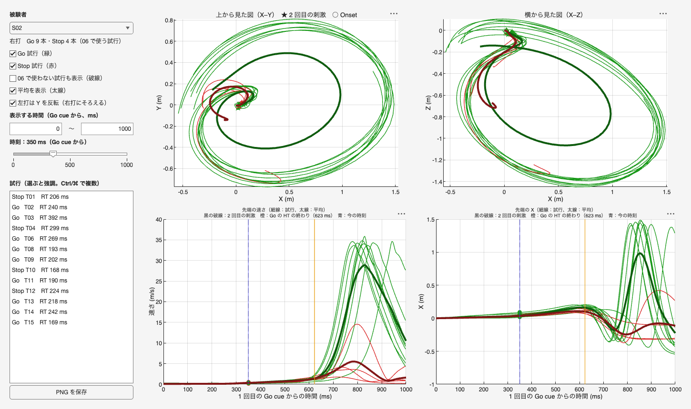
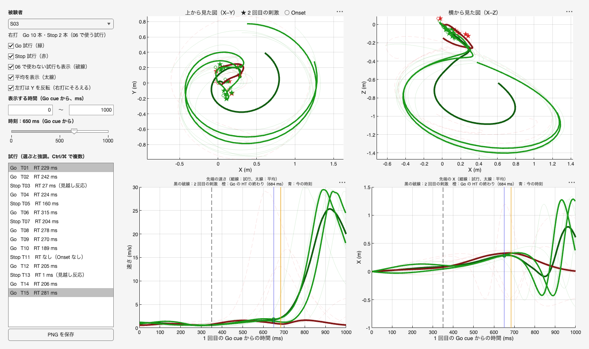

# Go/Stop の top の軌道を被験者ごとに比べるツール（技術説明）

作成：2026-11-11　加藤 和太郎（student）、Claude Code

## 1. 目的

Go/Stop 条件で、被験者ごとに Go 試行と Stop 試行の top（バット先端）の軌道を重ねて見る。[06_go_vs_stop](../06_go_vs_stop/技術説明.md) は 10 名の平均で比べたので、一人ひとりの試行で、Stop 試行がどこまで進んでどう止まったか、Go 試行とどこで分かれるかを確かめるために使う。

## 2. 画面



| 場所 | 内容 |
|---|---|
| 左：被験者 | S01〜S10 を選ぶ。打席（右打・左打）と、06 で使う試行の本数が出る。初めて選ぶ被験者は x3 を読み込むので数秒かかる |
| 左：チェック | Go 試行（緑）・Stop 試行（赤）の表示、06 で使わない試行（破線）の表示、平均（太線）の表示、左打の Y の反転 |
| 左：表示する時間 | Go cue からの時間（ms）。初めは 0〜1000 ms |
| 左：時刻のスライダー | 動かすと、各試行のその時刻の top の位置に点が動く（4 つの図すべて）。時系列の図には青の縦線が出る |
| 左：試行の一覧 | 選ぶとその試行を太く、ほかを薄くする（Ctrl / ⌘ で複数）。何も選ばないと元に戻る。06 で使わない試行は理由（見越し反応・Onset なし・top の欠け・除外）が出る |
| 左：PNG を保存 | 画面をそのまま `output/trajectory_SXX_日時.png` に保存する |
| 右上 | 上から見た図（X–Y）、横から見た図（X–Z）。★ = 2 回目の刺激（350 ms）の時の top、○ = Onset の時の top |
| 右下 | 先端の速さと X の時系列。黒の破線 = 2 回目の刺激、橙 = Go の HT の終わり（その被験者の Go 試行の平均） |

試行を選んで強調した例（S03、06 で使わない試行も表示、時刻 650 ms、Go T01・T15 を選んだ）：



## 3. 計算の方法

| 項目 | 内容 |
|---|---|
| 試行 | Go/Stop 条件の全 15 試行。06 と同じ分け方で、Go = x8 の除外のあと MT と HT がある Go 試行、Stop = Onset があり top の品質に問題がなく RT ≥ 150 ms の Stop 試行。それ以外は「06 で使わない試行」 |
| 時刻 | 1 回目の Go cue（LED ch2 が 2 V を超えた時点）を 0 |
| 位置 | Go cue の時の top を原点（m）。NaN の線形補間 → 30 Hz の 2 次 Butterworth で filtfilt（06 と同じ） |
| 速さ | 中心差分（250 Hz） |
| 平均 | 06 で使う試行だけを 4 ms ごとに補間して平均 |
| 左打の Y の反転 | 左打（S01・S04・S06・S07・S10、[01_stride_fxfy の 3.1 節](../01_stride_fxfy/技術説明.md) で記録と確認）は Y の符号を変えて右打にそろえる |
| RT | 一覧の RT は Onset から出し直した値（x8 の `RTForce_ms` は短い Go 試行で NaN になっているため） |

## 4. 使い方

1. 6 節のコードを、このフォルダに `gostop_trajectory_viewer.m` という名前で保存する
2. MATLAB の現在のフォルダをこのフォルダにして、`gostop_trajectory_viewer` を実行する。`gostop_trajectory_viewer('Subject', 3)` で S03 から開く
3. 別の場所に保存したときは、`gostop_trajectory_viewer('ProjectFolder', 'Project002 のフォルダ')` とする

## 5. 注意すること

- 読み込んだ被験者は画面を閉じるまで覚えておく（2 回目からは速い）。x3 は 1 人約 22 MB
- 上から見た図・横から見た図は軸の縦横の比をそろえている（`axis equal`）
- 確認は MATLAB R2026a で、画面を出さずに操作（被験者の切り替え、06 で使わない試行の表示、スライダー、試行の選択）を動かして行った。画面を出したときの操作の感じはまだ確かめていない

## 6. コード（gostop_trajectory_viewer.m）

```matlab
function gostop_trajectory_viewer(varargin)
% gostop_trajectory_viewer.m
%
% Go/Stop 条件の、被験者ごとの Go 試行と Stop 試行の top（バット先端）の軌道を比べるツール。
%
% 画面
%   左：被験者の選択、表示する試行、表示する時間、時刻のスライダー、試行の一覧、PNG の保存
%   右：上から見た図（X–Y）、横から見た図（X–Z）、速さの時系列、X の時系列
%   緑 = Go 試行、赤 = Stop 試行。破線 = 06 で使っていない試行（見越し反応・Onset なし・top の欠けなど）
%   ★ = 2 回目の刺激（Go cue の 350 ms 後）の時の top、● = Onset の時の top
%   スライダーを動かすと、各試行のその時刻の top の位置に点が動く
%
% 座標
%   時刻は 1 回目の Go cue を 0 にそろえる。位置は Go cue の時の top を原点にする（m）
%   左打（S01・S04・S06・S07・S10、2026-11-11 に記録で確認）は、「左打は Y を反転」にすると
%   右打と同じ向きにそろう
%
% 試行の分け方（06_go_vs_stop と同じ）
%   Go   = x8 の除外のあと MT と HT がある Go 試行
%   Stop = Onset があり、top の品質に問題がなく、RT ≥ 150 ms の Stop 試行
%   それ以外の Go/Stop 条件の試行は「06 で使わない試行」（破線）
%
% 使い方
%   gostop_trajectory_viewer                  % 画面を開く
%   gostop_trajectory_viewer('Subject', 3)    % S03 を開く
%   被験者を初めて選ぶときは x3 を読み込むので数秒かかる（2 回目からは速い）
%
% 2026-11-11

%% 引数
ip = inputParser ;
addParameter(ip, 'Subject', 1) ;
addParameter(ip, 'ProjectFolder', '') ;   % 空ならこのファイルの場所から決める
addParameter(ip, 'Visible', 'on') ;       % 確認用（'off' で画面を出さない）
addParameter(ip, 'SaveTo', '') ;          % 確認用（開いた直後に PNG を保存して閉じる）
parse(ip, varargin{:}) ;
Opt = ip.Results ;

%% 設定
T2ms      = 350 ;                    % 2 回目の刺激（Go cue から）[ms]
KeepMs    = [-300 1500] ;            % 読み込んで残す時間 [ms]
Lefty     = [1 4 6 7 10] ;           % 左打の被験者
GridMs    = 4 ;                      % 平均を出す時刻の間隔 [ms]（250 Hz）
ColGo     = [0.10 0.60 0.10] ;
ColStop   = [0.85 0.15 0.15] ;
ColHT     = [0.90 0.60 0.00] ;

scriptFolder = fileparts(mfilename('fullpath')) ;
if isempty(Opt.ProjectFolder)
    projectFolder = fullfile(scriptFolder, '..', '..', '..', '..') ;   % Project002 のフォルダ
else
    projectFolder = Opt.ProjectFolder ;
end
analysisFolder = fullfile(projectFolder, 'Experiments', 'Main experiments', '03_Analysis') ;
outFolder      = fullfile(scriptFolder, 'output') ;
addpath(analysisFolder) ;
Prm = parameters ;
load(fullfile(analysisFolder, 'x8_StatTable', 'StatTable.mat'), 'TrialTable') ;
TT = TrialTable(TrialTable.Condition == "gostop", :) ;
Subjects = unique(TT.Subject)' ;
Cache = containers.Map('KeyType', 'double', 'ValueType', 'any') ;   % 被験者ごとの試行のデータ

%% 画面
fig = uifigure('Name', 'Go/Stop の top の軌道', 'Position', [40 40 1450 860], 'Visible', Opt.Visible) ;
gMain = uigridlayout(fig, [1 2]) ;
gMain.ColumnWidth = {280, '1x'} ;

gL = uigridlayout(gMain, [16 1]) ;
gL.RowHeight = {22, 26, 22, 22, 22, 22, 22, 22, 22, 26, 22, 45, 8, 22, '1x', 30} ;   % 12 行目がスライダー（目盛りの数字の分だけ高くする）
gL.RowSpacing = 4 ;
uilabel(gL, 'Text', '被験者', 'FontWeight', 'bold') ;
ddSub   = uidropdown(gL, 'Items', compose('S%02d', Subjects), 'ItemsData', Subjects, 'Value', Opt.Subject) ;
lblSide = uilabel(gL, 'Text', '') ;
cbGo    = uicheckbox(gL, 'Text', 'Go 試行（緑）', 'Value', true) ;
cbStop  = uicheckbox(gL, 'Text', 'Stop 試行（赤）', 'Value', true) ;
cbExcl  = uicheckbox(gL, 'Text', '06 で使わない試行も表示（破線）', 'Value', false) ;
cbMean  = uicheckbox(gL, 'Text', '平均を表示（太線）', 'Value', true) ;
cbFlip  = uicheckbox(gL, 'Text', '左打は Y を反転（右打にそろえる）', 'Value', true) ;
uilabel(gL, 'Text', '表示する時間（Go cue から、ms）', 'FontWeight', 'bold') ;
gT = uigridlayout(gL, [1 3]) ;  gT.Padding = [0 0 0 0] ;  gT.ColumnWidth = {'1x', 20, '1x'} ;
efT0 = uieditfield(gT, 'numeric', 'Value', 0,   'Limits', [KeepMs(1) KeepMs(2)]) ;
uilabel(gT, 'Text', '〜', 'HorizontalAlignment', 'center') ;
efT1 = uieditfield(gT, 'numeric', 'Value', 1000, 'Limits', [KeepMs(1) KeepMs(2)]) ;
lblNow  = uilabel(gL, 'Text', '時刻：350 ms', 'FontWeight', 'bold') ;
slNow   = uislider(gL, 'Limits', [0 1000], 'Value', T2ms, 'MajorTicks', [0 500 1000], 'MinorTicks', 0:100:1000) ;
uilabel(gL, 'Text', '') ;
uilabel(gL, 'Text', '試行（選ぶと強調。Ctrl/⌘ で複数）', 'FontWeight', 'bold') ;
lbTr    = uilistbox(gL, 'Items', {}, 'Multiselect', 'on') ;
btnSave = uibutton(gL, 'Text', 'PNG を保存') ;

gR = uigridlayout(gMain, [2 2]) ;
axXY = uiaxes(gR) ;  axXZ = uiaxes(gR) ;  axSp = uiaxes(gR) ;  axX = uiaxes(gR) ;

%% 状態
Tr     = struct([]) ;     % 表示中の被験者の試行
H      = struct('line', {}, 'dot', {}) ;   % 試行ごとの線と点のハンドル（4 つの図の分）
hNowLn = gobjects(0) ;    % 時系列の図の、今の時刻の縦線

%% コールバック
ddSub.ValueChangedFcn   = @(~,~) changeSubject() ;
cbGo.ValueChangedFcn    = @(~,~) redraw() ;
cbStop.ValueChangedFcn  = @(~,~) redraw() ;
cbExcl.ValueChangedFcn  = @(~,~) redraw() ;
cbMean.ValueChangedFcn  = @(~,~) redraw() ;
cbFlip.ValueChangedFcn  = @(~,~) redraw() ;
efT0.ValueChangedFcn    = @(~,~) changeWindow() ;
efT1.ValueChangedFcn    = @(~,~) changeWindow() ;
slNow.ValueChangingFcn  = @(~,ev) moveNow(ev.Value) ;
slNow.ValueChangedFcn   = @(src,~) moveNow(src.Value) ;
lbTr.ValueChangedFcn    = @(~,~) highlight() ;
btnSave.ButtonPushedFcn = @(~,~) savePng() ;

changeSubject() ;
if ~isempty(Opt.SaveTo)
    drawnow ;
    exportapp(fig, Opt.SaveTo) ;
    delete(fig) ;
end

%% ---- 入れ子の関数 ----------------------------------------------------------
    function changeSubject()
        s = ddSub.Value ;
        if ~isKey(Cache, s)
            dlg = [] ;
            if strcmp(fig.Visible, 'on')   % 画面を出していないときは進み具合の表示を出せない
                dlg = uiprogressdlg(fig, 'Title', '読み込み中', 'Message', sprintf('S%02d の x3 を読み込んでいます', s), 'Indeterminate', 'on') ;
            end
            Cache(s) = loadSubject(s) ;
            if ~isempty(dlg), close(dlg) ; end
        end
        Tr = Cache(s) ;
        side = '右打' ;  if ismember(s, Lefty), side = '左打' ; end
        lblSide.Text = sprintf('%s　Go %d 本・Stop %d 本（06 で使う試行）', side, ...
            sum([Tr.Kind] == "go"), sum([Tr.Kind] == "stop")) ;
        redraw() ;
    end

    function D = loadSubject(s)
        % 被験者 s の Go/Stop の全試行について、Go cue を 0 にした top の位置と速さを出す
        S = load(fullfile(analysisFolder, 'x3_DataChecked', sprintf('Data%02d.mat', s)), 'DataArray') ;
        Ts = TT(TT.Subject == s, :) ;
        D  = struct('Trial', {}, 'Cue', {}, 'Kind', {}, 'Why', {}, 'RT', {}, 'HTEnd', {}, 't', {}, 'P', {}, 'Spd', {}) ;
        for r = 1:height(Ts)
            Data = S.DataArray(Ts.Trial(r), 4) ;
            if ~isfield(Data.Markers, 'top') || isempty(Data.Markers.top), continue, end
            fsA  = Data.AnalogFs ;  fsM = Data.FrameRate ;
            tCue = find(Data.LEDData(:,2) > Prm.Cue.GoThresholdV, 1, 'first') ;
            if isempty(tCue), continue, end
            P = prepMarker(Data.Markers.top, fsM, Prm.Fc) ;
            v = [NaN(1,3) ; (P(3:end,:) - P(1:end-2,:)) * fsM / 2 ; NaN(1,3)] ;
            t = ((1:size(P,1))' / fsM * fsA - tCue) / fsA * 1000 ;
            P = P - interp1(t, P, 0) ;
            k = t >= KeepMs(1) & t <= KeepMs(2) ;

            isGo = Ts.CueText(r) == "Go" ;
            if isGo
                use = ~isnan(Ts.MT_ms(r)) && ~isnan(Ts.HookTime_ms(r)) ;
            else
                use = ~isnan(Ts.SwingOnsetForce(r)) && ~Ts.IsBadTop(r) && Ts.RTForce_ms(r) >= Prm.RT.FloorMs ;
            end
            why = "" ;
            if ~use
                if isnan(Ts.SwingOnsetForce(r)),                why = "Onset なし" ;
                elseif Ts.RTForce_ms(r) < Prm.RT.FloorMs,       why = "見越し反応" ;
                elseif Ts.IsBadTop(r),                          why = "top の欠け" ;
                else,                                           why = "除外" ;
                end
            end
            kind = "excl" ;
            if use && isGo, kind = "go" ; elseif use, kind = "stop" ; end

            % RT は Onset から出し直す（x8 の RTForce_ms は短い Go 試行で NaN にしてあるため）
            rt = NaN ;
            if ~isnan(Ts.SwingOnsetForce(r)), rt = (Ts.SwingOnsetForce(r) - tCue) / fsA * 1000 ; end
            D(end+1) = struct('Trial', Ts.Trial(r), 'Cue', string(Ts.CueText(r)), 'Kind', kind, 'Why', why, ...
                'RT', rt, 'HTEnd', rt + Ts.HookTime_ms(r), 't', t(k), 'P', P(k,:), 'Spd', sqrt(sum(v(k,:).^2, 2))) ; %#ok<AGROW>
        end
    end

    function show = isShown(i)
        switch Tr(i).Kind
            case "go",   show = cbGo.Value ;
            case "stop", show = cbStop.Value ;
            otherwise,   show = cbExcl.Value && ((Tr(i).Cue == "Go" && cbGo.Value) || (Tr(i).Cue == "Stop" && cbStop.Value)) ;
        end
    end

    function redraw()
        t0 = efT0.Value ;  t1 = efT1.Value ;
        if t1 <= t0, t1 = t0 + 100 ;  efT1.Value = t1 ; end
        slNow.Limits = [t0 t1] ;
        slNow.MajorTicks = [t0 round((t0+t1)/2) t1] ;  slNow.MinorTicks = [] ;
        slNow.Value  = min(max(slNow.Value, t0), t1) ;
        flip = 1 ;  if cbFlip.Value && ismember(ddSub.Value, Lefty), flip = -1 ; end

        Ax = [axXY axXZ axSp axX] ;
        for a = Ax, cla(a) ; hold(a, 'on') ; grid(a, 'on') ; end
        H = struct('line', {}, 'dot', {}) ;
        items = {} ;  data = [] ;
        for i = 1:numel(Tr)
            H(i).line = gobjects(1, 4) ;  H(i).dot = gobjects(1, 4) ;
            if ~isShown(i), continue, end
            col = ColGo ;  if Tr(i).Cue == "Stop", col = ColStop ; end
            ls  = '-' ;    lw = 1.0 ;
            if Tr(i).Kind == "excl", ls = '--' ;  lw = 0.8 ; end
            k = Tr(i).t >= t0 & Tr(i).t <= t1 ;
            t = Tr(i).t(k) ;  P = Tr(i).P(k,:) ;  P(:,2) = flip * P(:,2) ;
            H(i).line(1) = plot(axXY, P(:,1), P(:,2), ls, 'Color', col, 'LineWidth', lw) ;
            H(i).line(2) = plot(axXZ, P(:,1), P(:,3), ls, 'Color', col, 'LineWidth', lw) ;
            H(i).line(3) = plot(axSp, t, Tr(i).Spd(k), ls, 'Color', col, 'LineWidth', lw) ;
            H(i).line(4) = plot(axX,  t, P(:,1), ls, 'Color', col, 'LineWidth', lw) ;
            % ★ 2 回目の刺激、● Onset
            q = posAt(i, T2ms, flip) ;
            if ~any(isnan(q)) && T2ms >= t0 && T2ms <= t1
                plot(axXY, q(1), q(2), 'p', 'Color', col, 'MarkerFaceColor', col, 'MarkerSize', 9) ;
                plot(axXZ, q(1), q(3), 'p', 'Color', col, 'MarkerFaceColor', col, 'MarkerSize', 9) ;
            end
            if ~isnan(Tr(i).RT) && Tr(i).RT >= t0 && Tr(i).RT <= t1
                q = posAt(i, Tr(i).RT, flip) ;
                plot(axXY, q(1), q(2), 'o', 'Color', col, 'MarkerFaceColor', 'w', 'MarkerSize', 5) ;
                plot(axXZ, q(1), q(3), 'o', 'Color', col, 'MarkerFaceColor', 'w', 'MarkerSize', 5) ;
            end
            % 今の時刻の点
            H(i).dot(1) = plot(axXY, NaN, NaN, 'o', 'Color', col, 'MarkerFaceColor', col, 'MarkerSize', 6) ;
            H(i).dot(2) = plot(axXZ, NaN, NaN, 'o', 'Color', col, 'MarkerFaceColor', col, 'MarkerSize', 6) ;
            H(i).dot(3) = plot(axSp, NaN, NaN, 'o', 'Color', col, 'MarkerFaceColor', col, 'MarkerSize', 6) ;
            H(i).dot(4) = plot(axX,  NaN, NaN, 'o', 'Color', col, 'MarkerFaceColor', col, 'MarkerSize', 6) ;
            % 一覧
            if isnan(Tr(i).RT), rtTxt = 'RT なし' ; else, rtTxt = sprintf('RT %.0f ms', Tr(i).RT) ; end
            note = '' ;  if Tr(i).Kind == "excl", note = sprintf('（%s）', Tr(i).Why) ; end
            items{end+1} = sprintf('%-4s T%02d　%s%s', Tr(i).Cue, Tr(i).Trial, rtTxt, note) ; %#ok<AGROW>
            data(end+1)  = i ; %#ok<AGROW>
        end

        % 平均（06 で使う試行だけ）
        if cbMean.Value
            tg = (ceil(t0/GridMs)*GridMs : GridMs : t1)' ;
            for c = ["go" "stop"]
                idx = find([Tr.Kind] == c) ;
                if isempty(idx) || (c == "go" && ~cbGo.Value) || (c == "stop" && ~cbStop.Value), continue, end
                Pm = NaN(numel(tg), 3, numel(idx)) ;  Sm = NaN(numel(tg), numel(idx)) ;
                for j = 1:numel(idx)
                    Pm(:,:,j) = interp1(Tr(idx(j)).t, Tr(idx(j)).P, tg) ;
                    Sm(:,j)   = interp1(Tr(idx(j)).t, Tr(idx(j)).Spd, tg) ;
                end
                Pm = mean(Pm, 3, 'omitnan') ;  Pm(:,2) = flip * Pm(:,2) ;  Sm = mean(Sm, 2, 'omitnan') ;
                col = ColGo ;  if c == "stop", col = ColStop ; end
                col = col * 0.6 ;   % 平均は少し暗く
                plot(axXY, Pm(:,1), Pm(:,2), '-', 'Color', col, 'LineWidth', 3) ;
                plot(axXZ, Pm(:,1), Pm(:,3), '-', 'Color', col, 'LineWidth', 3) ;
                plot(axSp, tg, Sm, '-', 'Color', col, 'LineWidth', 3) ;
                plot(axX,  tg, Pm(:,1), '-', 'Color', col, 'LineWidth', 3) ;
            end
        end

        % 時系列の図の縦線：2 回目の刺激、Go の HT の終わり（06 で使う Go 試行の平均）、今の時刻
        htEnd = mean([Tr([Tr.Kind] == "go").HTEnd], 'omitnan') ;
        hNowLn = gobjects(1, 2) ;
        for a = 1:2
            ax = axSp ;  if a == 2, ax = axX ; end
            xline(ax, T2ms, 'k--', 'LineWidth', 1) ;
            if ~isnan(htEnd), xline(ax, htEnd, '-', 'Color', ColHT, 'LineWidth', 1.2) ; end
            hNowLn(a) = xline(ax, slNow.Value, '-', 'Color', [0.3 0.3 0.9], 'LineWidth', 1) ;
            xlim(ax, [t0 t1]) ;
        end

        % 図の体裁
        axis(axXY, 'equal') ;  axis(axXZ, 'equal') ;
        title(axXY, '上から見た図（X–Y）') ;  xlabel(axXY, 'X (m)') ;  ylabel(axXY, 'Y (m)') ;
        title(axXZ, '横から見た図（X–Z）') ;  xlabel(axXZ, 'X (m)') ;  ylabel(axXZ, 'Z (m)') ;
        lineNote = sprintf('黒の破線：2 回目の刺激　橙：Go の HT の終わり（%.0f ms）　青：今の時刻', htEnd) ;
        title(axSp, {'先端の速さ（細線：試行、太線：平均）', lineNote}, 'FontSize', 10) ;  xlabel(axSp, '1 回目の Go cue からの時間 (ms)') ;  ylabel(axSp, '速さ (m/s)') ;
        title(axX, {'先端の X（細線：試行、太線：平均）', lineNote}, 'FontSize', 10) ;    xlabel(axX,  '1 回目の Go cue からの時間 (ms)') ;  ylabel(axX,  'X (m)') ;
        side = '' ;  if flip == -1, side = '（Y を反転）' ; end
        title(axXY, sprintf('上から見た図（X–Y）%s　★ 2 回目の刺激　○ Onset', side)) ;

        lbTr.Items = items ;  lbTr.ItemsData = data ;  lbTr.Value = {} ;
        if isempty(items), lbTr.Value = [] ; end
        moveNow(slNow.Value) ;
    end

    function q = posAt(i, tq, flip)
        q = interp1(Tr(i).t, Tr(i).P, tq) ;
        q(2) = flip * q(2) ;
    end

    function moveNow(tq)
        lblNow.Text = sprintf('時刻：%.0f ms（Go cue から）', tq) ;
        flip = 1 ;  if cbFlip.Value && ismember(ddSub.Value, Lefty), flip = -1 ; end
        for i = 1:numel(H)
            if isempty(H(i).dot) || ~isgraphics(H(i).dot(1)), continue, end
            q = posAt(i, tq, flip) ;  sp = interp1(Tr(i).t, Tr(i).Spd, tq) ;
            set(H(i).dot(1), 'XData', q(1), 'YData', q(2)) ;
            set(H(i).dot(2), 'XData', q(1), 'YData', q(3)) ;
            set(H(i).dot(3), 'XData', tq,   'YData', sp) ;
            set(H(i).dot(4), 'XData', tq,   'YData', q(1)) ;
        end
        for a = 1:numel(hNowLn), if isgraphics(hNowLn(a)), hNowLn(a).Value = tq ; end, end
    end

    function changeWindow()
        redraw() ;
    end

    function highlight()
        sel = lbTr.Value ;
        if iscell(sel), sel = [sel{:}] ; end
        for i = 1:numel(H)
            if isempty(H(i).line) || ~isgraphics(H(i).line(1)), continue, end
            if isempty(sel)
                lw = 1.0 ;  if Tr(i).Kind == "excl", lw = 0.8 ; end
                set(H(i).line, 'LineWidth', lw, 'Color', colOf(i)) ;  set(H(i).dot, 'Visible', 'on') ;
            elseif ismember(i, sel)
                set(H(i).line, 'LineWidth', 2.5, 'Color', colOf(i)) ;  set(H(i).dot, 'Visible', 'on') ;
                for a = 1:numel(H(i).line), uistack(H(i).line(a), 'top') ; end   % 図ごとに前に出す
            else
                set(H(i).line, 'LineWidth', 0.5, 'Color', [colOf(i) 0.15]) ;  set(H(i).dot, 'Visible', 'off') ;   % 薄くする
            end
        end
    end

    function c = colOf(i)
        c = ColGo ;  if Tr(i).Cue == "Stop", c = ColStop ; end
    end

    function savePng()
        if ~exist(outFolder, 'dir'), mkdir(outFolder) ; end
        f = fullfile(outFolder, sprintf('trajectory_S%02d_%s.png', ddSub.Value, char(datetime('now', 'Format', 'yyyyMMdd_HHmmss')))) ;
        exportapp(fig, f) ;
        uialert(fig, sprintf('保存しました：\n%s', f), 'PNG を保存', 'Icon', 'success') ;
    end
end

%% ローカル関数
function x = prepMarker(x, fs, fc)
% NaN を線形補間して、2 次 Butterworth で filtfilt し、m に直す（compare_go_stop.m と同じ）
t = (1:size(x,1))' ;
for col = 1:3
    nanIdx = isnan(x(:,col)) ;
    if any(nanIdx) && any(~nanIdx)
        x(nanIdx,col) = interp1(t(~nanIdx), x(~nanIdx,col), t(nanIdx), 'linear', 'extrap') ;
    end
end
[b, a] = butter(2, fc/(fs/2)) ;
x = filtfilt(b, a, x) / 1000 ;
end
```
