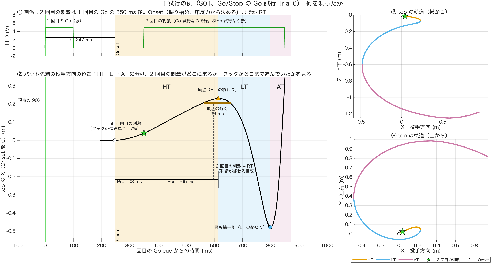
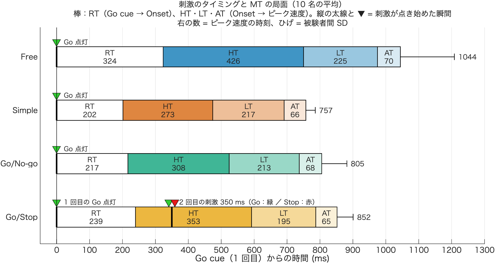
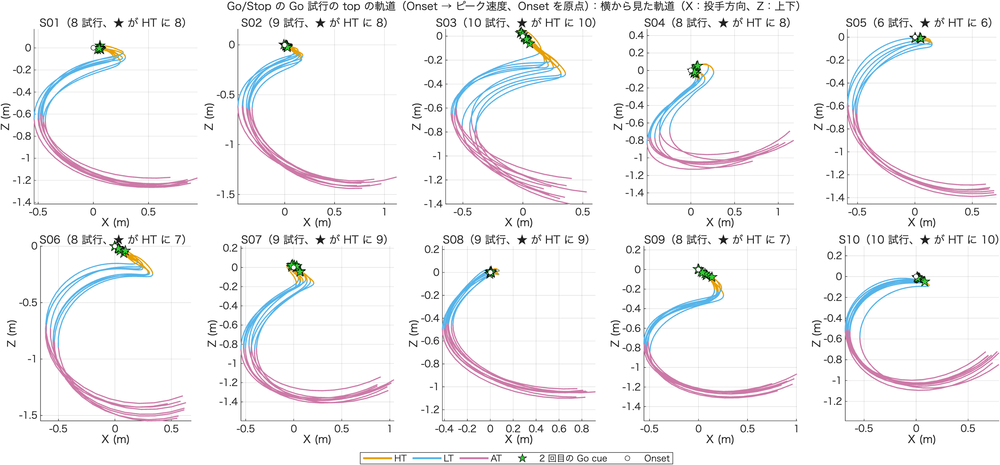
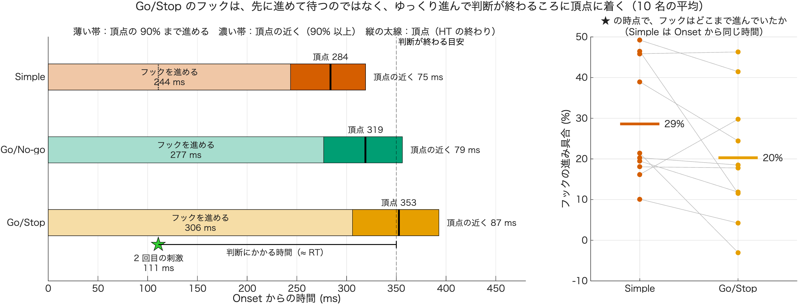
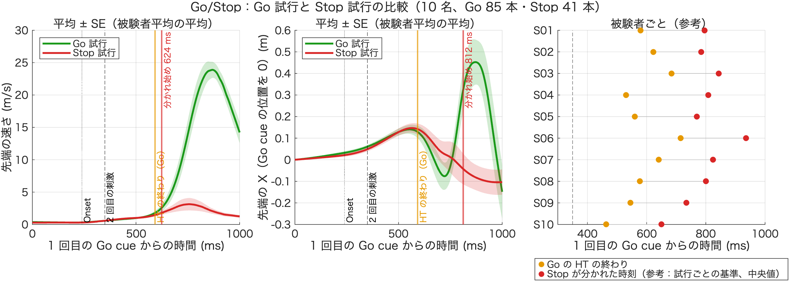
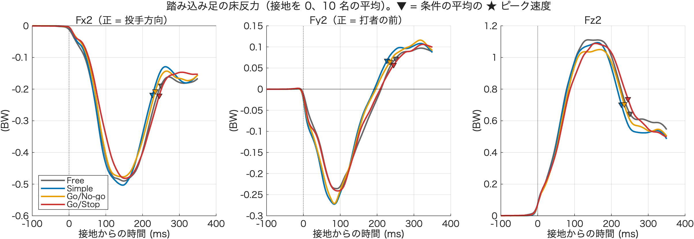

# 05_突っ込みと Go/Stop の判断

作成：2026-11-09　加藤 和太郎（student）、Claude Code　（ログ：`log/2026-11-09_02.md`）

2026-11-09 に行った分析をまとめたフォルダ。問いは 2 つ。

1. **体が投手方向へ突っ込んでいるか**：踏み込み足の床反力（前後 Fx2・左右 Fy2）で調べた
2. **Go/Stop で HT が延びるのは、2 回目の刺激を判断するための時間か**：2 回目の刺激がスイングのどこで点くか、そのあとフックがどう進むかで調べた

対象はすべて 10 名（S01〜S10。S03 は再測定のデータ、S04 は目視で残した試行も含む）の、x8 の除外のあとの Go 試行。

## 1. まず 1 試行で：何を測ったか

S01 の Go/Stop の Go 試行 Trial 6（値が中央値に近い試行）。詳しくは [00_single_trial_example/技術説明.md](00_single_trial_example/技術説明.md)。

- ① 2 回目の刺激は、1 回目の Go の 350 ms 後に点く。Go から振り始め（Onset）までが RT（この試行は 247 ms）
- ② バット先端の投手方向の位置を、HT（Onset → フックの頂点）・LT（→ 最も捕手側）・AT（→ ピーク速度）に分ける
  - 2 回目の刺激（★）は振り始めの 103 ms 後（Pre）に点き、そのときフックは頂点の 17% までしか進んでいない
  - 刺激のあと、HT が終わるまで 265 ms（Post）。頂点の近く（90% 以上）にいるのは 96 ms
  - 「2 回目の刺激 + RT」（判断が終わる目安）のころに頂点に着き、LT に入る
- ③ 軌道で見ると、★ は振り始めのすぐ近く（バットがまだ構えの近くにある）

## 2. わかったこと（まとめ）

| 問い | 結果 | フォルダ |
|---|---|---|
| 踏み込み足のブレーキは条件で違うか | **違わない**。ブレーキのピーク（−0.56〜−0.58 BW）も、時間あたりの力も同じ。Fx2 の力積が Free で大きいのは、接地 → ピーク速度が長いため | `01_stride_fxfy` |
| 2 回目の刺激はいつ点くか | 1 回目の Go の **350 ms 後**（LED の記録と実験スクリプトで確認） | `02_stimulus_phase_timeline` |
| 2 回目の刺激はスイングのどこで点くか | 85 本のうち **82 本（96.5%）が HT の中**。振り始めの約 110 ms 後、HT の前から 3 割あたり | `02`・`03_gostop_top_trajectory` |
| HT の終わりは 2 回目の刺激に合わせて決まるか | **試行ごとには合わせていない**（HT と RT の傾きがほぼ 0）。**平均では**、刺激の後の HT（242 ms）が Go/Stop の RT（239 ms）とほぼ同じで、判断が終わるころに LT に入っている | `04_ht_after_cue` |
| フックを先に進めて、頂点の近くで待っているか | **待っていない**。2 回目の刺激の時点のフックは Simple より進んでいない（20% vs 29%）。頂点の近くにいる時間の延長も 11 ms だけ。フックは大きく・ゆっくり進み、判断が終わる目安（振り始めの 350 ms 後）のころに頂点（353 ms）に着く | `05_hook_progress` |
| Go 試行と Stop 試行の動きはいつ分かれるか | **HT の間は分かれない**。HT の終わり（592 ms）まではほぼ同じで、速さが分かれ始めるのは Go cue から **624 ms**（2 回目の刺激の 274 ms 後、HT の終わりの約 30 ms 後）。判断は HT から LT に移るところで表れる（2026-11-11 に Stop 試行の見越し反応 5 本を除いた版。元は 696 ms） | `06_go_vs_stop` |

**今の解釈**：踏み込み足の力からは、突っ込みを止めきれていない様子は見えない。Go/Stop では、フックの頂点で止まって待つのではなく、**フック全体を大きく・ゆっくりにして判断の時間をかせぎ、判断が終わるころに LT に入っている**ように見える。Go と Stop の動きが分かれるのも HT が終わってからで、判断は「HT の間の動き」ではなく「LT に進むか止まるか」に表れている。

p 値はすべて MATLAB で出した確認用の値（RM-ANOVA の GG 補正、対応のある t 検定）で、本番の統計（JASP）ではない。

## 3. 図（全員の結果）

| 図 | 何がわかるか |
|---|---|
|  | 条件ごとの刺激のタイミング（▼）と RT・HT・LT・AT。Go/Stop の 2 回目の刺激は HT の中に来る |
|  | Go/Stop の全 Go 試行の top の軌道（横から見た図）。★ = 2 回目の Go cue。どの被験者も ★ は振り始めのすぐ近く（HT の始め） |
|  | フックの進み具合。Go/Stop は頂点の 90% に達するのが遅く、判断が終わる目安（350 ms）のころに頂点に着く |
|  | Go 試行（緑）と Stop 試行（赤）の top の速さと X。HT の終わりまでは重なり、その後 Go だけが加速する |
|  | 踏み込み足の Fx2・Fy2・Fz2（接地を 0）。条件の差は小さい |

## 4. フォルダの中身

各フォルダの `技術説明.md` に、目的・計算の方法・結果・使い方・コードを書いた。`output/` は 2026-11-09 に実行した結果。

| フォルダ | 内容 | コード（技術説明.md の最後） |
|---|---|---|
| `00_single_trial_example/` | 1 試行の例で、02〜05 が何を測っているかを示す図 | `plot_single_trial_example.m` |
| `01_stride_fxfy/` | 踏み込み足の Fx2・Fy2 の指標と波形 | `stride_fxfy_analysis.m` |
| `02_stimulus_phase_timeline/` | 刺激のタイミングと RT・HT・LT・AT の図。2 回目の刺激が来る局面を数える | `plot_stimulus_phase_timeline.m` |
| `03_gostop_top_trajectory/` | Go/Stop の全 Go 試行の top の軌道（局面の色分け、2 回目の Go cue に ★） | `plot_gostop_top_trajectory.m` |
| `04_ht_after_cue/` | HT と 2 回目の刺激の関係（試行ごと・被験者平均）。x8 の値だけで計算 | `ht_after_cue_analysis.m` |
| `05_hook_progress/` | フックの進み具合と、頂点の近くにいる時間 | `hook_progress_analysis.m`、`plot_hook_progress_timeline.m` |
| `06_go_vs_stop/` | Go 試行と Stop 試行の top の速さ・X の比較と、分かれ始めた時刻（見越し反応の確認、SPM も） | `compare_go_stop.m`、`plot_gostop_bias_check.m`、`spm_go_stop.m` |
| `07_trajectory_viewer/` | 被験者ごとに Go 試行と Stop 試行の top の軌道を比べるツール（画面で操作） | `gostop_trajectory_viewer.m` |

コードを使うときは、技術説明.md のコードを、そのフォルダに書いてある名前で保存して実行する。フォルダの深さ（`7.1_解析結果/05_…/<ツール>/xxx.m`）を変えると、Project002 のフォルダが見つからなくなる（[7.1_解析結果 の README](../README.md) の置き場所の決まり）。

## 5. 気づいたこと（確認が必要）

- **左打者がいる**：構えたときの骨盤の向き（ASIS − PSIS の Y）が正の S01・S04・S06・S07・S10 が左打、負の S02・S03・S05・S08・S09 が右打。2026-11-11 にバットの回る向き（上から見て左打は時計回り）でも同じ分け方になり、実験の記録（基礎情報記録用紙の「打席」）とも 10 名すべて一致した（[01_stride_fxfy の 3.1 節](01_stride_fxfy/技術説明.md)）。骨盤のマーカーの左右の名前は試行によって入れ替わっているので、左右の ASIS を別々に使うときは注意する
- **Methods（`Manuscript/2. Methods/draft.md`）と実際が 2 か所違う**
  - 2 回目の刺激は「1 回目の Go cue から 0.25 秒後」と書いてあるが、実際は 0.35 秒後（0.25 秒は 1 回目の Go が消えてからの時間）
  - 「自由スイング条件は Go cue を呈示しない」と書いてあるが、実際は Free でも Ready の 1.5 秒後に Go（緑）が点灯している
- S08 は Simple の HT が 111 ms と短く、LT が 341 ms と長い。局面の分け方が他の被験者と合っていない可能性がある

## 6. 次の候補

- フックの進み具合の結果が、基準（90%）や、頂点が小さい試行を外したこと（26 試行）で変わらないか確かめる
- ~~Go と Stop の比較で、Stop 試行の振り始めが早かった（210 vs 239 ms）理由を確かめる~~ → 2026-11-11 に確認。外れた試行の偏りではなく、Stop 試行に見越し反応（RT < 150 ms）が 5 本残っていたため。除くと RT の差は 10 ms（p = .175）（`06_go_vs_stop` の 4.1 節）
- 接地の時点の重心の前向きの速度（どれだけの勢いで踏み込んだか）を調べる（突っ込みの続き）
