# MATLAB教材_入門

MATLABでの解析ができるようになるまで書き溜めていくMDファイル。AIは使用しない。

参考教材：MATLABプログラミング入門 [改訂版]　上坂吉則 著

---

## 1-1. 作業ディレクトリを開く

* ホームタブのディレクトリを開くをクリックする　→　作業したいフォルダを選択

* カレントディレクトリが赤線部分に表示される

## 1-2. 画面表示

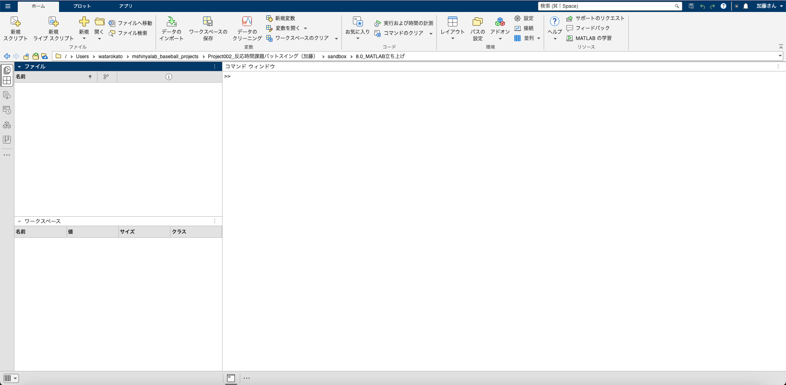

* ファイル（左上）：カレントディレクトリの中身
* **ワークスペース**（左下）
* **コマンドウインドウ**（右）

## 1-3. プログラムをキーインしてみる

* コマンドウインドウに「1+2」とキーインしてみる

* →　Enterを押すと、、

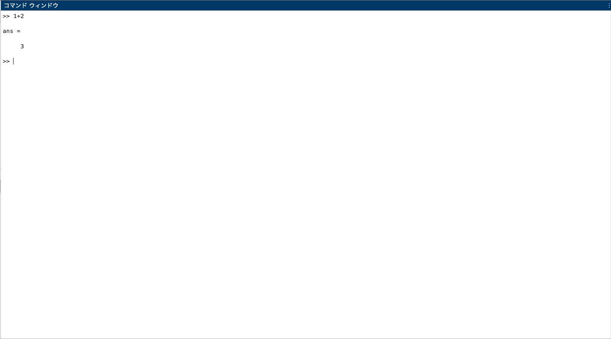

* 「・ans = 3」と表示される

### これを「コマンドの実行」という

このやり方は、プログラムを保存して後日使うというやり方や、長くて複雑なプログラムを作るのには向かない

## 1-4. Mファイルの作成

作業ディレクトリが合っているかを確認する

* コマンドウインドウに「pwd」と入力

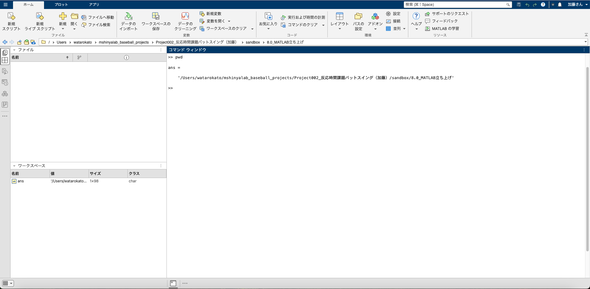

作業ディレクトリ（今回は「8.1_MATLAB再学習」）までのパスが表示されればOK

* ファイルウインドウにて右クリック　→　新規　→　スクリプト　を選択

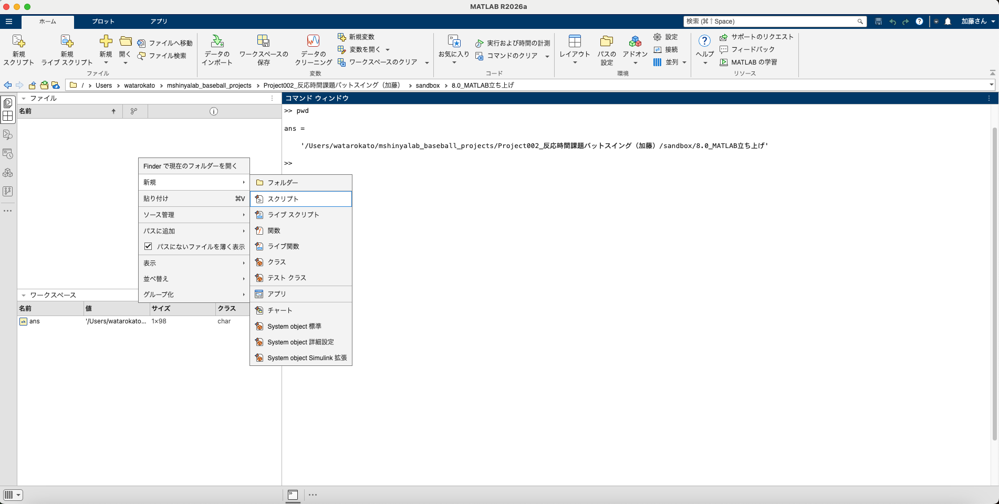

* 「untitled.m」が作成される

* ダブルクリックすると、エディットウインドウが開き、エディタータブが追加される

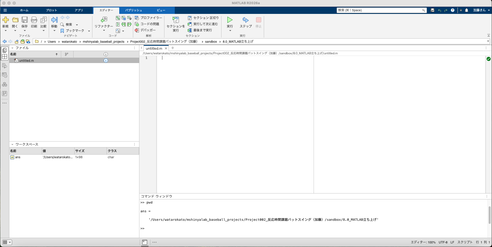

* ファイルの名前を変更する（p0001）：ファイル名は任意で構わないが、拡張子は必ず「m」にする必要がある
* 試しに、「1+2」と入れてみる

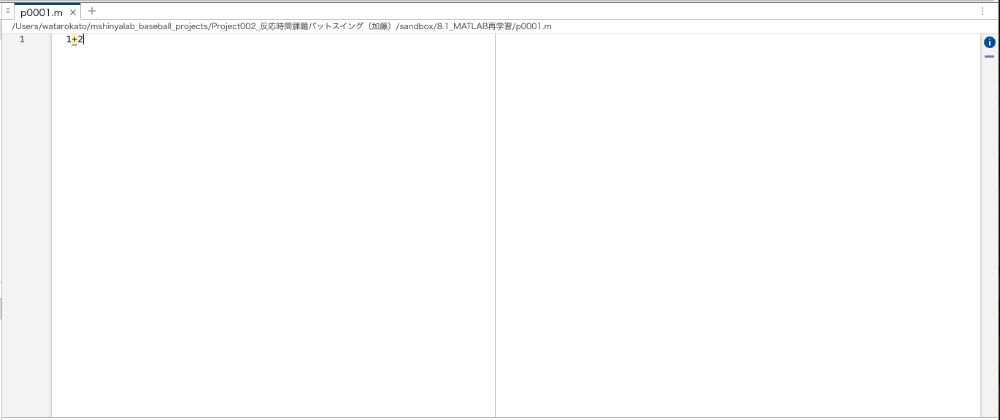

* エディタータブにある実行を押すと、、、

このプログラムが実行され、コマンドウインドウに計算結果が表示される

### **プログラムに変更を加えたのちに保存したいときは、「ctrl+S」のショートカットで保存できる（macの場合は、「cmd+S」）**

---

## 2-1. 数の計算

* 足し算「+」
* 引き算「-」
* 掛け算「*」
* 割り算「/」
* これらを用いて実際に計算してみる（p0002）

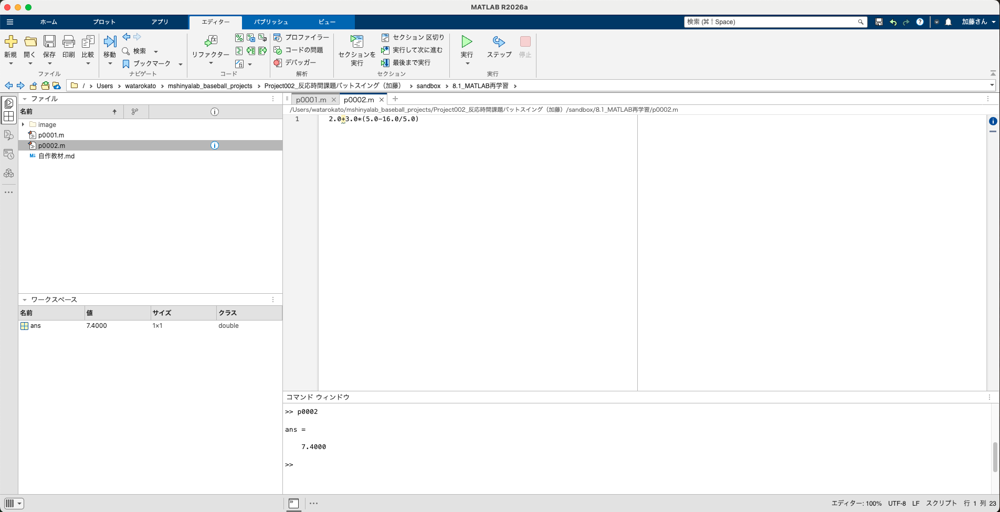

* べき乗を計算するには「^」を用いる

## 2-2. 変数を使う

* 変数の名前は「アルファベット」「数字」「_（アンダースコア）」から構成される
* **最初はアルファベットから始まらなければならない**
* MATLABでは、大文字と小文字は区別される：MATLABに元々組み込まれている関数や定数が全て小文字から始まっているため、ユーザーが用いる変数を大文字で始めて意識的に区別するのも1つの工夫
* 実際に使ってみる

例題：元金1,000,000円を年利0.01%で10年間、複利で銀行に預けた時の元利合計を計算する

元金を変数A、年利を変数R、預けた年数を変数Nに格納する

元利合計の計算式：A*(1+R).^N

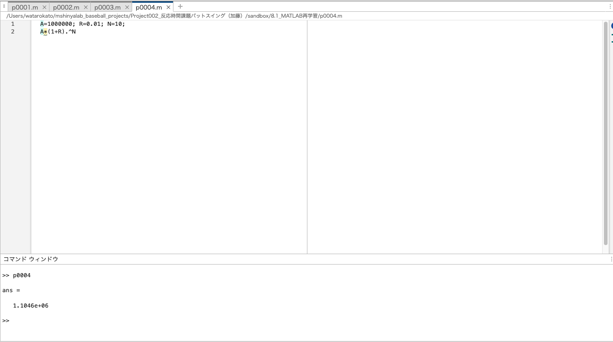

結果を変数Fに格納してみる

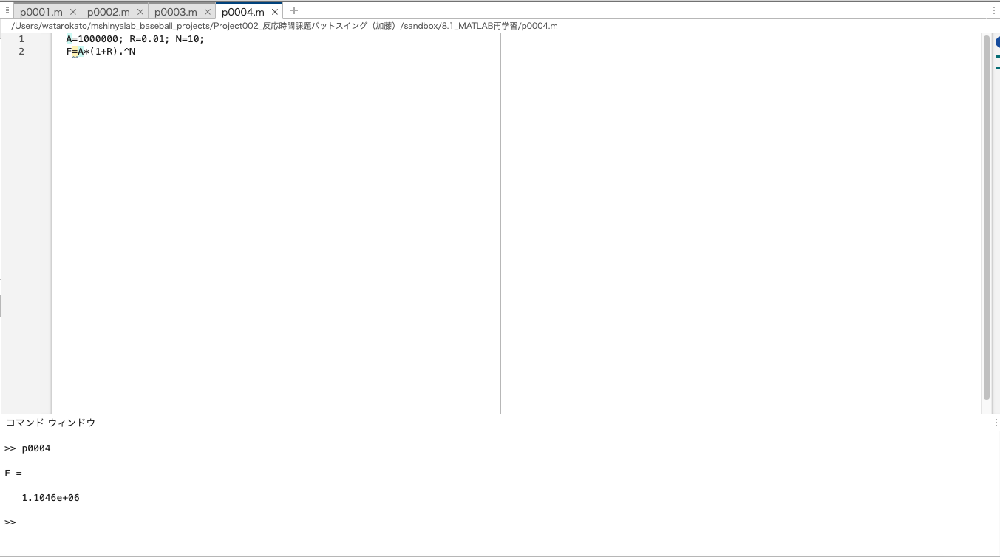

## 2-3. 組み込み関数を使ってみる

MATLABにはたくさんの関数がすでに組み込まれており、これらを使うことで複雑な計算も簡単なプログラムで実行できたり、計算時間も大幅に短縮できる

例題：1から100までの2乗の和を計算してみる

* 繰り返しの処理をする for 文を使用する

このように書いてみた

* S=0とS=S+I^2の後ろについている**「;」によって、計算結果を表示しないようにできる**
* 5行目のSを入れておくことにより、100^2までを全て足し合わせた結果が表示される

* 組み込み関数 sum を使って同じ例題を解いてみる

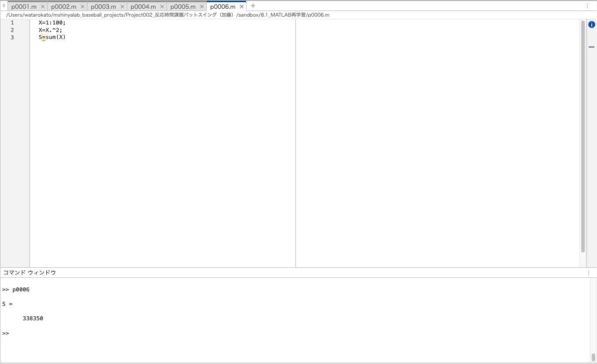

このように書いてみた

* この場合、行列（1:100）の各要素を個別に演算するには、「.^」を使用して要素単位のべき乗を行う

組み込み関数を用いることで、より簡単に計算を実行できた

MATLABには大量の関数が存在しているため、おおよそどのような関数が存在しているのかを知っておくことも重要

コマンドウインドウに「help」と入力・実行すると、ヘルプブラウザーを開く案内が出る

ヘルプブラウザー

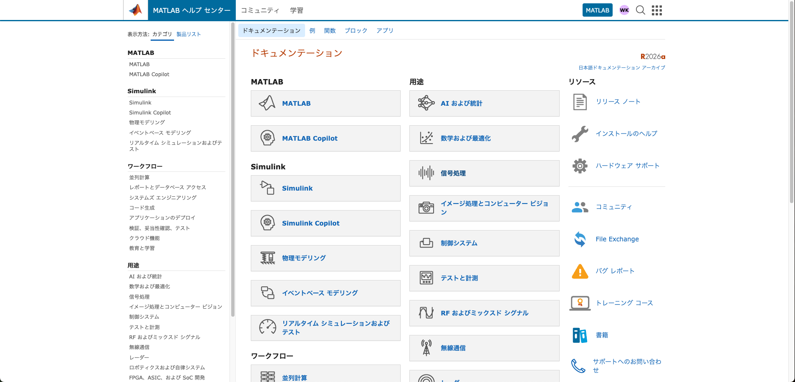

---

## 3-1. ベクトルを作る

* 行ベクトルを作ってみる

* スペースの代わりに「,」を用いることもできる（X=[1,2,3,4,5]）

* 同じ成分を持つ列ベクトルを作ってみる

* 記号「;」は行の区切りを表すのに使われる
* 記号「'」を使って、「X=[1 2 3 4 5]'」と表すこともできる

* 等差数列をなす成分を持つベクトルを書いてみる

例題：初項1、末項3、公差0.5の等差数列

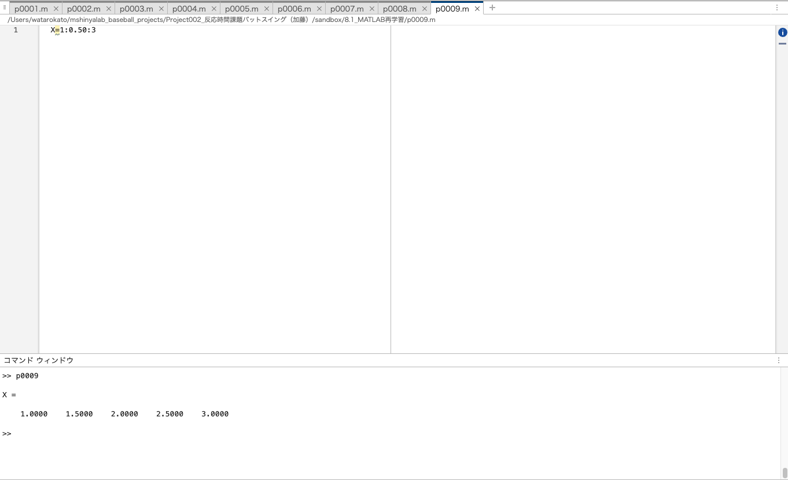

## 3-2. 行列を作る

* 行列を作ってみる

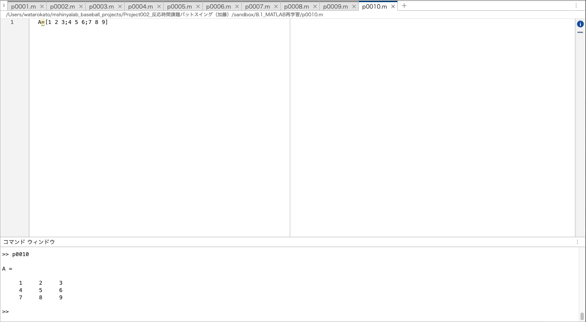

* 2つのベクトル x＝[x1 ... xn]、y=[y1 ... yn] をそれぞれ第1行、第2行とする行列を作ってみる

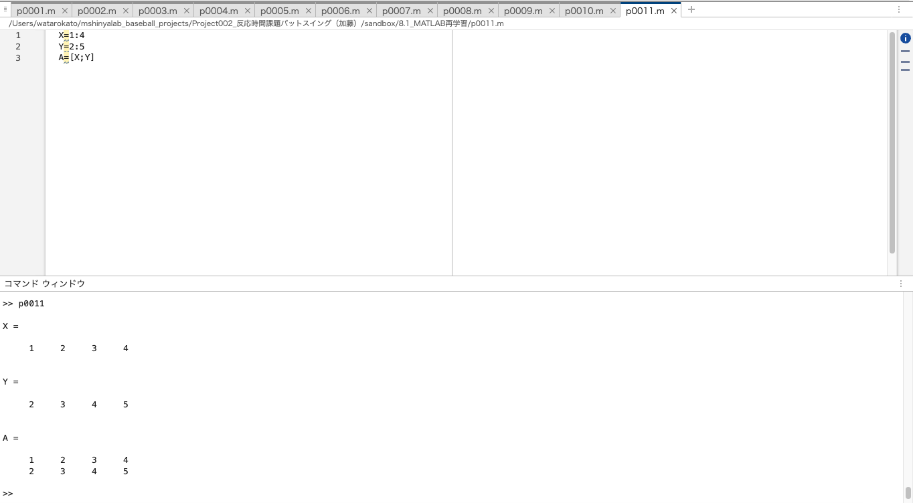

## 3-3. 行列の演算

* 行列の足し算、引き算をしてみる

* 他の計算方法についても同様に書くことができる

## 3-5. 行列の処理

* ベクトルや行列の成分を取り出してみる

* ベクトルや行列内の番号を指定する
